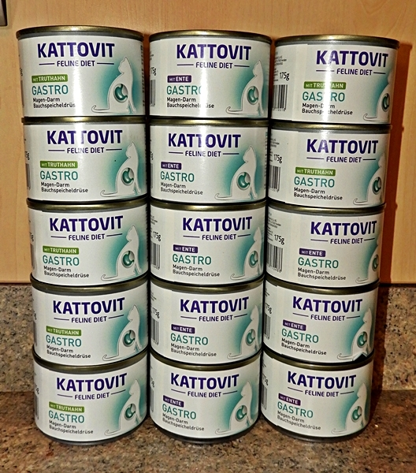
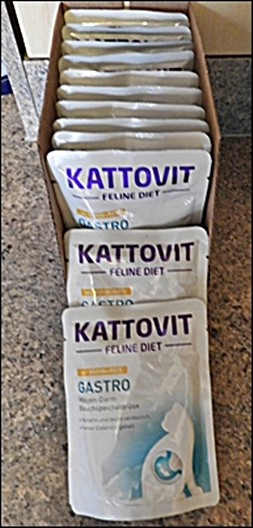
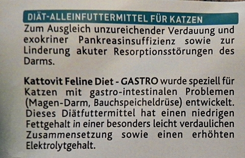
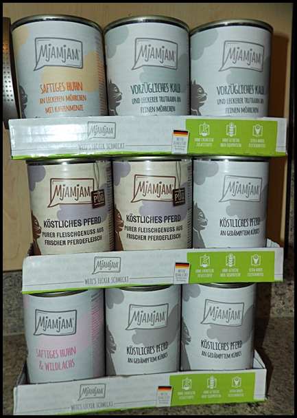
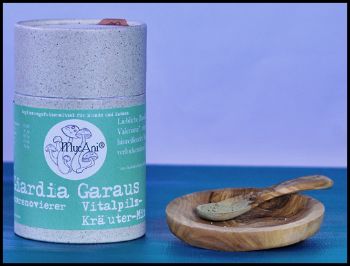
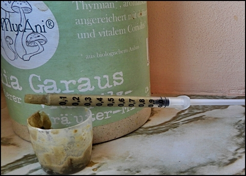
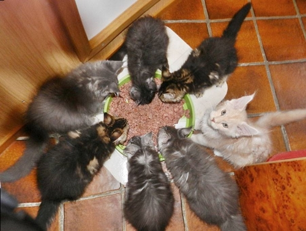
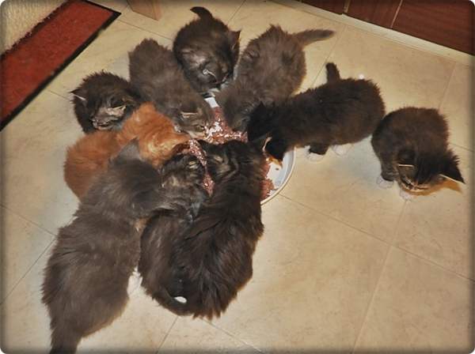
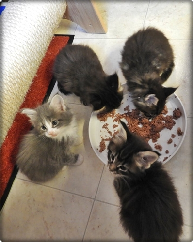
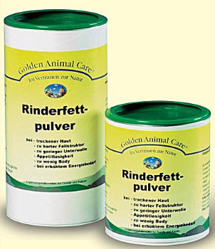

Unsere Mutterkatzen\
Während der Säugezeit werden der Kätzin Höchstleistungen abverlangt. Je nach Wurfgröße steigt der Energiebedarf um das 4-fache an. Mutterkatzen, die jetzt nicht ausreichend versorgt werden, befinden sich nach kurzer Zeit in einem bedauernswerten Zustand. Sie benötigen alle Energie für die Milchbildung, magern sehr stark ab und ihr Fell wirkt stumpf und unansehnlich

Auch haben säugende Kätzinnen einen anderen Verdauungsablauf als normalerweise. Dadurch das sie Unmengen an Futter zu sich nehmen, scheinbar nie richtig satt werden, neigen sie zu Pankreasstörungen und Resorptionsstörungen im Darm. Gibt man normales herkömmliches Futter sind sie, dadurch das der Körper schlechter verwertet und es manchmal unverdaut hinten wieder rauskommt, Durchfallanfällig.\
In der Aufzuchtsphase bekommen unsere Mutterkatzen wenn die Kitten die 3. Lebenswoche erreicht haben, dieses Futter bis die Kitten 11 - 12 Wochen alt sind. Dann normalisiert sich die Verdauung wieder

Unsere Kittenfütterung

Wenn die Kitten 6 Wochen alt sind, füttern wir diese Feuchtnahrung

Mjamjam in allen Sorten

Damit sich erst gar keine Giardien entwickeln gibt es bei uns **(vorbeugend!!)** für die Kitten "Giardia Garaus". Ab der 7. Lebenswoche. jedes Kitten bekommt 1 mal am Tag eine kleine Spritze davon ins Mäulchen so haben Giardien keine Chance!

Taurin kommt unter das Futter

Eine ENERGIEBOMBE! Der Energiebringer Rinderfettpulver eignet sich auch phantastisch als Appetitanreger für Katzen, die wählerisch sind, sowie schwächliche Jungtiere. Bekommen bei uns Gross und Klein in 10%iger Dosenmilch (Bärenmarke) eingerührt.Unsere Katzen lieben diesen Brei!!!

Nochmal zur Kittenernährung!!\
Wir füttern unsere Kitten weder mit Rohfleisch noch mit Eintagsküken, sondern ausschließlich mit Dosenfutter und hochwertigem selbstgekochten Fleisch oder Lachs. Ob die neuen Besitzer barfen oder Rohfüttern bleibt ihnen überlassen. Wir geben ein Starterpäckchen dazu, welches ALLES beinhaltet was die Kidis hier gewöhnt sind.
