Die Ernährung für unsere Katzen besteht aus 70% Dosenfutter, 20% **gekochtem** Muskelfleisch,

sowie Hühnerbrustfilet und Lachs (alles gekocht) **und nur** **5%Trockenfutter**

Mjamjam und Miamor in allen Sorten

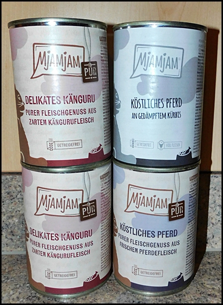
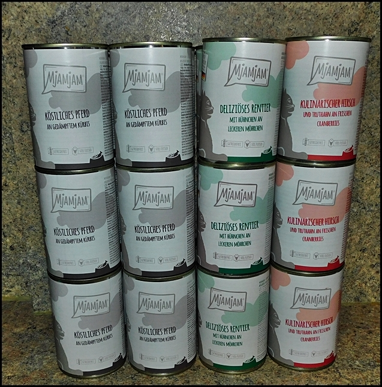
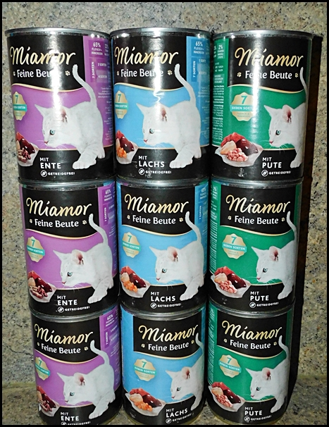

Nassfutter von Animonda, nur diese Flachschalen\
**Kein Carny bei uns!**

Ganz besonders beliebt sind diese Milkies\
mit Milch und Sahne

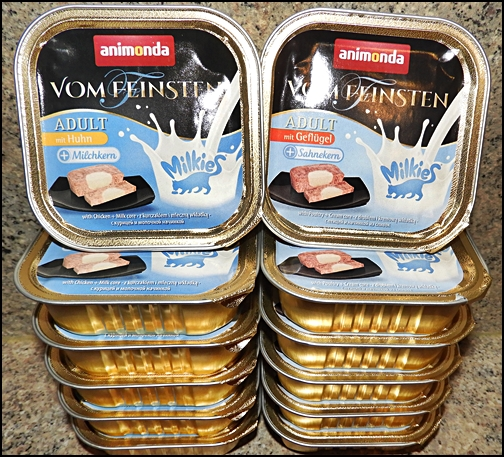

Suppe für Katzen. Bei uns heiß begehrt\
Flüssignahrung wird zusätzlich gerne als Leckerchen genommen.

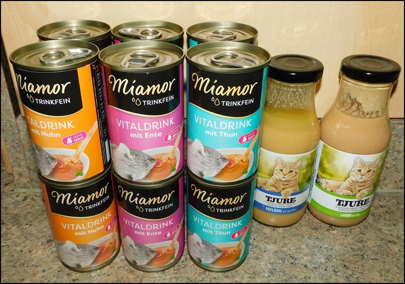

Eine Schüssel Vitaltrunk gibt es bei uns jeden Tag\
Menge für 8 Katzen:\
2 Dosen Miamor Suppe\
2 Essl. Flocken\
2 Eigelb\
1 gehäufter Teel. Taurin\
Ist gesund und gibt schönes Fell

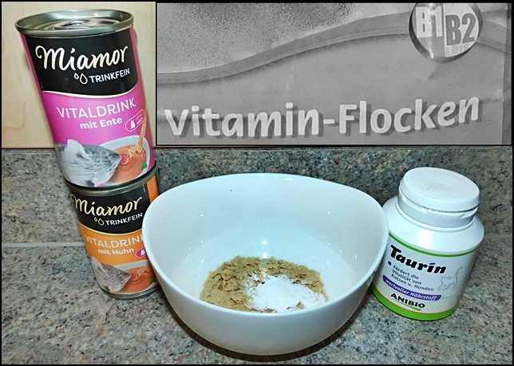

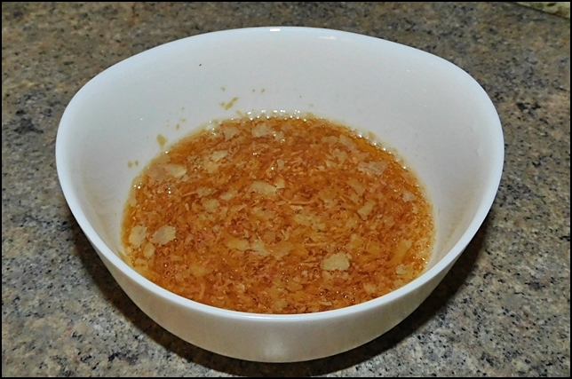

Hier das Verwöhnprogramm für unsere Katzen.\
es wird natürlich nicht alles auf einmal gegeben, sondern abwechselnd und auch nicht jeden Tag

Leckerchen werden bei uns sehr dosiert gefüttert. Es ist und soll\
ein Highlight bleiben

Hochbegehrt als Leckerchen Animonda Tütchen

Hier flippen sie aus

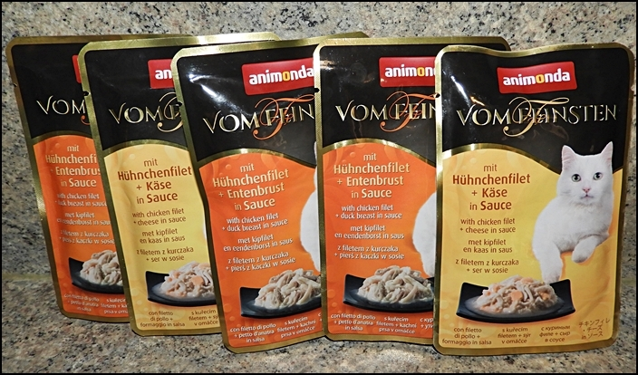

Leckerchen

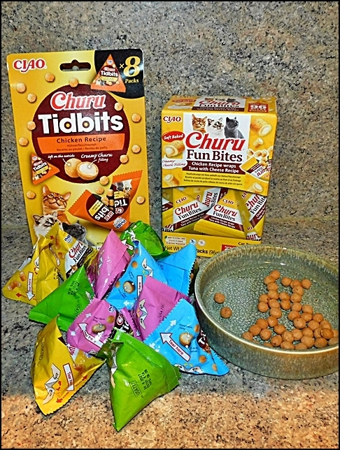
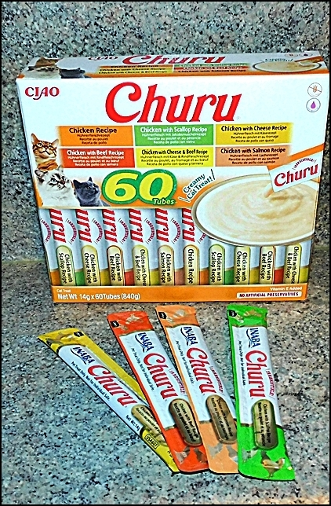

Die Futterzusätze.\
Wird nicht zu jedem Futter gegeben, sondern nur Kurmäßig das ein oder andere untergemischt

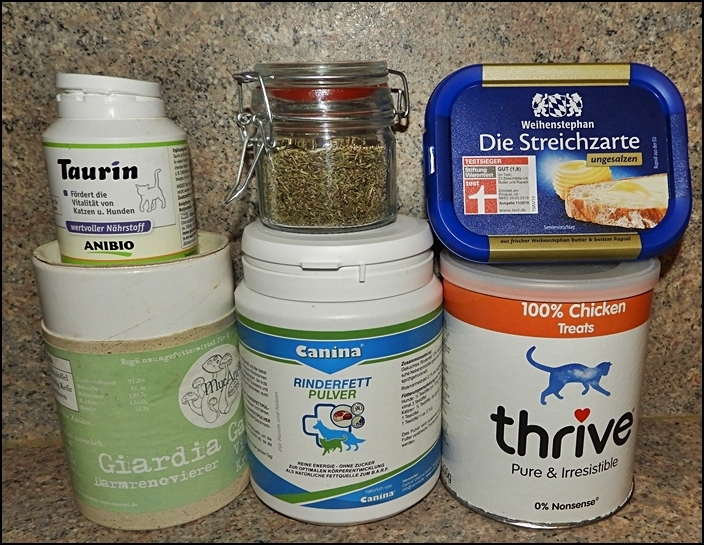

Butter Für geschmeidige Darmwände und für die Ausscheidung von Haarballen.

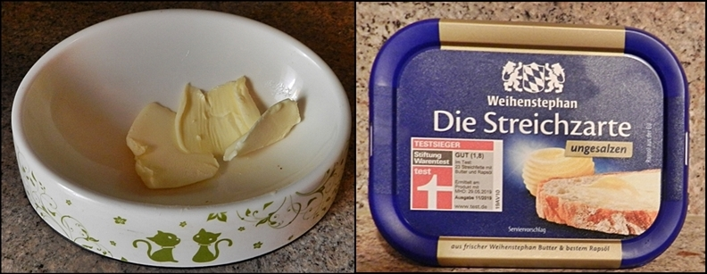

Für übergewichtige Katzen ist das hier\
eine Alternative

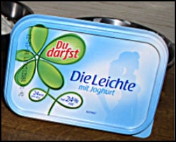

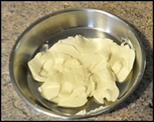

**Um das Dosenfutter aufzuwerten** und mit mehr Fleischanteil gehaltvoller zu machen, koche ich immer auf Vorrat Muskelfleisch und hochwertiges Rind und Geflügelfleisch sowie Lachs.\
Ich koche Rinderherz und Beinscheibe aus. Das Fleisch geht durch den Zerkleinerer und wird in den Sud eingerührt. Es wird nur grob verkleinert so das sie noch Sehnen und Knorpel die in der Beinscheibe sind kauen müssen. Die Brühe sorgt für ausreichend Feuchtigkeit. Es wird dann unter das Dosenfutter gemischt

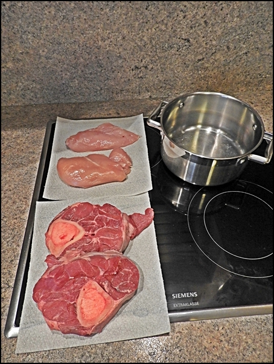

Frische Beinscheibe wird gekocht und durch den Zerkleinerer gegeben

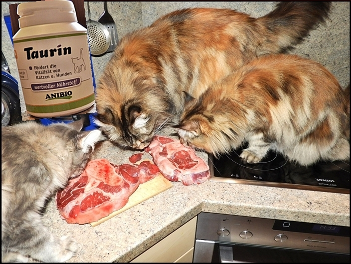

Beinscheibe\
Fleisch und Knochen. Köcheln lassen, das sieht dann so aus. Vom Knochen lösen, das Mark im Knochen rausschaben und nach dem Zerkleinern unterrühren.

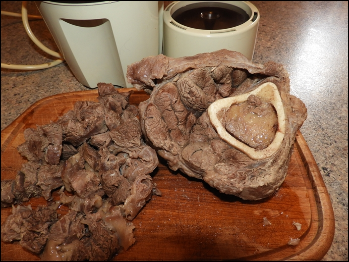

Das kleingeschnittene Fleisch dann durch die Moulinette geben

Vorher

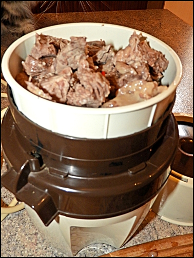

Nachher

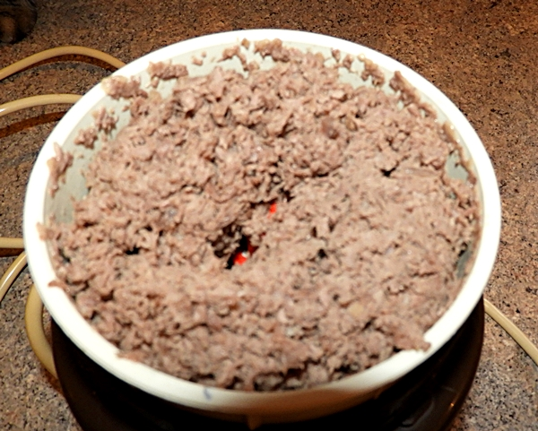

Das sieht dann aus wie Gehacktes

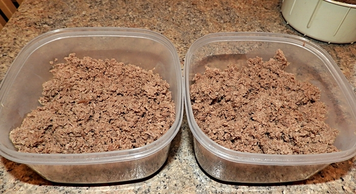

dann die Brühe einrühren, die ist sehr gehaltvoll und fettreich

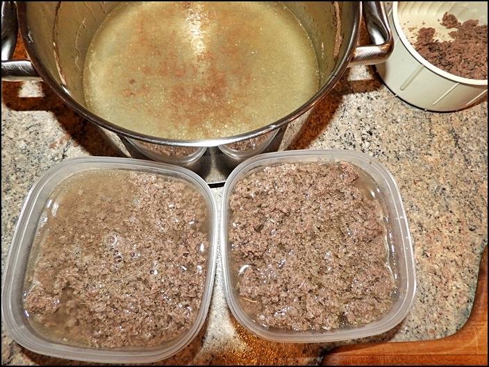

Dann kommt es portioniert in den Gefrierschrank.\
Diese Portionen reichen für 3-4 Tage.

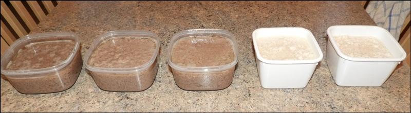

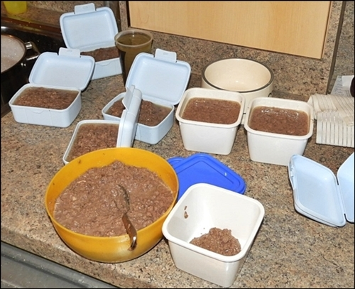

Das wird dann unter das Dosenfutter gezogen.

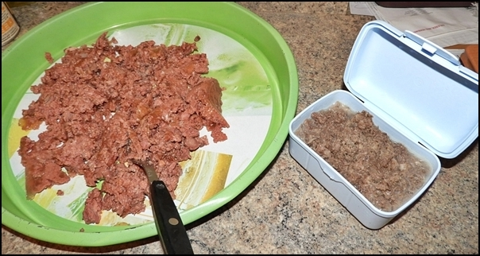

darunter kommt Taurin.

Wichtig in der Ernährung ist Taurin\
[Klick hier und lies](/ernaehrung/taurin/)

Almo Nature nur zum Verwöhnen mal untermischen\
(ist kein Alleinfutter)

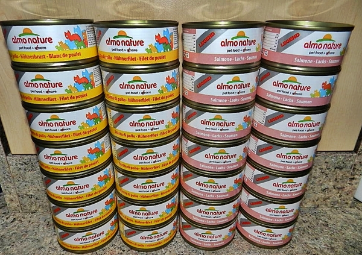

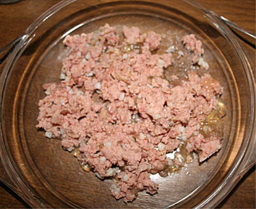

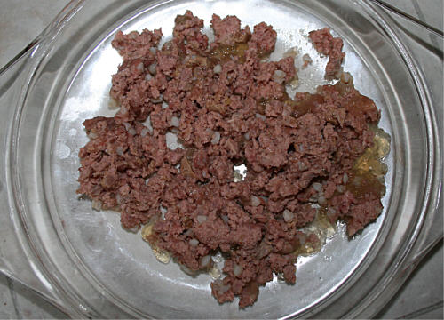

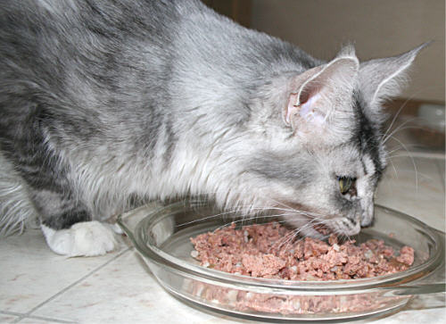

Über das Feuchtfutter kommt Hühnchen pur getrocknet. Es wird über das Futter gebröselt - und es gibt bei uns keine Katze die nicht aus dem tiefsten Schlaf zum Futternapf kommt, wenn ich mit diesem Snack komme. Auch Kitten lieben es!!!

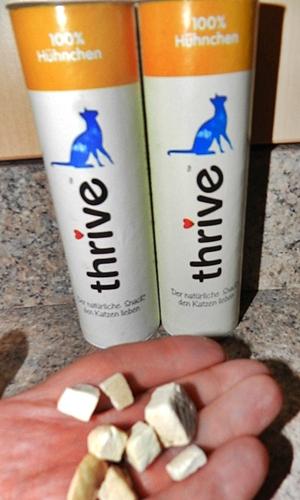

Nein! Es wird erst gekocht!!

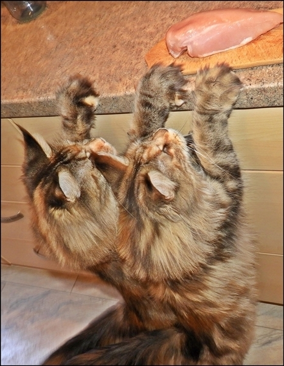

Butter oder Magarine

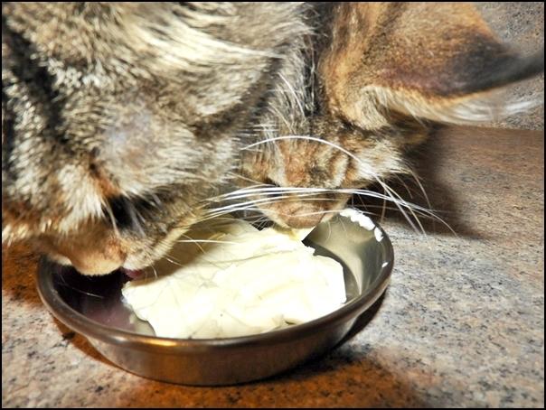

Bei uns gibt es kein Trinkwasser aus Trinkbrunnen oder Trinkwasserspender! Kalkfreies Mineralwasser von Volcic.\
Trinkwasser für unsere Katzen werden in Porzelanschalen gefüllt, 2 mal am Tag frisch befüllt und mit heißem Wasser ausgespült, dazu kommt bei jeder Neubefüllung 1 Messerspitze Ascorbinsäure, es steigert die Abwehr. Aber nur wenn man es IMMER bei jeder Wassergabe, also 2 X täglich und nicht nur sporadisch gibt. Sonst bringt es nichts.

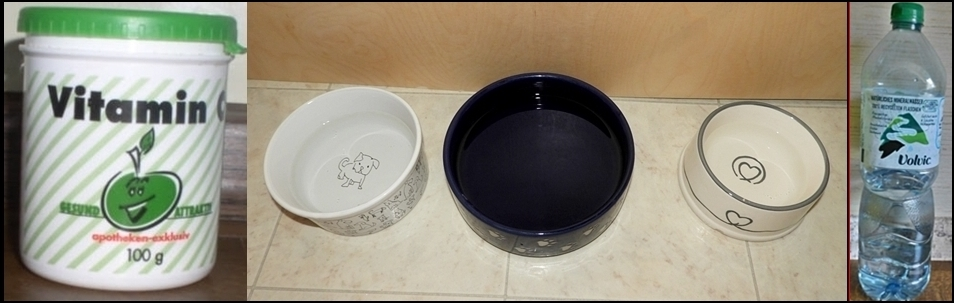

Gegen Harngries und Harnsteine (Struvit) bei Katern kann man etwas tun, man kann vorbeugen!\
Unsere Kater bekommen 2 X täglich 2 cm Pastenstrang von dieser Paste.

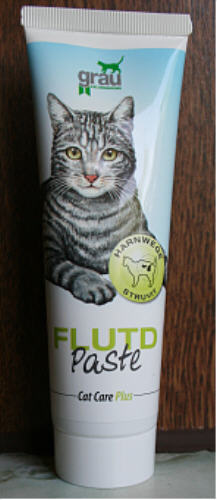

Harngries und Harnsteine führen bei Katern (sehr selten auch bei Katzen) zu Problemen beim Urinabsatz. Diese Paste senkt den Harn-pH-Wert ab, säuert den Urin an und kann so der Bildung von Struvitkristallen entgegenwirken.

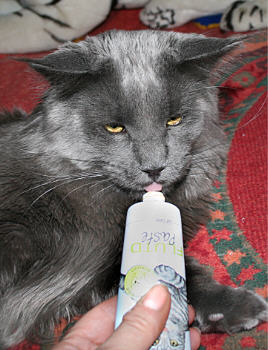
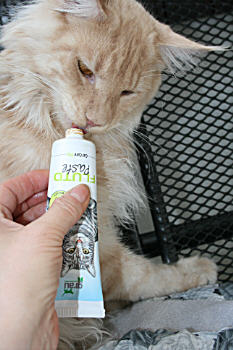
