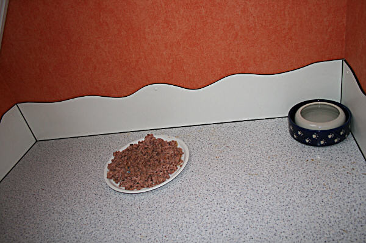
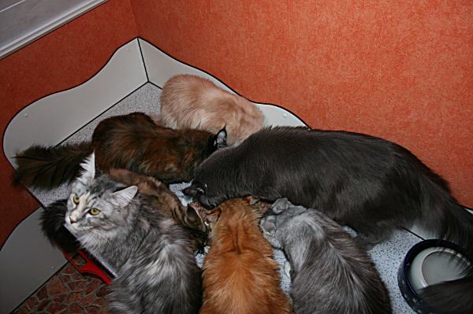
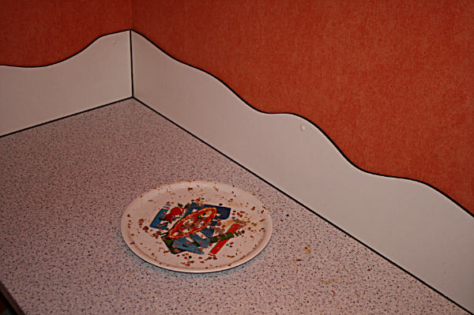

Mäkelkatzen! Meine Katze frißt mäkelig oder - Wie man sich Mäkler erzieht.\
Von Karin Lemanowicz

Diesen Bericht habe ich geschrieben nachdem ich lange Gespräche mit Katzen-Ernährungsspezialisten unserer Tierklinik hatte und habe es mir aus den Büchern von Dr. Leyhausen erlesen.

**"Meiner Katze ist kein Futter gut genug. Ich kann füttern was ich will, sie mag es nicht, schabt sogar mit dem Pfötchen, maunzt mich an, also hat sie doch Hunger. Sie hat einfach keinen guten Appetit".**

Vielen wird das bekannt vorkommen und auch bei mir war es vor vielen Jahren so und ich der Verzweiflung nahe, weil ich viel Futter entsorgt habe, immer wieder neue Sorten ausprobiert hatte, bis ich mich mit Ernährungsspezis unterhalten habe und mir die Bücher von Professor Dr. Paul Leyhausen durchlas und mich zum Umdenken meiner Fütterung überwand und seitdem habe ich keine Mäkler mehr, sondern alle haben guten Appetit und fressen ihre Mahlzeiten mit Freude. Ein Erfolg seit weit über 20 Jahren.

Eine Katze könnte es sich in der freien Natur kaum erlauben zu mäkeln oder heikle Futtergewohnheiten zu haben. Aber in der Natur gibt auch keiner nach, denn es kommt keine Maus vorbeigelaufen die leckerer ist als die vorhergehende. Unsere Wohnungskatzen haben es aber sehr schnell gelernt ihre Menschen zu erziehen und ihre Nachgiebigkeit auszunutzen.

Oft entsteht dadurch ein völlig falsches Fütterungsverhalten der Katzenbesitzer und fordert einfach nur ein Umdenken. In der Natur ist eine Katze nicht wählerisch. und es ist völlig normal das sie täglich immer das gleiche Futter frißt.

Warum ist Ihre Katze heikel geworden?\
1\. Irgendwann ist sie mal nicht so hungrig gewesen und hat das ihr hingestellte Futter verweigert. Schnell wurde ein anderes Futter aufgemacht, evtl. wurde eine Tüte mit Leckerli aufgemacht, damit Mietzi nun ja frißt und sie bekam größte Aufmerksamkeit.\
"Magst du es nicht? Schmeckt es dir nicht? Bist du krank? Und dieses Gesäusel begleitet mit Streicheleinheiten hat sie sich gemerkt. Sie hat nun gelernt. Wenn ich diese Futtersorte nicht fressen mag und sie verweigere, bekomme ich etwas anderes und dazu noch viel Aufmerksamkeit und schon hat sie einen Weg gefunden ihren Menschen zu tyrannisieren und sie können glauben, das ist für manche Katzen oft der schönste Sport

2\. Ihre Katze hat nie Hunger, nie richtig Appetit, da sie immer Futter im Napf hat und der ständige Futtergeruch ihr den Appetit verdirbt.

3\. Ihre Katze hat immer einen Napf mit Trockenfutter stehen um sich den ganzen Tag zu bedienen wie sie mag.

Was können Sie nun tun?\
Die Katze ist ein Beutetier-Fresser und ihr Verdauungssystem ist darauf aufgebaut, Nahrung mit immer der gleichen Qualität zu bekommen. Beutetiere haben immer die gleiche Zusammensetzung. Es ist wichtig eine qualitativ gute Futtersorte zu wählen und auch nur bei dem Futter einer Firma zu bleiben. Füttern mit verschiedenen Futtersorten, evtl. mal Billigfutter, mal gutes Futter, ist klar - natürlich von verschiedenen Firmen, kann schwerwiegende cronische Magen-Darm und Verdaungsprobleme hervorrufen, denn jedes Futter einer Firma hat seine eigenen Zusammensetzungen und ist Stress für die Verdauung.

In den meisten Katzenhaushalten, gerade bei Berufstätigen, wird dann tagsüber eine Schale mit Trockenfutter hingestellt für den Hunger zwischendurch. Und genau diese Katzen, die den ganzen Tag Trockenfutter zur Verfügung haben, sind meist niemals richtig hungrig und nörgeln und mäkeln dann bei den Futterzeiten.

Geben Sie Ihrem Kind den ganzen Tag Kekse und Bonbons und es wird am Tisch nicht mit Appetit Kartoffeln und Gemüse essen. Wenn Katzen das Futter immer riechen haben sie niemals richtig Appetit und nehmen dann von dem angebotenen Futter sehr wenig bis gar nichts. Man hat somit einen heiklen Fresser erzogen. In der Natur ist der Beutefang und der Verzehr für Katzen immer ein Höhepunkt am Tag. Den nimmt man seinen Katzen, wenn sie nie auf Futter warten müssen. Professor Dr. Paul Leyhausen sagt:\
Viele wohlmeinende Katzenfreunde machen den Fehler, die Katze nie hungrig werden zu lassen. Damit aber nehmen sie ihr die größte Freude, die Freude am Essen. Nicht bei jeder Mahlzeit braucht man so viel zu geben, dass etwas übrigbleibt. Reste sollten auch nicht regelmäßig zur weiteren Verfügung stehen. Hunger ist auch bei Katzen der beste Koch.

Stellen Sie sich vor, Sie essen den ganzen Tag zwischendurch Nüsse, Popcorn oder sonstwas und gehen dann ins Restaurant und bekommen ein leckeres Steak oder Schnitzel mit herrlichen Beilagen serviert. Der Genuss des Essens ist nicht derselbe, als hätten Sie so richtig Hunger.

Führen Sie Fütterungszeiten ein. Ändern Sie Ihr Fütterungsverhalten und die Katze wird auf Dauer wieder mit Freude fressen.

Bieten Sie Ihrer erwachsenen Katze 2 Mahlzeiten am Tag (Jungtiere bis zum Alter von 4 Monaten sollten 3 Mahlzeiten bekommen) und räumen Sie das Futter nach einer halben Stunde, spätestens nach einer Stunde weg. Die Katze braucht 4-6 Stunden zum Verdauen. Erwachsene Katzen können 12 Stunden von Mahlzeit zu Mahlzeit gut ohne Leckerchen und Trockenfutter sein.

Besser ist ganz auf Trockenfutter zu verzichten und nur (wenns denn sein muss) als Leckerlis 1 Stunde nach den Mahlzeiten, sozusagen Abends als Betthupferl. Füttern Sie möglichst immer um die gleiche Zeit und geben Sie nichts zwischendurch, auch wenn die Katze bettelt. Beschäftigen Sie Ihre Katze mit Spielen und Schmusen.

Katzen lieben geregeltes Leben und Rituale! Dass Futter zu jeder Zeit zur Verfügung steht, ist auch körperlich ungesund, das sagte mir in der Duisburger Tierklinik damals ein Tierarzt der von Ernährung der Katze wirklich Ahnung hatte und auch darauf spezialisiert war. Der Verdauungsapparat beginnt, sich auf die Verdauung des Futters vorzubereiten, wenn das Tier Futter riecht. Wenn Ihre Katze das Futter ständig riecht, laufen die Verdauungssäfte auch andauernd und der Verdauungsapparat arbeitet auf Hochtouren bis er ermüdet. Die Folge sind Magen-Darm und Verdauungsprobleme aller Art.

O-Ton des o.g. Tierarztes unserer Tierklinik: Die meisten Probleme habe ich hier auf dem Behandlungstisch sitzen, die durch falsche Fütterung hervorgerufen werden, von Leber, Nieren, Magen, Darm bis Hautprobleme.

Dr. Paul Leyhausen sagt:\
Eine Katze, die den ganzen Tag über mit Futter vollgestopft wird oder Futter zur ständigen Verfügung hat, kann darauf, je nach Veranlagung und Charakter, auf zwei Arten reagieren:\
Sie verweigert die Nahrung, da sich nie richtiger Appetit einstellt und wird bald rappelmager, oder sie fügt sich und setzt mit der Zeit zu viel Fett an. Beides aber wird ihre Lebenserwartung erheblich kürzen.

Aus Plastiknäfen sollte generell nicht gefüttert werden, das sollte aber wohl schon jedem verantwortungsvollen Katzenbesitzer bekannt sein. Plastiknäpfe speichern den Geruch von altem Futter, sogar noch nach dem Spülen. Oder sie riechen muffig, nach Öl (Plastik ist ja ein Nebenprodukt der Ölindustrie). Vergessen Sie nicht, dass Ihre Katze eine viel bessere Nase hat! Außerdem reagieren viele Katzen allergisch auf Plastik (Kinnakne). Bakterien nisten sich in die kleinen Risse älterer Plastiknäpfe ein und können Allergien verursachen. Keramik, Glas oder Metallgeschirr speichert keine unappetitlichen Gerüche.

Bewahren Sie die Reste nie in der Futterdose auf. Wenn Sie die Dose öffnen beginnt das Metall an zu oxidieren, sobald es mit dem Sauerstoff in Berührung kommt und es gibt dem Futter einen Beigeschmack. Reste der Dose können Sie in einer Gefrierdose im Kühlschrank 2-3 Tage aufbewahren und angewärmt wieder anbieten.

So sieht es bei uns aus. Es ist angerichtet. Dieses ist ein riesiger Teller, wie der einer übergrossen Pizza. Drauf ist 1200g Futter, reicht immer für eine Fütterung für 8 Katzen.

Hier ein Teil unserer Fresser, alle fressen von einem grossen Teller und zwar ohne Streit!! Ist alles leergefressen gibt es noch einen kleinen Nachschlag, damit auch alle sattwerden und die fressen können die nicht in der großen Gemeinschaft fressen möchten.

Haben fertig!!\
Nörgler haben nun Pech gehabt das wissen Sie, denn ich verlasse normalerweise das Zimmer wenn sie fressen und lass mich nicht anbetteln \*lach. Sie werden dann bei der nächsten Fütterung schauen das sie zu einem vollen Bauch kommen, das ist ein Lernprozess. Ich gebe dann aber noch einen kleinen Nachschlag um zu sehen, ob auch alle satt geworden sind

