Futterzeit ist ein Highlight im Leben unserer Katzen.

Wenn ich in die Küche gehe und einen ganz bestimmten Schrank aufmache kommt Leben in unsere Cats

Pepper und sein Deputi sind immer die ersten

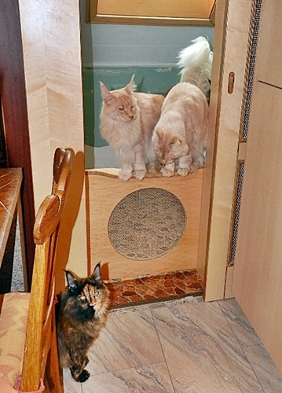

Zuerst kommen nur ein paar, aber innerhalb von 2 Minuten bin ich mir\
wiedermal über die Anzahl unserer Katzenfamilie bewußt.

Yolanina

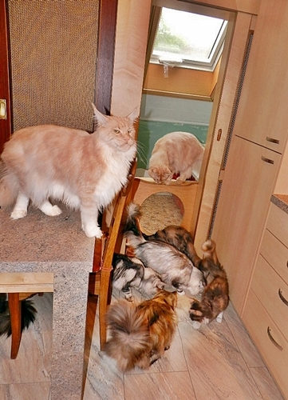

Orchidee und Hero

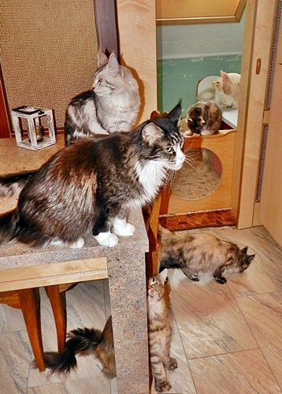

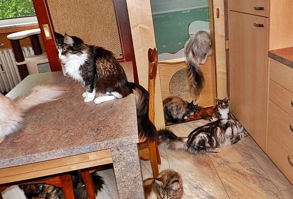

Deputi

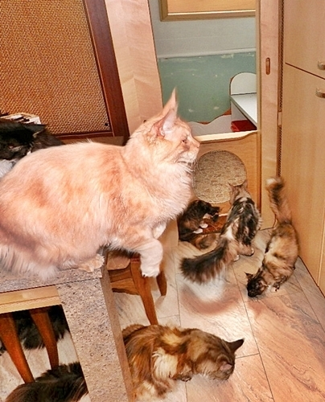

Ich kenne keine Katze die dem zerbröselten "Thrive"\
(100% Hühnchensnack) wiederstehen kann.

Das sind jetzt 4 Dosen a 400g auf\
einem riesigen Teller Durchmesser 35 cm

Alle fressen genüßlich mit zusammengesteckten Köpfen ohne Faucherei und Zickerei.

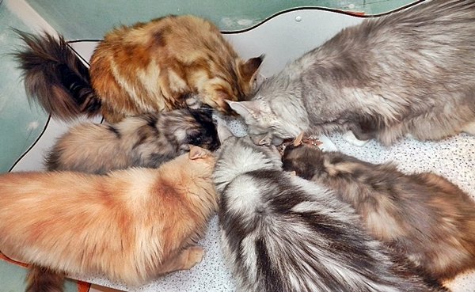

Unsere 3 Kater: Deputi, Pepper und Hero

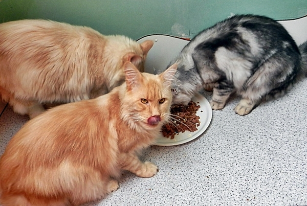
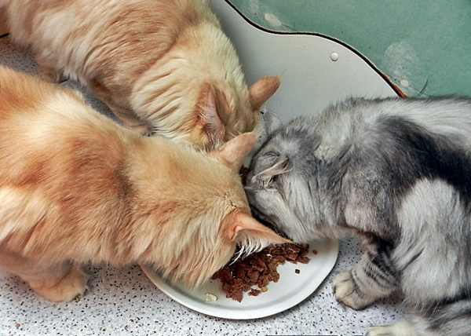

Fertig Es werden sogar die Krümmel noch gefressen.

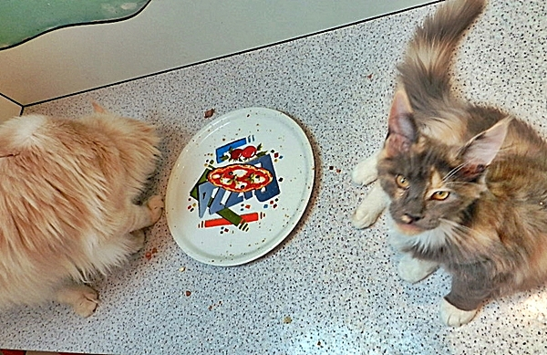

Und dann warten auch noch DIE

\*gaaaanz lieb guck

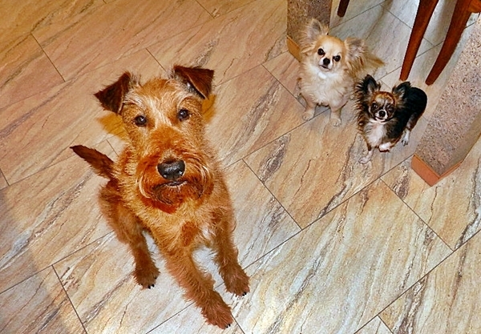

So schnell kann ich gar nicht die Kamera einstellen wie das Futter aufgesaugt ist

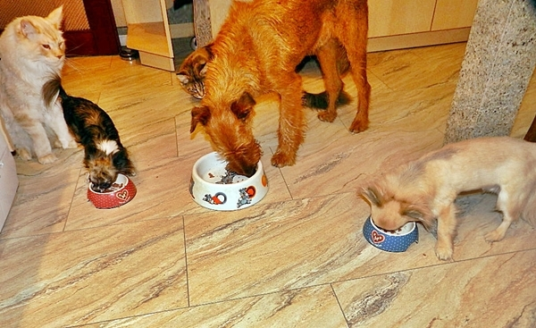

Und schau sich einer den dicken verfressenen Depi an, er\
will bei Chiqua im Napf angeln.Dann knurrt sie wie ein Wolf

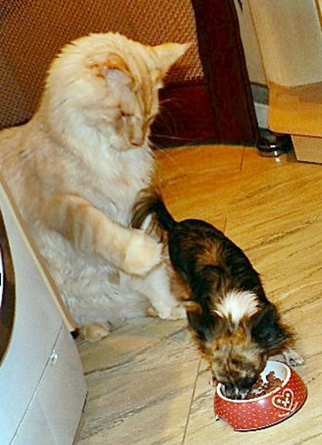
