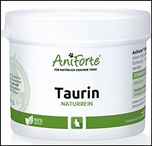

**Warum Taurin???**\
I**ch hatte vor vielen langen Jahren mal einen guten Tierarzt der sich auf Ernährung der Katzen spezialisiert hatte, der damals schon NEIN zu Trockenfutter sagte und mir sehr sehr viele Ernährungstipps für die Gesundheit der Katzen gab, unter anderem schon vor 30 Jahren Taurinpulver unbedingt empfahl!.**

Im Gegensatz zur Leber von anderen Tieren kann die Katzenleber selbstständig nicht ausreichend Taurin synthetisieren. Die für die Umwandlung in Taurin zuständigen Enzyme sind bei Katzen kaum aktiv. Insgesamt geht rund die Hälfte an Taurin, das die Katze über ihre Nahrung aufnimmt, wieder verloren. Darum brauchen Katzen eine regelmäßige Taurinzufuhr. Es variiert aber je nach Lebenssituation:\
So brauchen tragende, säugende und ältere Katzen mehr Taurin als andere.

Gerade Züchter sollten sich mit der Problematik "Taurinmangel" bei tragenden und säugenden Katzen beschäftigen. Taurinmangel ist gar nicht so selten der Grund für Probleme in der Aufzucht. Unfruchtbarkeit, Fehlentwicklungen der Föten kann durchaus auf einen Taurinmangel zurückzuführen sein.\
Vor allem noch ungeborene Katzenbabys können Schaden nehmen, wenn die werdende Mutter nicht ausreichend mit der Aminosäure versorgt wird. Entweder sie sterben bereits als Fötus im Mutterleib oder kommen mit erheblichen Fehlbildungen zur Welt, die mit einer geringeren Lebenserwartung einhergehen.\
Bei uns kriegen es tragende und säugende Kätzinnen immer! Sowie auch die Babys

Bei Katzen die in der Zucht eingesetzt werden sind oftmals Unfruchtbarkeit, Fehlentwicklungen der Föten, oder auch ein gestörtes Immunsystem Anzeichen für einen bestehenden Taurinmangel.

Das Problem bei Dosenfutter ist, dass Taurin nicht hitzebeständig ist und durch das Kochen der einzelnen Bestandteile zerstört wird.

Natürlich findet man Taurin als lebenswichtigen Stoff in so gut wie jedem Katzenfutter, aber es gibt gravierende Unterschiede in der Menge und Qualität.

Bei Futter (z.B. Dosenfutter) die beim Herstellungsprozess stark erhitzt wurden ist es meist zerstört.

**Aber Achtung!**\
Es wird oftmals Taurin in Taurintabletten oder anderen Produkten mit deklariertem Taurinzusatz angeboten, wie z.B. Snacks und die sogenannte Katzenmilch. ist zwar für die Katze lecker, aber meist ist der Tauringehalt zu niedrig und es überwiegen andere Inhaltsstoffe wie Zucker und Fette die in großen Mengen nicht verfüttert werden sollten

Um das benötigte Taurinlevel zu erreichen, ist reines Taurin in Pulverform die bessere Lösung. Es kann nicht überdosiert werden, den für eine Überdosierung müßte die Katze schon sehr viel bekommen. Nach Anleitung füttern ist immer richtig. Wir selber geben schon seit über 30 Jahre Taurin zum Futter. Wir haben sehr wenig, ja so gut wie keine Probleme mit Kittensterblichkeiten und schwächlichen Babys.

Ich selbst lege sehr viel Wert auf die gesunde Ernährung unserer Maine-Coon-Katzen.
