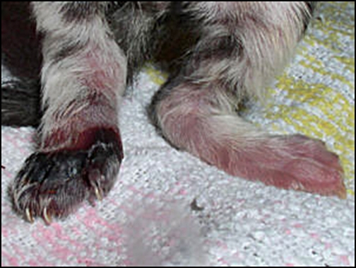
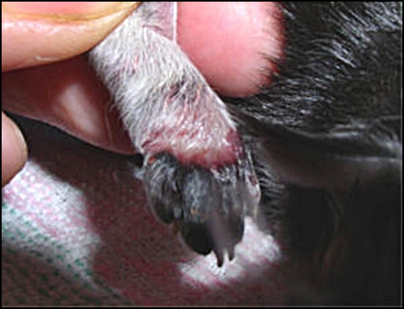
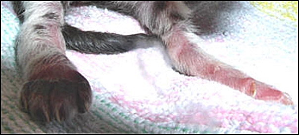
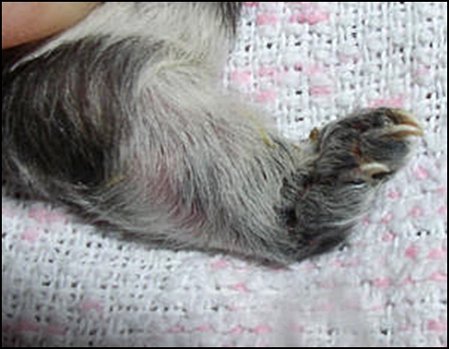
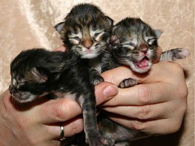
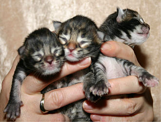

11.11.2004 Eine Geburt

Unsere Mahagony war hochtragend und wir bereiteten uns gerade auf ihre 2. Geburt vor.\
Am 59.Tragetag hörte ich ein lautes Knurren. Ich dachte nicht daran das Gony sich schon mit ihrer Geburt beschäftigte, als ich unter ihrem Schwanz ein kleines frischgeborenes Mini-Baby sah.\
Frühgeburten!!Ich packte Mutter samt Baby in die Wurfkiste und raffte in Windeseile Windelunterlagen, gekochte Tücher, Zwirn usw. zusammen, als sie schon wieder die nächsten Wehen bekam.\
Probleme kündigten sich an!

Trotz intensiver Presswehen, konnte das nächste Kitten nicht austreiben und ich konnte auch nichts greifen, kam nirgendwo dran. Dazu kam noch, das Gony extrem unruhig und panisch war und nicht in der Kiste bleiben wollte.

Ich konnte ihr nicht helfen. So ging eseine Zeit, bis sich endlich ein Pfötchen zeigte, das ich mit einem Frotteetuch festhielt und bei der nächsten Wehe unterstützend leicht zog.\
Herraus kam ein vermatschtes Getüdel das erstmal undefinierbar aussah. An einer Nachgeburt hingen 2 Winzlinge die mit der Nabelschnur so verwickelt waren und sich so stranguliert hatten, das ich nicht wusste wo ich ansetzen sollte, die Kleinen zu befreien. Ein Beinchen war so fest um den Köper des anderen Winzlings stranguliert das es blutete, es war einmal am Oberschenkel und einmal am Füßchen stranguliert weiter entlang lief die Nabelschnur um des anderen Öhrchen das ebenfalls abgeschnürt war und blutete, auch sein Hälschen war stranguliert. Ich brauchte ca. 10 Min. um alles zu befreien und aufzuschneiden, mit dem Erfolg, das bei beiden Frühchen die Nabelschnüre am Bauch abrissen, natürlich viel zu kurz. Ich konnte die Blutung kaum stoppen, das Abbinden war eine Katastrophe.\
Was tun?\
Ich versuchte mich zur Ruhe zu zwingen, nabelte ab so gut es ging, desinfizierte die Nabelenden und schaute mir das blutende Beinchen an. Es war dick geschwollen und blutrot. In der Zeit bekam Gony noch 2 weitere Kitten, um die sie sich aber Gott sei Dank alleine kümmerte. So - 5 Kitten zu früh, Gony keine Milch (was normal ist bei Frühgeburten am 59.Tag), die Babys noch keinen Saugreflex. Es sollte so sein!

Ein Wärmebettchen wurde hergerichtet. Nun hiess es kämpfen. Meine Tierärztin am Telefon sagte, das Beinchen mit Seifenlauge massieren massieren massieren. Schwierig - denn das Winzle schrie gottserbärmlich vor Schmerzen.

Es kommt nun bei Frühchen darauf an, ob die Lungen schon ausgebildet sind, dann hat man mit viel Disziplin rund um die Uhr (Tag und Nacht) und das ca. 4-5 Tage (bis sich Milch bei der Mutter bildet) eine Chance die Winzis am Leben zu erhalten.

Haben sie keinen Saugreflex, aber einen Schluckreflex kann man ganz vorsichtig mit einer Pipette Tröpfchen für Tröpfchen und das alle 5 - 10 Min. Aufzuchtsmilch füttern. Wir entschieden uns für eine Sondenernährung.

Haben Sie keinen Schluckreflex muss man mit Magensonde rangehen, das kann man sich vom Tierarzt zeigen lassen. Es hört sich schlimmer an wie es ist, ist halt nur zeitaufwendig.

Sind die Lungen noch nicht funktionsfähig, versterben die Kleinen sowieso in den nächsten Stunden/Tagen, trotz aller Bemühnungen.

Jetzt hiess es 3 - 4 Nächte keinen Schlaf und zwischen den Fütterungen das ledierte Beinchen massieren usw. auch alles andere versorgen, wie Haushalt, Katzen, Gassi mit den Hunden.

Am nächsten Morgen war das Pfötchen und Beinchen vom Körper ab bis zu den Zehen auf das 3fache angeschwollen. Es sah aus wie aufgeblasen, total schwarz und stand zur Seite weg als wenn es nicht dazugehörte. Es sah furchtbar aus!!

Sofort war ich bei Praxisöffnung bei unserer Tierärztin. Sie meinte 2-3 Tage müssen wir dem Mini eine Chance geben. Bei Verschlimmerung wird sie eingeschläfert, denn eine Amputation ist in dem Alter nicht möglich.\
Ich bekam eine extra angerührte Durchblutungssalbe, ein Desinfektionsspray und der Winzling bekam eine schmerzstillende Spritze.\
Nun hiess es jede Stunde massieren. Zwei Stunden durfte sie danach nicht zu Mutter und Geschwister. Ich hielt sie an meinem Körper solange warm.\
Dann mit Seife abwaschen, anschliessend klares Wasser und dann ab zu Gony zum bemuttern. Wenngleich sie auch keine Milch hatte, ihrer Mutterpflichten war Gony sich bewusst.

Die Babys nahmen nicht zu, zwei nahmen ab von 70 auf 60 g, ein kleiner Kater (der Strangulierte) sogar auf 55 g. Meine Tierärztin wies mich an, mich doch jetzt nicht auf Gewichtszunahme zu konzentrieren, sondern nur ganz einfach darauf, kontinuierlich zu füttern und sie einfach nur versuchen am Leben zu erhalten, mit Gewalt das Gewicht zu erhöhen bringt überhaupt nichts. Einfach nur bitte funktionieren sagte sie!\
Nun gut\
Am nächsten Morgen war das Pfötchen zwar auf fast Normalgrösse abgeschwollen, aber immer noch schwarz und die Haut war so porös durch die enorme Schwellung, das es aus der Haut ständig blutete. Es hiess weiter massieren, jeden Tag zum Tierarzt eine Schmerzspritze, in Seifenlauge baden, einreiben, massieren, Spray für Entzündung, 2 Std. von Gony entfernen das sie es nicht ableckt, abwaschen, wieder für eine Stunde zu Mami zum Trösten und bemuttern, danach wieder dieselbe Prozedur. Stress für den Winzling für Mama und für mich! Nebenher noch die Handaufzucht nach wie vor alle 10 Min.\
Das war Arg!

Hier hatten wir noch Hoffnung, es könnte doch noch werden.\
Das Beinchen nach dem Abschwellen, es schien gut duchblutet und die Kleine strampelte damit.

Nach 3 Tagen absolute Freude. Das Pfötchen hing nicht mehr wie bisher leblos daneben. Die Kleine belastete es. Es war wieder Leben drin.

Fazit eine Woche später:\
Um alles abzukürzen, es war eine harte Woche zwischen Zweifel, Selbstaufgabe, Tränen und Hoffnung.\
Leider haben es ein Katerchen und die Kleine mit dem abgeschnürten Pfötchen nicht geschafft. Das Stück (Vorderzehchen) war am 5. Tag abgestorben und schwarz und eine Amputation in dem Alter vorzunehmen rieten mir 2 kompetente Tierärzte ab.\
Es waren genau die 2 Babys die sich mit der Nabelschnur stranguliert hatten, sie waren wahrscheinlich auch der Auslöser der Frühgeburt.

**Hier war das Füßchen abgestorben und das Beinchen fing wieder an dicker zu werden und sich zu entzünden.**

Nach 5 Tagen bildete sich bei Gony die Milch und die 3 die es geschafft haben, nuckeln und sie nehmen gut zu. Das ist im Moment für uns zufriedenstellend.\
Die drei Wonneproppen entschädigen uns für Alles!\
Das sind sie mit 1 Woche

