So...ich fange an, die Geburt festzuhalten und zu dokumentieren.

Wir haben jetzt genau 21:00 Uhr und seit Stunden, genau genommen seit heute Mittag hält Dreami mich schon in Atem und sorgt dafür, das ich mich nur mit ihr beschäftige und ihr die volle Aufmerksamkeit gebe. Die Wurfkiste steht bereit mit ausgekochtem Leinen und Wickelunterlagen, sowie allen Geburtsutensilien.

Aber liebe Dreami, ich habe noch andere Aufgaben zu erledigen, als mich stundenlang zu dir zu setzen und Pfötchen zu halten.

Ich habe keine Chance, sie sitzt auf mir, begleitet jeden meiner Schritte. Sie schnurrt, quäkt und schimpft mit mir und schmeißt sich vor meine Füße.\
Gehe ich in Richtung Wurfkiste, rennt sie vor, springt rein, schmeißt sich auf den Rücken und macht Luftmilchtritt.\
Ihr flehender Blick will mir sagen: **\>\>Ich brauche dich jetzt und hier!!\<\<**

**o.K Dreami!**

Ich betüddel sie, um meine andere Arbeit drum herum, so gut es geht setze mich zwischendurch an ihre Wurfkiste, was sie dankend beschnurrt. Ihr Blick sagt: **\>\>Geht doch!\<\<**

Ich kenne meine, ansonsten sehr selbstständige und ein wenig distanzierte Katze nicht wieder. Wenn sie in die Geburtsvorbereitung kommt, ist sie eine ganz andere Katze.\
21:00 Soooooo endlich....... nach dem Kochen, Essen, Abwasch, Katzen versorgen, Hunde-Gassigang nehme ich mir die Zeit und setze mich zu ihr. Sie schaut mich zufrieden an und ich streichel und massiere ihren massigen Bauch, rede mit ihr. Sie antwortet. Wir haben ein gutes Gespräch von Mensch zu Katze und Katze zu Mensch.

22:10 nachdem Dreami in der Wurfkiste alles unterste nach oben gegraben hat und zu einem, für Menschen ungemütlichen Knubbel geformt hat und sie wie ein Frosch obendrauf liegt, setzen die ersten Wehen ein.

23:20 Dreami wird unruhiger, die Wehen heftiger, sie klagt und hechelt. Nun beginnt die Geburt. Ich hole mir eine Decke, mache mir einen Kaffee und stelle mich auf eine schlaflose Nacht ein.

0:10 die Wehen steigern sich zu Presswehen. Dreami presst und jammert, stemmt die Hinterbeine gegen die Wurfkiste, sie schmeißt sich hin und her, will endlich Erleichterung. Ich gebe ihr die erste Calciumspritze und eine Traubenzuckerlösung ins Mäulchen.

0:40 Ein Schrei, das erste Baby ist da. Ein black tabby Mädchen, kräftig und rege und sie schreit wie am Spieß. Gut so, macht die Lungen frei und stärkt sie. Dreami versorgt sie sofort.

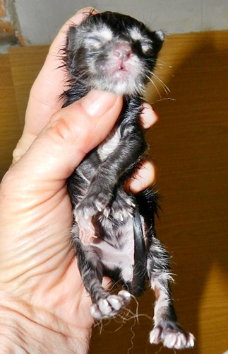
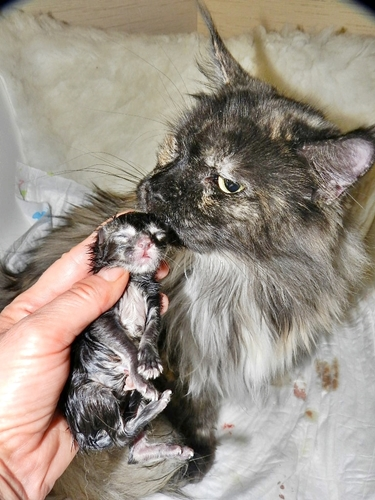

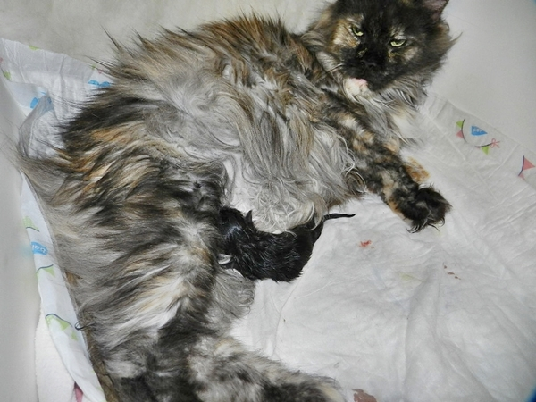
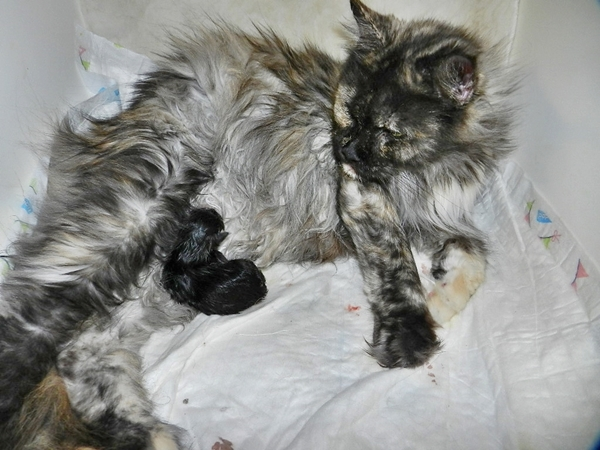

1:25 der nächste Schrei und während Nr.1 sich schon an der Zitze festgesaugt hat, wird Nr.2 geboren. Ein kräftiges blau-weißes Mädchen.

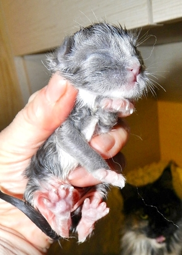
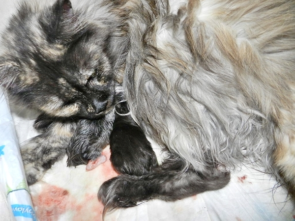

Da habe ich Dreami doch unterstellt, sie kann keine Mädchen bekommen, weil bisher nur Kater in den Würfen waren. Oh Sorry meine Hübsche, ich nehme alles zurück.

Ich wechsel die blutigen durchtränkten Wickelunterlagen und Dreami leckt dankbar und erleichtert ihre beiden Kinder. Sie schnurrt, legt sich auf die Seite und ruht ganz entspannt.

2:30 die nächsten Wehen setzen ein und vorbildlich treibt Nr. 3 aus. Ein Riesenmädchen in blacksmoke.

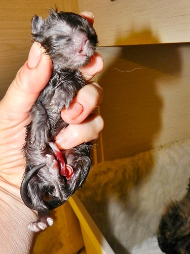

Dreami wird nun ruhiger und schnurrt sich rythmisch ein, betüdelt ihre 3 Babys.

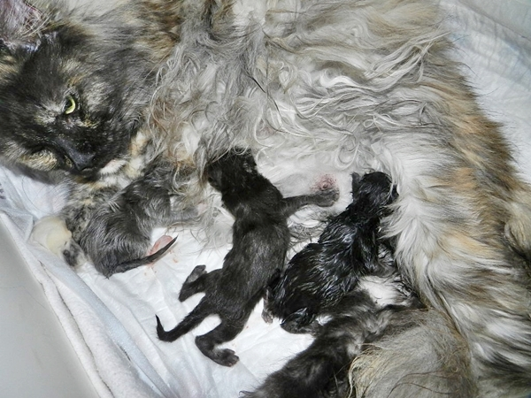

Große Pause.\
Ich schlafe ein wenig ein, besäuselt durch Dreamis Schnurrkonzert.

3:40 ich schrecke auf von Dreamis Press-Stöhnen und rucki-zucki wird Nr. 4 geboren. Ein roter Kater, ebenso kräftig wie seine Schwestern.

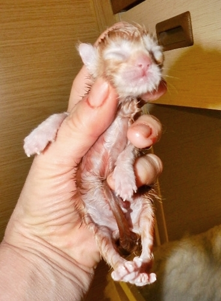
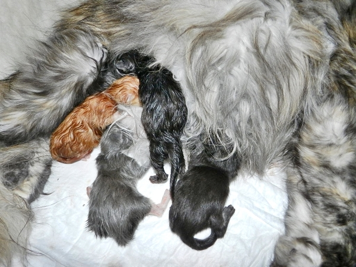

Dreami wirkt erschöpft aber sofort, ohne Pause kommt die nächste Wehe, die sie sehr plagt.

3:50 Nr.5 ist geboren ein sehr großer kräftiger Kater in blue silver tabby mit weiß. Dreami sammelt ihre Kräfte um ihn auszutreiben. Nun tut mir mein Mädchen aber ein bißchen leid, die mit offenem Maul immer weiter schnurrt. Ich gebe ihr noch eine Calciumspritze und einen Traubenzuckerdop. Das stärkt sie.

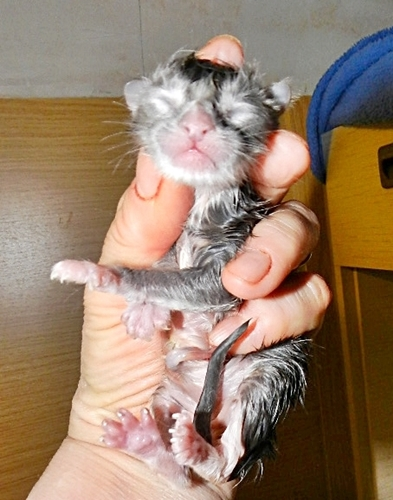
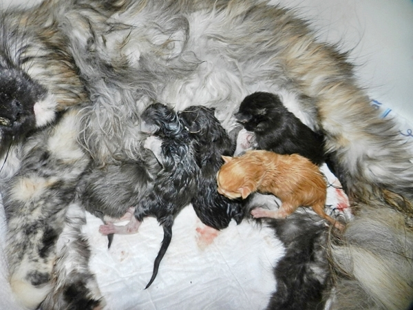

Große Pause!!\
Und wir döseln beide wieder so vor uns hin.

5:45 ein letztes gequältes Pressen und ein sehr kleines buntes Minimädchen ist ausgetrieben. Ich bräuchte mir eigentlich keine Mühe zu geben (tue es aber trotzdem), ich sehe sofort, jegliche Versuche sie zu beleben ist zwecklos, sie ist tot. Ich rubbel sie aber trotzdem, pumpe und massiere ihren Brustkorb. Letzter Versuch dann noch, sie unter einem kalten Wasserstrahl zu halten. Das hatte schon öfter mal Wirkung, wenn sie einfach nicht beikommen wollen. Der Schock der doch oft Tote zu Lebenden erwacht hat. Aber Nichts, ich gebe nach 5 Minuten auf. Weiß und fahl, viel zu klein liegt sie da. Das Gesichtchen ist ein wenig vergreist.

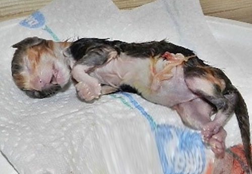

Auch das will ich euch nicht ersparen, denn das gehört dazu wenn man züchtet. Ich bin traurig, freue mich aber über 5 dicke schmatzende, gesund wirkende Babys und eine fürsorgliche zufriedene Mama\
Geschafft mein Mädchen du hast es mal wieder gezeigt und eine Meisterleistung vollbracht, nun kannst du entspannen!

1 Tag nach der Geburt. Die Babys\
glänzen wie die Speckschwarten

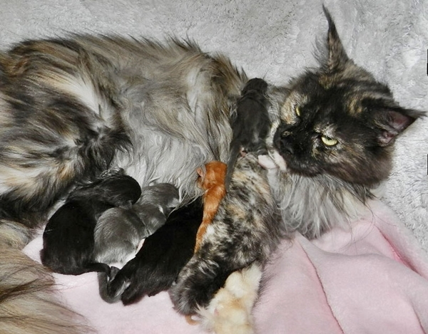

Meine zufriedene Dreami

Und nun hoffen wir das alle gut gedeihen und wachsen und uns keinen Kummer machen!!
