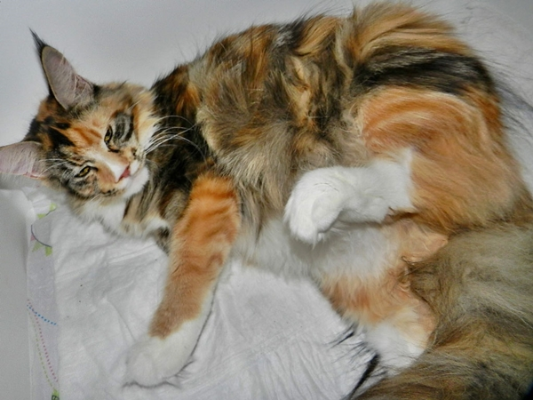
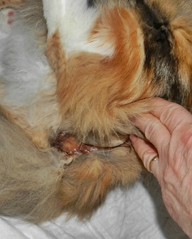
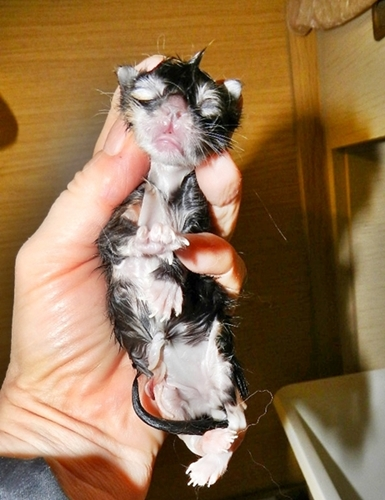
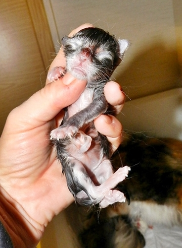
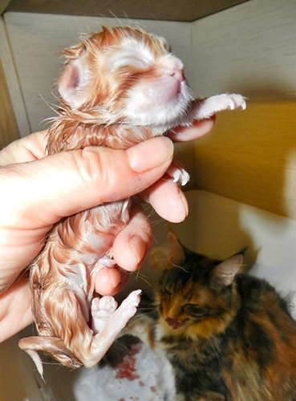
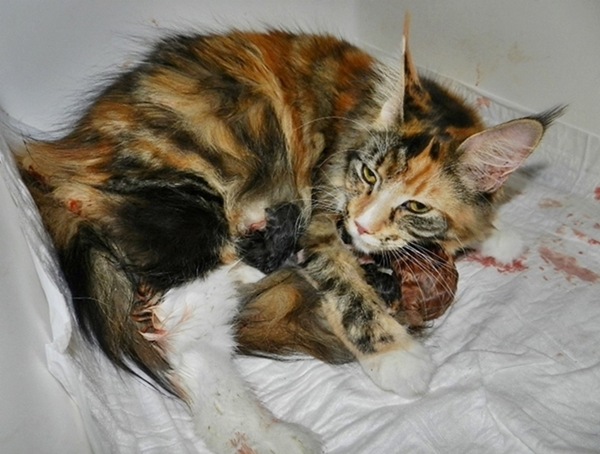
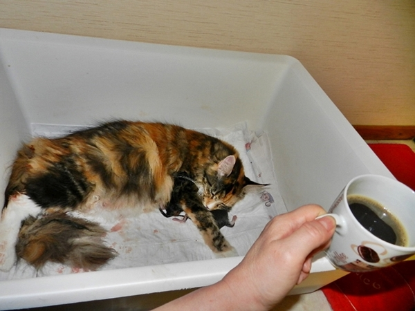
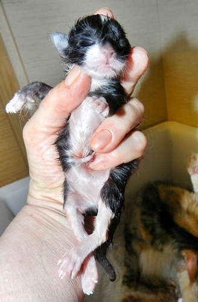
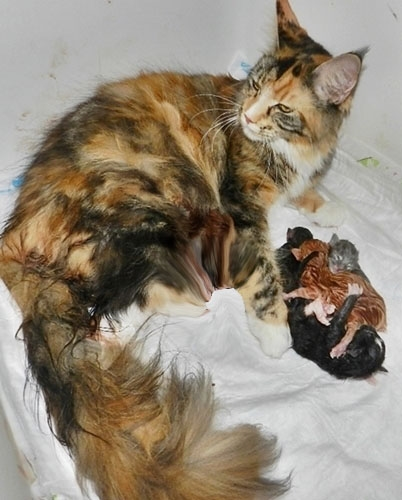
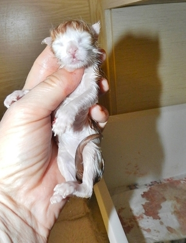

So.........ich fange an, die Geburt festzuhalten und zu dokumentieren.

Es ist jetzt genau **18:30 Uhr**. Wehen kündigen sich an. Wir beide ziehen uns zurück in unser Geburtszimmerchen. Curly Sue ist die Ruhe selbst, ich sowieso. Sie schnurrt sich rythmisch ein, schaut mich dankbar an, das ich bei ihr sitze.

Schleim ist schon abgegangen

**19:50** die Presswehen beginnen. Curly schmeißt sich hin und her, stämmt sich mit allen 4 Pfoten gegen die Wände der Wurfbox, sie mauzt, jammert. Ich streichel.

**20:20** das erste Baby ist da, ein Mädchen black torbie/white 115g

**20:40** nach drei kurzen Presswehen rucki zucki ist das zweite Baby da.\
Ein Mädchen blue tabby/white, ebenfalls 115g

Curly kümmert sich sofort und leckt gerade ihre Babys ab, da folgen wieder ein paar starke Wehen.

**20:50** folgt ohne Probleme ein kräftiger Kater in red tabby 135g

So..... wir haben nun **22:00.** Ich warte, döse, es tut sich nichts und es strampelt noch in Curlys Bauch. Curly versorgt und beschnurrt ihre Babys, wärmt sie und legt sich schlafen.

Ich schlafe auch ein bißchen.

Es ist **1:15** und es tut sich immer noch nichts. Ich bin wach, koche mir Kaffee. Curly geht es gut, sie chillt und schnurrt, sammelt Kraft.

**2:10** die nächsten Wehen setzen ein und ein riesiger black/white-Kater treibt aus. 135g

Curly schwächelt, sie hechelt und ist ziemlich fertig. Sie macht Pause. Ich nutze die Zeit und wechsel ihre Unterlagen, alles blutige weg, damit sie trocken und frisch gebettet ist. Dann versorge ich sie mit einem Mix aus homöopathischen Wehenmitteln, Vitamin B und Calcium. Sie kommt wieder zu Kräften, hört auf zu hecheln, macht aber eine große Pause.

**3:15** nichts tut sich.........Kaffeeeeee!!!!

**3:45** es geht weiter. 2 Presswehen und ein riesengroßes sehr kräftiges Katerchen macht seinen ersten Schrei\
red tabby mit sehr viel weiß 145g.

Es ist geschafft. Ich fühle kein Kitten mehr im Bauch. Curly entspannt sich. Ich gehe ins Bett kann bis 9:00 ausschlafen.

6 Stunden nach der Geburt. Ich mache die ersten Fotos, nachdem ich alles gesäubert habe

Mutter Curly ist glücklich, sie hat Schwerstarbeit geleistet und wird nun verwöhnt!!!!

