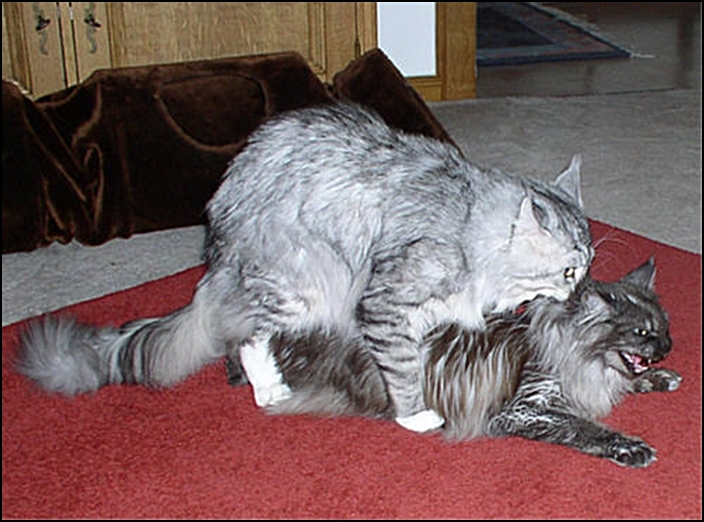
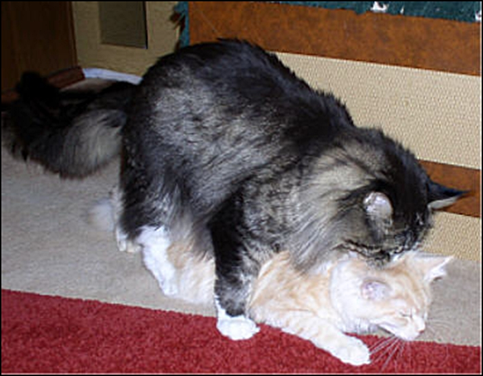
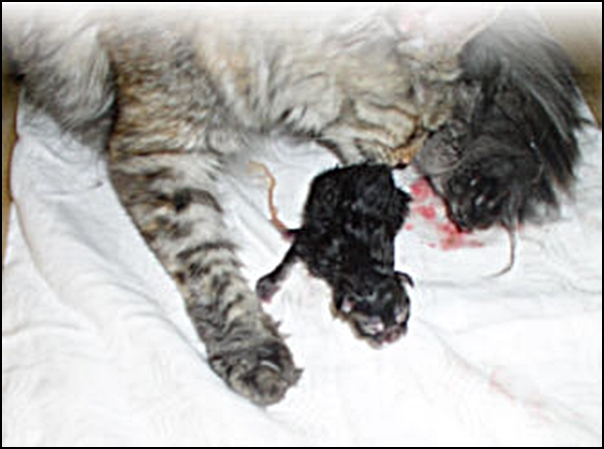
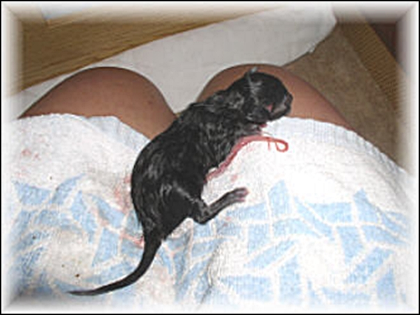
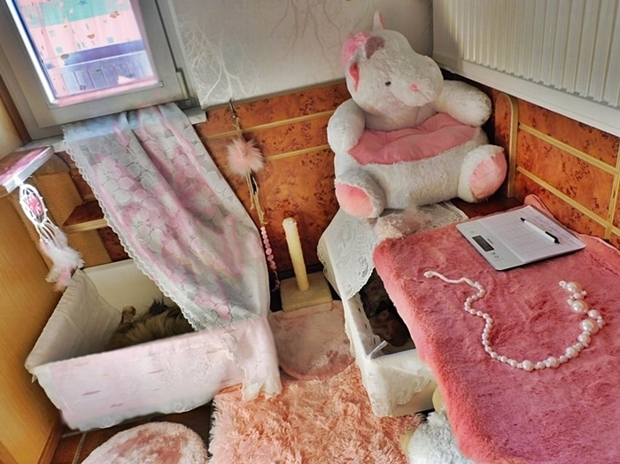

**Zuchtplanung/Katzenfamilienplanung**

Die Entscheidung Rassekatzen zu Züchten sollte nicht leichtfertig und mal eben so getroffen werden. Es gehört viel Planung, Geduld, Platz und vor allen Dingen ZEIT und GELD dazu und es ist zudem sehr arbeitsaufwendig. Ich kenne einige Züchter die sich in der Zucht wirklich finanziell ruiniert haben, sie wurden dann von den Kosten aufgefressen!

Das Wissen kommt mit der Erfahrung, das hat kaum ein Züchter von Anfang an. Das lernt sich nach einigen Jahren.\
Man muss auch oft eine besondere Beziehung zum Putzlappen haben, soviel Dreck macht zum Beispiel eine Deckkaterhaltung und die Jungtieraufzucht.\
Züchten ist nichts für bequeme Leute,\
WIRKLICH NICHT!!

Das Sauberhalten des gesamten Wohnbereiches ist manchmal schon sehr krass, wenn man den Interessenten und Käufern ein niveauvolles sauberes Ambiente bieten will. Und da haben Interessenten und Käufer beim Kauf einer teuren Rassekatze ein Recht drauf.

Wer meint, man brauche nur eine rollige Kätzin und darauf lässt man einen paarungsbereiten Kater, nur um dann anschliessend Rassekätzchen verkaufen zu können, ist im Irrtum. Um qualitativ hochwertigen und (erb)gesunden Nachwuchs aufziehen zu können, bedarf es erstmal guter und gesunder Zuchttiere. Unkenntnis und Fehler in der Auswahl der Zuchtkatzen/Kater schlagen sich bestenfalls in finanziellen Verlust aus, schlimmsten Fall aber im Leiden oder Verlust von Zuchttieren oder/und der Babys.\
Will man in der Wohnung Züchten, stellt sich die Frage:

**Genug Platz?**\
Es sollten unbedingt bevor die Kätzinnen und die Kater zum Einsatz kommen, Schallungen und die üblichen Gentests gemacht werden. Und Überlegungen wie:\
Platz für räumliche Trennungen?\
Platz für Mutter und Kitten?\
Vor allen Dingen für die Kitten, wo sie sicher vor Unfällen und Abstürzen spielen und toben können?\
Platz für die Deckkater?

Eine Zucht in einer Wohnung zu halten, muss schon gut durchdacht werden/sein.\
Ich gehe jetzt nicht von einer Liebhaberzucht mit 1 Deckkater und 2 - 3 Zuchtkätzinnen aus, sondern von einer Zucht in denen mit Verpaarungen über viele Jahre gearbeitet wird, wo mehrere Deckkater eingesetzt werden und auch mehrere Zuchtkatzen leben und demzufolge mehr Würfe geboren werden.

Dazu braucht sehr viel man Platz und man muss auch räumliche Trennungen einplanen für die Deckkater, für die Kitten. Vor allen Dingen für Mütter mit Kitten, wo sie nicht von nervenden potenten Deckkatern gestresst werden.

Was auch sehr wichtig ist, oder mal werden kann, sind 1 oder 2 Quaratänebereiche, falls es gesundheitliche Probleme gibt und mal eine Katze vom gesamten Bestand getrennt werden muss, oder eine Katze absolute Ruhe braucht. Es muss gut zu Lüften sein, einfach zu putzen und zu desinfizieren.

**Der Erwerb einer Zuchtkatze.**\
Am besten beginnt man mit einer oder zwei Zuchtkätzinnen und wenn man schon die Wahl hat, nicht unbedingt mit einem Deckkater. Züchterneulinge sollten sich bei erfahrenen Züchtern Rat holen. Kennt man keinen, oder man hatte nicht das Glück bei solch einem Züchter ein Kätzchen zu erwerben, kann man auch Kontakte bei Zuchtberatungen in Vereinen knüpfen.\
Hat man sich für eine bestimmte Rasse entschieden, sollte man sich über verschiedene Zuchten informieren um Vergleiche ziehen zu können. Man sollte mit Vorsicht und einem vernünftigen Mass an Kritik an den Kauf rangehen. Kontakte zu Zuchten bekommt man heute hauptsächlich über das Internet. Auf Katzenausstellungen kann man sich Eindrücke holen und persönlich das Gespräch zu Züchtern suchen, evtl. kann man einen Besuchstermin ausmachen.

**Wenn die Katze Nachwuchs haben soll**\
Das Alter der Rolligkeiten bei Kätzinnen ist ganz unterschiedlich. Maine Coons sind in der Regel nicht vor 10-12 Monaten rollig, meistens später. Aber es gibt auch die ganz Frühreifen, die hatte hier schon mit 6 Monaten.

Man sollte keinesfalls mehr wie 3 Rolligkeiten verstreichen lassen, allerspätestens sollte man sie in der 4 Rolligkeit decken lassen, optimaler ist die 2. Rolligkeit. Es kann sonst zu Zysten an den Eierstöcken kommen, was im ungünstigsten Fall zur Unfruchtbarkeit führen kann.\
Eine Zuchtkatze sollte niemals als Gebärmaschine benutzt werden. Ausreichende Pausen braucht sie zwischen den Geburten und sie sollte immer gut in Kondition und in bestem Gesundheitszustand sein.

**Der Partner für die Kätzin und zukünftiger Vater der Babys!**\
Ist die Katze nun rollig und man hat keinen eigenen Deckkater, beginnt die Suche nach einem Geeigneten. Wichtig ist unter anderem hierbei das Vertrauensverhältnis zu dem Deckkaterbesitzer und das Gefühl seine Kätzin dort gut aufgehoben und beaufsichtigt zu wissen, damit sie so wenig wie möglich Stress hat. Dafür schaue man sich, wenn es irgendwie machbar ist, bei dem Deckkaterbesitzer vor der Rolligkeit der Kätzin alles an, um Vereinbarungen und ungefähren Termin abzusprechen. In der Regel wird die Kätzin in der Hochrolligkeit zum Kater gebracht und bleibt je nach Deckung bis zu 3 - 4 Tagen.\
Wichtig ist, das der in Aussicht genommene Deckkater, als der Erzeuger Ihres Nachwuchses für Ihre Kätzin geeignet ist.

Um dieses beurteilen zu können, muss man Vorzüge und auch die Schwächen der Eigenen kennen und auch selbstkritisch sein und zusehen das der Kater ergänzende Qualitäten hat. Ich spreche jetzt für die Maine Coon.\
Wenn z.B. die eigene Katze ein eher schwaches Kinn, einen eher kürzeren Schwanz oder kleinere Ohren hat, auf kürzeren Beinen steht, evtl. das Profil nicht so optimal ist wie es sein sollte, dann sollte der Kater keinesfalls die selben Schwächen haben.

**Unsere Kater im Einsatz!**

**Sie ist gedeckt**\
Die Kätzin war nun beim Kater und mit der 4./5.Woche beginnt der Bauch sich zu runden und die Zitzen werden rosa bis rot und schwellen zusehens an. Eine gesunde Kätzin geniesst diese Zeit und widmet sich ihrem Futter, ihren Menschen und ihrem Müßiggang. Sie ist ausgeglichen und gut in Kondition. Die Spielzeiten werden seltener bei zunehmendem Bauchumfang und endlich ist es dann soweit.

Meiner Erfahrung nach und da kann ich wieder nur für die Coons und die Hauskatzen sprechen, pünktlich am 64./65.Tag, selten früher oder später. Bei mir haben aber auch schon Kätzinnen am 70 Tag geboren. Eine gute Zuchtkatze hat keine Probleme, sie wird alles meistern. Man sollte aber eine gebärende Katze NIEMALS alleine lassen, sie braucht ihren vertrauten Menschen, Trost und Zuspruch. Ausserdem ist es nicht immer wahr, das die Katze alles alleine macht. Es kann soviel kleine Problemchen geben, was das Leben der Katzenwelpen kosten kann.

.

In den langen Jahren in denen wir züchten, kann ich mit gutem Gewissen sagen, das nicht EINE unserer Mädels ohne mich ihre Kinder kriegen musste. Es ist mir ein einziges mal passiert das ich vor Erschöpfung eingeschlafen war, weil ich schon 2 Nächte zuvor mit der Kätzin gewacht habe, weil ich immer gedacht hatte es ginge los. 2 tote Kitten waren die Qittung. Sie lagen unterkühlt in einer anderen Ecke. Mutter mit 2 anderen lebenden Babys lagen in einer anderen Ecke.

Nur mal einige Beispiele: Einer Bekannten von mir sind 2 Babys erstickt und eines unterkühlt, weil die Kätzin das erste Baby auf den kalten Fliesen in der Küche hat liegen lassen. Weil sie von der nächsten Wehe geplagt wurde, ging sie ins Katzenklo, bekam wieder 2 Babys die im Streu erstickten. Die Kätzin war alleine. Meine Bekannte hatte einen Termin anderweitig.

Ich weiss von einer Kätzin die sich den nackten Putzeimer als Nest aussuchte (Katzen sind da manchmal enorm unvernünftig) 2 Babys erstickten im Fruchtwasser, weil keine Unterlage die es aufsaugte, darin war.\
Wenn die Wehen kurz hintereinander kommen, kümmert sich die Kätzin evtl. nicht um das vorher Geborene und kriegt das nächste an einem anderen Platz. Unterkühlung ist dann für das Babys tödlich.

**Soooo....Babys kommen**\
Die Wurfkiste sollte schon Tage vorher bereitstehen und was ich persönlich ganz wichtig finde, darauf zu achten, das die Kätzin da wo sie wirft auch in den nächsten Wochen ihre Jungen aufziehen und säugen darf. Ich hatte schon Anrufe von genervten Zuchtanfängern, die ganz aufgeregt waren, weil die Mutter ihre Jungen aus der liebevoll gestalteten Wurfkiste immer wieder rausschleppte und nach näherem Nachfragen, kam herraus dass sie in irgendeinem Schrank oder einer ungemütlichen Ecke geworfen hatte und genau da ihre Kinder aufziehen wollte, das hatte sie sich schliesslich ausgesucht.

Hier in unserem kleinen Geburtszimmerchen. Zwei unserer Mütter\
in ihren Boxen. Mütter können rein und raus. Nach 3 Wochen ziehen\
sie in einen gößeren Bereich

Es kann auch sein, das die Wurfkiste zu warm zu kalt, zu hart zu weich, zu hell zu dunkel ist. Oder zu nah bei den Menschen oder zu weit von den Menschen ist. Jede Katze will es anders haben, das herrauszufinden ist nicht immer einfach und oft heikel. Katzen können da manchmal sehr kompliziert sein.
