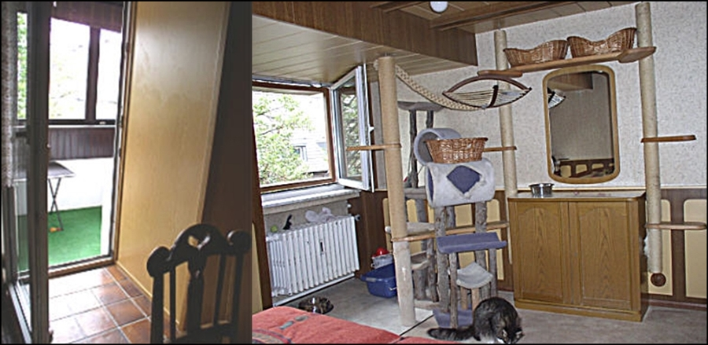
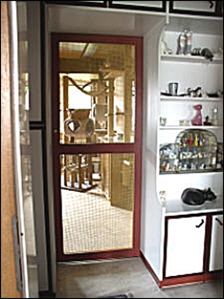
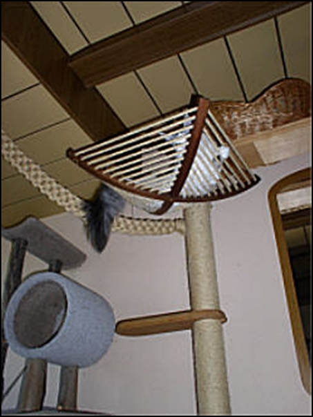

**Deckkaterhaltung**\
(eigener Deckkater oder einen Fremddecker suchen?)

Einen eigenen Deckkater in der Wohnung zu halten, ist zwar für die Deckungen der eigenen Katzen bequem, ist aber wesentlich Zeit und sehr viel arbeitsaufwendiger und der Stress in der Katzenfamilie ist erheblicher als ohne Kater. Ein Deckkater im Wohnbereich, mit hier und da rollenden Kätzinnen ist nichts für schwache Nerven!!

In bestimmten Phasen, z.B. im Frühjahr kann es sein das ein Kater sein Geschrei morgens um 4:00 anfängt und mit kleinen Pausen bis Mitternacht durchschreit.

Hat man so einen Macho der alles deckt, einschliesslich den Besen in der Küche und auch die Babys keine Ruhe vor ihm haben, der die Mädchen nur unterdrücken und sie sich gefügig machen will, dann haben die Ladys absolut nur Stress und können auch keine richtige Hirachie untereinander aufbauen. Dann ist oft Chaos und Unfrieden in der gesamten Katzenfamilie!!! Solch einem Kater ist besser damit gedient ein Katerzimmer als eigenes Reich zu haben wo er.dann zwar separiert, aber nicht isoliert ist. Und auch für die Mädels ist es die bessere Lösung.

Es gibt Züchter die in diesen Stress-Situationen, (Kater schreit, besteigt ständig nichtrollige Kätzinen) als Notlösung dem Kater Hormone z.B. Androcur spritzen lassen und es wird von einigen Tierärzten sogar empfohlen (nicht von meiner Tierärztin!!) Ich habe bei einigen meiner Mitzüchtern sehr viele Probleme miterlebt, als sie ihre Kater mit Hormonen behandelten. Kater wurde nach einem halben Jahr sehr krank, entwickelte Tumore an den Katzerzitzen, die aufplatzten und einer OP unterzogen werden mussten, mit enormen Kostenfaktor. Ich habe erlebt das ein anderer Kater danach 2 Jahre nicht mehr gedeckt hat, sogar einige nie wieder.

Aussage meiner Tierärztin:\
Es kann manchmal sehr lange dauern bis der Kater wieder deckt. Schon aus diesem Grund und auch weil es schwere gesundheitliche Schäden/Chaos im Hormonhaushalt zur Folge haben kann, sollte man das lieber lassen.

Wer keine Nerven für einen Deckkater hat oder keine Möglichkeit ihn ordentlich zu separieren, in einem grossen Katerzimmer mit Freisitz, der sollte lieber keinen Deckkater halten. Kater isoliert in irgendwelchen Kammern oder Badezimmern gehalten, bieten ein Bild des Jammers und haben mein Mitleid.

Gegen solch ein liebevoll eingerichtetes Katerzimmer mit Freisitz für Frischluft und Sonne ist\
nichts einzuwenden. Diese Lösung ist allemal besser wie ständigen Stress in der Katzenfamilie\
unter Kater, Kätzinnen und Kitten.

Optimal - getrennt durch eine Gittertür vom\
Wohnbereich, so ist der Kater nicht isoliert

Mit deckenhohen Plätzen und Ausgucken\
für den König der Katzencrew

Glück dem Deckkaterbesitzer, der einen, mit allen veträglichen, in Harmonie lebenden Kater hat, der mit Kätzinnen und Babys zusammenlebt und dann auch noch nichtmal spritzt. Ein Deckkater, der mit einer oder mehreren geschlechtreifen Katzen lebt und nicht spritzt, den mag es geben, ist aber eher die Ausnahme. Wir haben auch so ein Schätzchen, ich kenne es aber auch anders.

Mit einem spritzenden Deckkater zu leben ist unglaublich schwierig, denn auch wenn man noch soviel putzt, auf Dauer, bei immer wieder erneutem markieren des Katers, ist der Gestank nicht wegzubringen und wenn man nicht gerade ein Haus irgendwo freistehend und ohne Nachbarn hat, wird es unerträglich, auch für Leute die zu Besuch kommen.

Die 2. Möglichkeit ist, sich einen Deckkater bei einem anderen Züchter zu suchen, der ihn für Fremddeckungen freigibt. Oft eine schwierige Angelegenheit. Hat den Vorteil, man hat keinen Gestank in der Wohnung und Ruhe unter den Katzen, hat aber enorme Nachteile anderer Art. Man ist abhängig und - man muss erstmal einen finden. Züchter die gute Vererber zu Hause haben, wollen DIE auch meist für sich alleine und geben sie nicht zum Decken frei. In den Katerpuffs, wo alle ihre Katzen hinbringen und die in öffentlichen Deckkaterverzeichnissen angeboten werden, ist immer ein gesundheitliches Risiko.

Gerade bei den Maine Coon Züchtern ist kaum ein Kater zu finden und wenn, ist er sehr hoch in den Deckgebühren. Hat ein Züchter einen guten erfolgreichen Kater, wird er ihn nur für sich behalten, was ich persönlich gut verstehen kann, denn auch unsere Deckkater geben wir nicht für Fremdeckungen.

Ich sage immer: Unsere Jungs haben hier genug zu tun! Nicht zuletzt auch wegen Einschleppung von Krankheiten. Es müssen nicht immer schlimme Viren sein, auch mit harmloseren Erkrankungen (bakterielle Darminfekte z.B. Giardien) die man der Katze, die zu einem kommt, nicht immer ansieht, kann man sich seine gesamte Zucht verseuchen. Auch ein Beispiel sind Flöhe. Zwar harmlos, aber doch unangenehm und es wird teuer, wenn es nicht sofort erkannt wird und man viele Tiere hat.

Nicht immer muss die zu Besuch kommende Lady total verfloht sein um Flöhe einzuschleppen. Man kann es auch wenn man durchkämmt NICHT IMMER SEHEN. Dasselbe Risiko haben natürlich auch Katzenbesitzer die zum Deckkater in eine andere Zucht kommen!! Man muss abwägen und wissen, wie man es machen will, beide Möglichkeiten sind nicht bequem.
