**Handaufzucht! Wenn die Mutterkatze ausfällt**

Wenn der Mutterkatze kurz nach der Geburt oder in den ersten Lebenstagen der Kitten etwas passiert, z.B. sie hat eine Gesäugeentzündung, eine Gebärmutterentzündung oder gar Vereiterung, einen Kaiserschnitt, oder im schlimmsten Fall, sie ist verstorben, dann steht man als Züchter vor einem Problem\
**Was tun mit den Kleinen?**\
Hat man keine 2. Kätzin die gerade Babys hat oder keine Amme, heißt es: Die Kleinen mit dem Fläschchen aufziehen, ein sehr sehr schwieriges Unterfangen. Da heißt es Tag und Nacht äußerste Disziplin. Die Aufzucht von Neugeborenen verlangt einen sehr imensen persönlichen Einsatz, vor allem nimmt es so viel Zeit in Anspruch!!

In meinem Fall bekam die Mutterkatze 5 Tage nach der Geburt eine Gebärmuttervereiterung mit Fieber, Lustlosigkeit. Die Babys mußten komplett von der Mutterkatze getrennt werden um kein Risiko der Verseuchung von Streppto/Staphylokokken einzugehen, denn das bedeutet den Tod der Babys. Die Mutterkatze mußte hochantibiotisch behandelt werden und das über 2 X 10 Tage, dazwischen eine Woche Pause.\
**Und das bei 8 Babys!!**\
Leider hatte ich keine Amme und keine 2. Kätzin die gerade Kitten hatte. Aber selbst eine andere Mutterkatze hätte neben ihrem eigenen Wurf nicht auch noch 8 weitere Kitten aufziehen können. In der ersten Woche heißt es, alle 2-3 Stunden, auch Nachts, füttern, Bäuche massieren, um die Babys zum urinieren und abkoten zu animieren (was sonst die Mutter wegleckt).\
Ich habe mal ein paar Fotos und Anmerkungen unserer Handaufzucht eingestellt.\
Auf den Fotos sind die Babys allerdings schon 14 Tage alt und ich hatte schon 10 harte Tagen hinter mir, aber alles routiniert im Griff. Es ist für Katzenbesitzer die damit nicht geübt sind und noch nie Babys aufgezogen haben sehr schwierig, ja fast unmöglich, denn es muß ein disziplnierter Ablauf rund um die Uhr eingehalten werden und hygienisch muss alles top sein. Man kann sehr viel falsch machen, was Gesundheitsprobleme, schlimmsten Fall den Tod der Kleinen zur Folge haben kann.

Ich habe schon sehr sehr viele Kätzchen, sogar von Geburt an, versorgt und gefüttert, komplett ohne Mutter. Ich habe auch schon viele Sorten der Aufzuchtsmilch und verschiedene Fläschchen ausprobiert. Ich bin immer wieder auf diese zurückgekommen

Nach Anordnung einrühren kräftig und lange aufschütteln und in die Fläschchen füllen

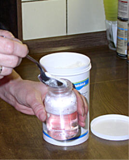
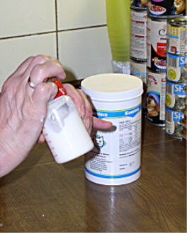

Kleiner Tipp zur Erleichterung: Die Fläschen und das gesamte Fütterungsgeschirr/besteck sofort nach der Fütterung gut und heiss ausspülen und in einer Plastikbox mit ausgelegtem Küchenpapier zusammenstellen für die nächste Fütterung.

Die Milch muß bei jeder Fütterung mit abgekochtem heißen Wasser NEU angerührt werden, darf nicht klumpen! Die Temperatur zum Füttern sollte so sein, das, wenn man die Flasche an die Wange nimmt, sie angenehm warm ist (wie man es bei Babys auch macht)..

Nun heißt es, man macht einen Plan, der immer wieder gleich abläuft. Saubere ausgekochten Frottetücher, Küchenpapierrolle und Handtücher sollten immer bereitliegen sowie sterile und saubere Fläschchen. Es sollte immer alles zusammen an einem Platz stehen, das man nicht lange vor der Fütterung suchen muß.

Auf den Packungen bzw. Begleitzetteln sind die Mengen sehr detailiert angegeben, die zur Fütterung der Kleinen angerührt werden müssen\
In der Zeit, indem die Fläschchen mit Babymilch abkühlen, versorge ich die Babys mit Bauch massieren und animieren zum Geschäftchen machen.

Dann wird gefüttert im Akord, denn alle 8 haben zur gleichen Zeit Hunger. Sind alle durch, fange ich nochmal von vorne an, denn oft hat der eine oder andere noch ein bißchen Hunger. Dann wird nochmal massiert und nochmal die Hinterteile geputzt, ob noch etwas abgeht oder bei dem ein oder anderen geklemmt hat.

Ganz am Anfang kann man auch die nehmen

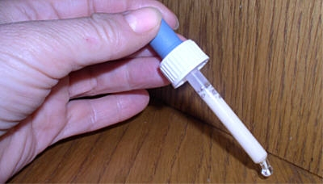
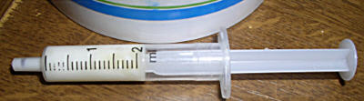
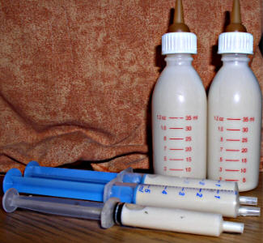
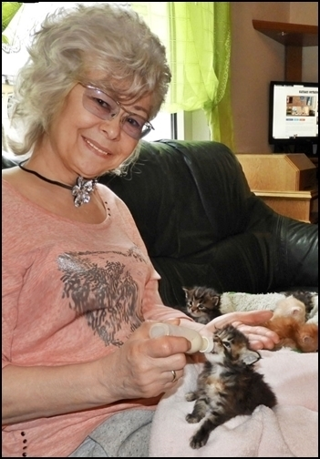
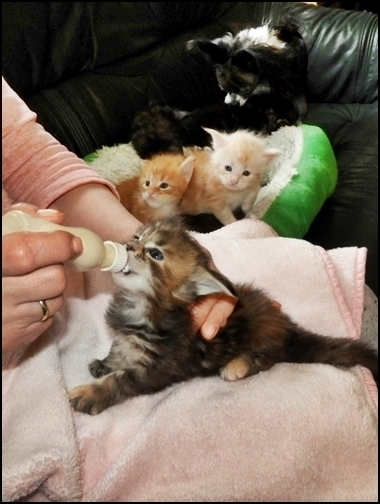
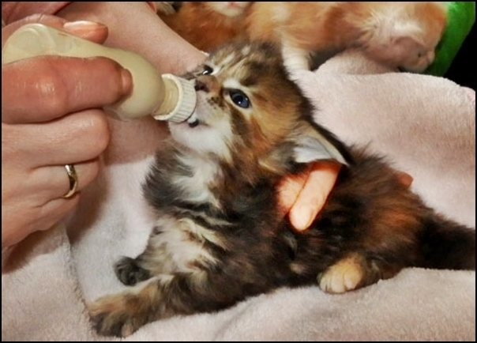
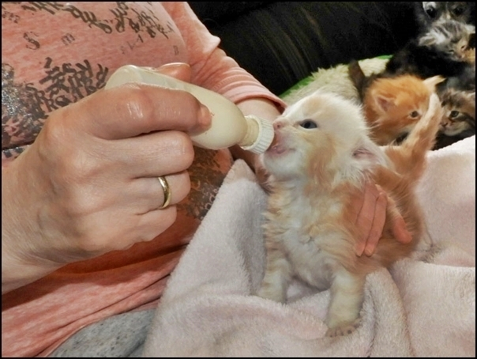
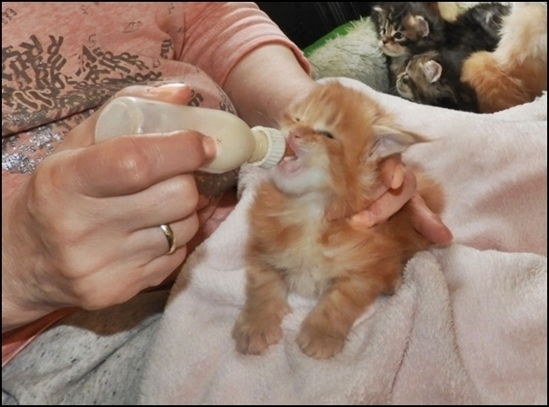
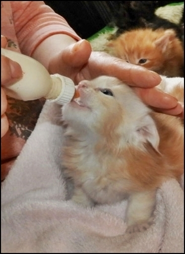
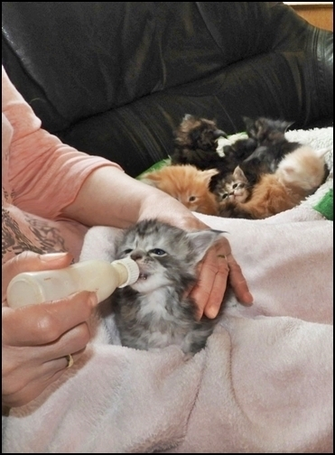

Sind alle satt, mache ich mir ein Schüsselchen mit sehr warmem Wasser, tauche eine Waschlappen, wringe ihn gut aus und dann werden die Babys gewaschen, wie mit der Zunge der Mutter nur ein bißchen größer.\
Das mögen sie sehr und fangen in der Regel sofort an zu schnurren.

Vernachlässigte Babys in der Handaufzucht, wenn man sie nicht pflegt und wäscht, sehen bald verklebt aus und bieten ein Bild des Jammers. Bakterien und Keime werden mit der Zeit zu einem Problem, wenn man nicht alles sauber hält, d.h. die Babys selber, sowie das Wurflager.

Es ist auch gleichzeitig eine Massage und der Verdauung der Babys förderlich und sehr wohltuend und entspannend

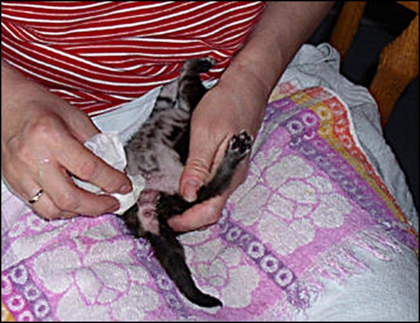

Das kann enorm stressig werden, wenn, wie in diesem Fall, 8 Babys alle ihr großes Geschäftchen machen

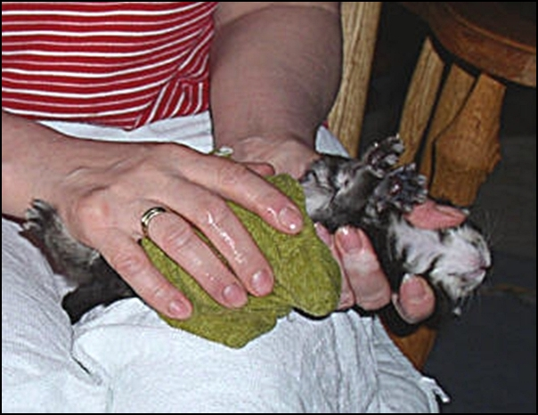
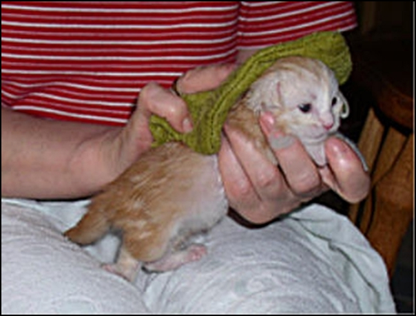
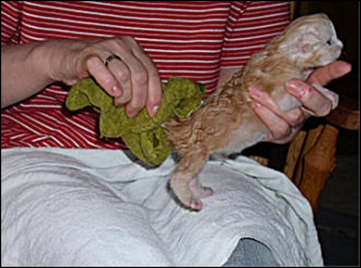

Abtrocknen - fertig. Bis in 3 -4 Stunden, da geht wieder alles von vorne los.\
Wenn die Babys bei einer Fütterung, mit Popos putzen und Waschung so wie ich es beschrieben habe, versorgt sind, fühlen sie sich wohl. Man merkt es, wenn sie nicht mehr schreien und wohlig schnurren und anschliessend einschlafen.

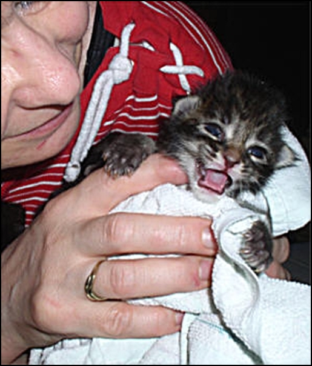

Zeiten der Fütterung:\
Babys 1 - 10 Tage alle 2- 3 Stunden (auch nachts) Babys 10 - 20 Tage alle 3 - 4 Stunden. Nachts nicht mehr, aber die letze Mahlzeit sollte noch um Mitternacht gegeben werden, die erste Mahlzeit möglichst 6 Uhr Morgens.\
Wenn ich die ganz Frischgeborenen füttere, mache ich es in den ersten Lebenstagen mit einer Pipette oder Aufziehspritze.

Ab 3. Woche nehme ich, der Menge wegen, diese Fläschchen die habe ich mir selber bebastelt aus Kinderfläschen mit Gimpetnuckel. Das ist die Menge für 8 Babys pro Mahlzeit in der 3. Woche. Nun bekommen sie 6 Mahlzeiten am Tag. Die letzte um Mitternacht, die erste um 6 Uhr Morgens.

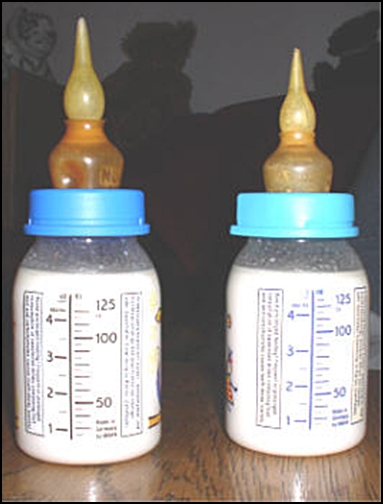
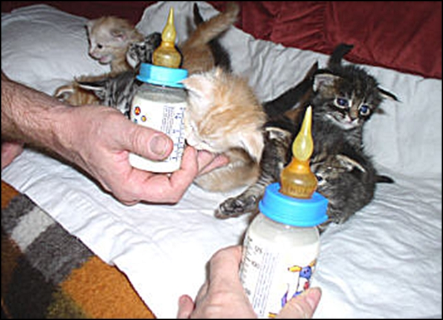
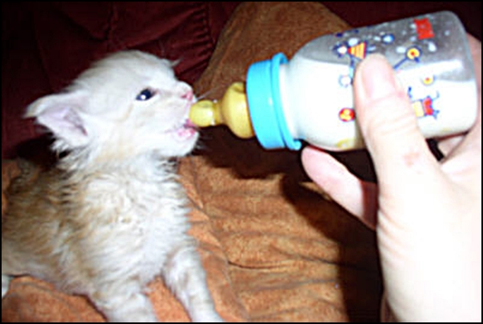

Hat man keine Aufzuchtsmilch im Hause, geht es auch mit Dosenmilch (10%iger Bärenmarke), angewärmt mit einer Prise Traubenzucker. Gibt es zur Not an jeder Tankstelle oder Trinkhalle. Als ich vor meiner Zucht noch aktiv im Katzenschutz gearbeitet habe, habe ich ganze Würfe ausschliesslich mit Dosenmilch und Traubenzucker grossgezogen. Es ist nicht das 100%ig optimale, aber es geht auch, kein Kitten hatte Probleme.

Und dann endlich!!!\
Sie gehen zum Klo und fangen an, selbständig zu fressen

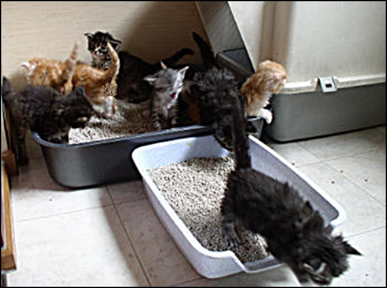
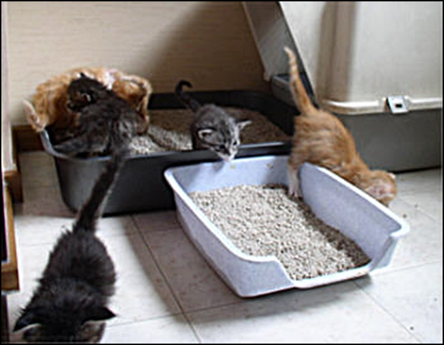

Nun ist es überstanden - die Kitten sind 7 Wochen alt.\
Alle sind gesund, alle haben gute Verdauung und alle fressen selbstständig.

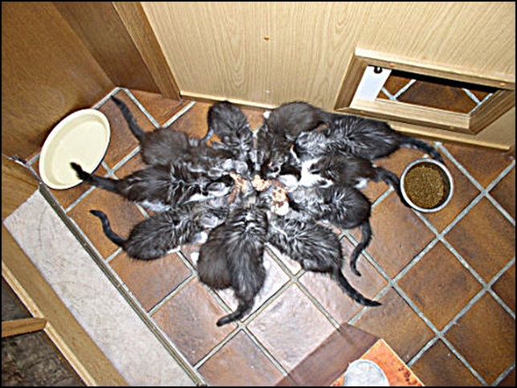

Hier noch ein paar Tipps aus meinem Erfahrungskästchen:\
Ich persönlich (und ich weiss es auch von anderen) habe keine gute Erfahrung gemacht mit Rotlicht, Wärmeflaschen und Heizdecken, die Babys können nicht sagen: Es ist zu warm und trocknen auch sehr schnell aus. Besser ist es, eine angenehme Raumtemperatur von 22° zu halten die Wurfkiste kuschelig auszulegen und einen sauberen Strickpullover über die Babys zu legen. Ein nicht fusselnder Strickpullover ist atmungsaktiv und hält die Wärme gleichbleibend. Man kann mal wechseln mit einem anderen Pullover, den man für ein paar Minuten auf die Heizung legt.

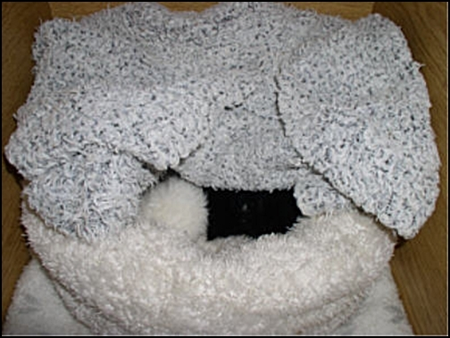
