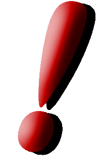
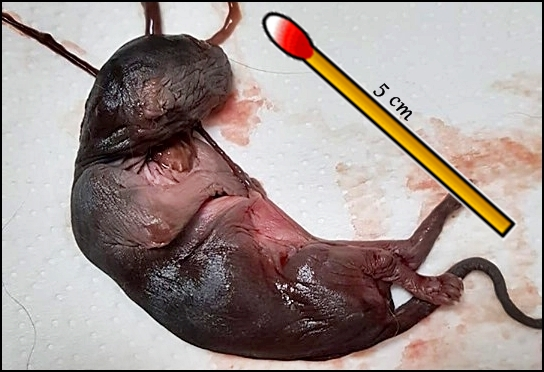
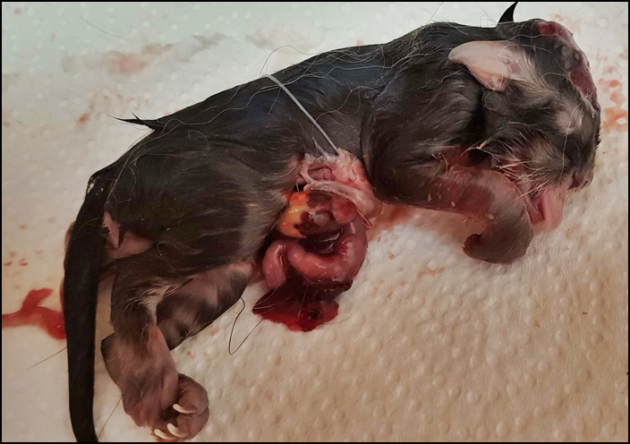
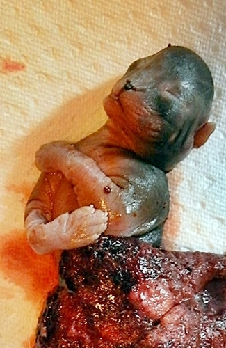
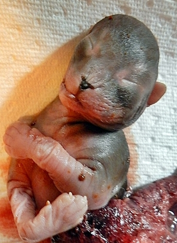
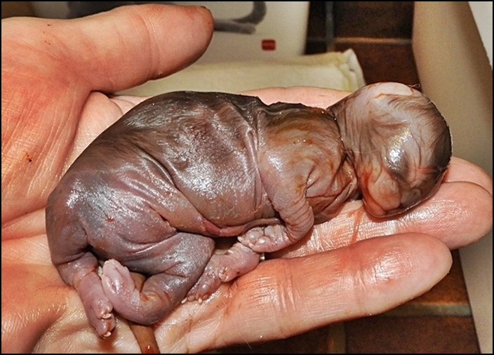
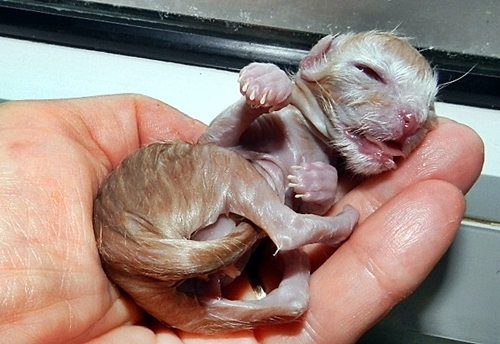
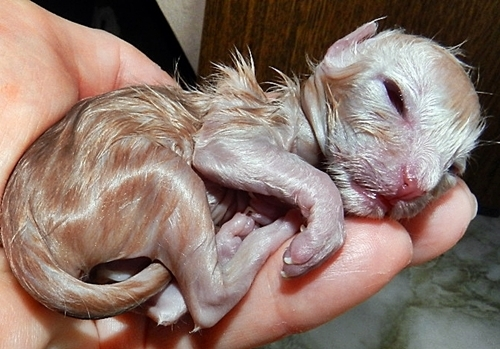
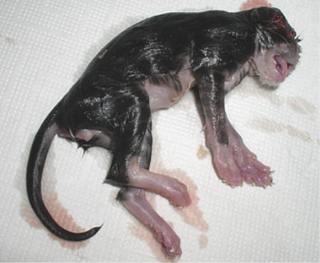
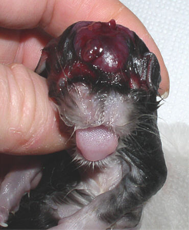

Diese Bilder unterliegen meinem Copyright und dürfen nicht kopiert oder verwendet\
oder runtergeladen werden. Dies stellt eine Urheberrechtsverletzung und somit einen\
Straftatbestand dar, der von mir sofort zur Anzeige gebracht wird.

Ein Wort dazu: Auch in noch so gesunden, genetisch gut überwachten und durchgetesteten Zuchten kann in seltenen Fällen eben auch mal die eine oder andere Abart geboren werden! Das ist die Natur. Und da muß ein Züchter auch mal mit rechnen.

Ein Kitten aus einem 10er Wurf. Leider hat es sich\
nicht fortlaufend entwickelt. Was man hier nicht sieht,\
es war kleiner wie ein kleiner Menschenfinger

Dieses Foto bekam ich von einer Züchterin zur Verfügung gestellt\
**mit ihrer Genehmigung darf ich es veröffentlichen**\
Ein Kitten mit offener Bauchdecke, deren komplette Eingeweide\
außerhalb des Körpers liegen. Und es kann sein das dieses Kitten\
lebt. **Was dann??** Für Anfänger oft ein Schock!

Hier eine Fehlgeburt in der 4 Tragewoche

Das ist ein Abort........

.......in der 4. Schwangerschaftswoche

Hier eine Frühgeburt. 10 Tage zu früh geboren und deutlich unterentwickelt und natürlich **nicht** lebensfähig

Ein Kitten normal am 65. Tag geboren (Totgeburt) Normal groß.\
Es hatte keine Knochen, keine Haare. Der Körper war wie ein\
Wassersack ohne Wirbelsäule

Hier ein gerade geborenes Kitten mit offenen Augen geboren. Dieses Kitten war natürlich blind\
und ist auch kurz darauf gestorben.

Totgeborenes Kitten mit offener Schädeldecke

