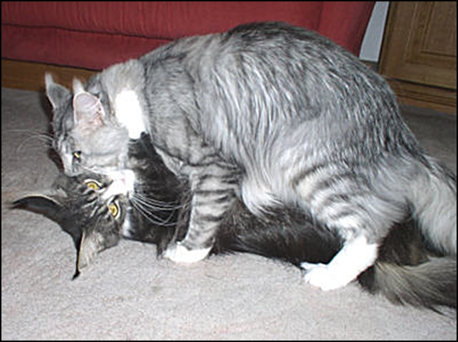
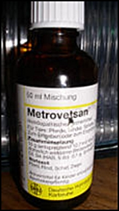
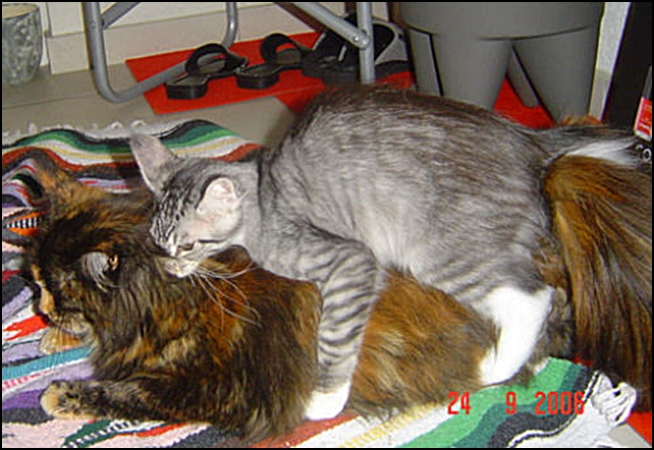

Verhütung bei Zuchtkätzinnen Hormone oder rollen lassen?

Probleme mit Zuchtkatzen? Hat man seine Zucht nun begonnen und aufgebaut, der erste Wurf hat Freude gemacht, stellt sich die Frage wie ist die Verhütung zu regulieren, damit man die Würfe auch planen kann, denn - es gibt ja nun mal Vereinsregeln an die man gebunden ist. Man kann und darf ja nicht 3 X im Jahr die Katze belegen. Das ist Ausbeutung und nicht im Sinne der Tierliebe!

Pille oder rollen lassen?\
Beides im Übermass ist nicht gut. Probleme kann es geben wenn die Kätzin immer wieder rollig war und nicht gedeckt wurde. Zysten an den Eierstöcken sind dann keine Seltenheit und Können für immer zur Unfruchtbarkeit führen.\
Das andere Extrem kann sein, wenn die Kätzin zu lange die Pille kriegt. Die Gebärmutterschleimhaut trocknet aus, was zur Folge haben kann, das die Einnistung des unbefruchteten Eies in die Gebärmutterwand verhindert wird.

Anmerkung zur Eingabe der Antibabypille für Katzen\
Nicht ausser Acht sollte man lassen, das bei einigen Katzen die Schilddrüsenwerte durch die Pille verändert werden und dies dann zu Agressionen/Streitereien mit anderen Katzen im Haushalt führen könnte. Die Pillen haben Auswirkungen auf die Schilddrüse, denn in der Pille sind Kortikosteroide enthalten. Das ist ja auch der Grund, weswegen manche Tierärzte bei Hautproblemen den Katzen die Pille verschreiben, weil eben Kortisonverbindungen darin enthalten sind. Kortison beeinflusst\
Also wie macht man es richtig? Dazu kann und will ich nichts raten. Ich kann nur sagen wie wir es handhaben.

Hat die Katze ihre Babys, geben wir, wenn die Kitten 6 - 8 Wochen alt sind, die Pille. Regelmässig über 3 Monate. Dann wird sie abgesetzt. Meine Erfahrung ist, das in den meisten Fällen die Katze nicht sofort danach rollig wird sondern sich Zeit lässt. Bei der nächsten Rolligkeit wird sie dann gedeckt - wenn zwischen dem vorigen Deckakt und dem folgenden Deckakt 9 Monate liegen. Ist die Zeit kürzer und sie wird unmittelbar nach Absetzen der Pille rollig muss sie 1-2 mal durchrollen um dann wieder zum Kater zu dürfen. So sind wir bisher gut gefahren und haben in den vielen Jahren in denen wir züchten, sehr sehr wenig Probleme in unserer Zucht.

Wir hatten allerdings auch schonmal eine Kätzin mit der wir so gerne Babys gehabt hätten, die nie eine Pille bekam und normal mit 13 Monaten rollig wurde, sich ausgiebig vom Kater decken liess und nicht aufnahm. Dieses wiederholte sich immer in Abständen von 8 Wochen insgesamt 4 mal. Immer dachten wir diesmal muss es geklappt haben, aber nichts. Homöopathische Kuren brachten keinen Erfolg. Wir liessen sie kastrieren und sie war voll mit Zysten an den Eierstöcken. Ohne Pille ohne Dauerrollen. Das gibt es auch und ist Pech.

Gebärmuttervereiterung\
(Pyometra)\
Die Gebärmuttervereiterung oder Pyometra entwickelt sich anfangs meist schleichend, wird daher oft erst im Spätstadium bemerkt und kann dann zu einem lebensbedrohlichen Notfall werden, vor allen Dingen wenn es sich um eine geschlossene Gebärmuttervereiterung handelt wo man keinen Ausfluss sieht. Die Gebärmutter füllt sich mit eitrigem Sekret und kann armdick anschwellen. Ins Blut übertretende Giftstoffe der Eitererreger bedingen eine rasche Verschlechterung des Allgemeinbefindens bis hin zum Kreislaufschock, im schlimmsten Fall folgt eine Sepsis, die den Tod der Katze zur Folge hat.

Die Verabreichung der Pille ist umstritten, es muss sich jeder Züchter selber beantworten wie er arbeiten will, denn ohne Pille geht es meistens nicht, entweder hat man eine ständig rollende Katze, (dieses ist für den Kater und für die Besitzer der Katze, falls sie nicht gerade Nerven aus geflochtenen Drahtseilen haben, Stress pur), oder - man hat eine ständig tragende und werfende Kätzin.

Andere Probleme mit Zuchtkätzinnen.\
Empfängnisverhütung ist bei Katzen eigentlich eher ein Problem als Unfruchtbarkeit, aber auch letzteres gibt es, wenn auch seltener. Natürlich sollte man, wenn die Kätzin nicht rollig wird, als erstes mal eine späte Entwicklung der Kätzin in Betracht ziehen, nicht ungeduldig werden oder gar schon mit 1,5 Jahren hormonell behandeln.\
Geduld!

Vor kurzem hörte ich wieder von mir bekannten Züchtern, die eine 16 Monate junge Maine Coon Katze mit Hormonen behandeln liessen (übrigens auf Anraten des Tierarztes) weil sie nicht rollig wurde.\
Auch wir hatten eine Zuchtkätzin die unsere Geduld strapazierte. Sie wollte nicht rollig werden, dann mit 17 Monaten 2 schwache Vorrolligkeiten und endlich mit fast 2 Jahren wurde sie richtig rollig nach einer Homöopathischen Unterstützungskur. Fortan war sie bis 8 Jahre äußerst fruchtbar ohne je Probleme mit Rolligkeiten Deckungen oder Geburten (immer 4-5 Welpen) zu haben.

Die soziale Stimmulation ist nicht zu unterschätzen und sehr wichtig. Artgerechte Haltung, Tageslicht, Sonne und Zuwendung. Die Kätzin sollte sich rundum wohlfühlen und nicht im Stress leben in einer zu grossen, untereinander stark rivalisiernden Gruppe, wo sie unterdrückt wird! Bleibt die Rolligkeit ganz aus, ist Rat und Hilfe vom Tierarzt angebracht. Es kann sich dann doch um eine hormonelle Störung, sowie um eine Anomalie der Fortpflanzungsorgane handeln.

Schwieriger sind fehlgeschlagene Verpaarungen. Das kann stressbedingt sein, z.B. lange Anfahrten zum Deckkater. Wenn die Katze sensibel ist, kann es sein, das man vergeblich fährt. Auch kann die Kätzin alle Anzeichen einer Rolligkeit zeigen, ohne den Gipfel der sexuellen Aufnahmefähigkeit zu erreichen und sich deshalb der Verpaarung wiedersetzen.

Auch hier schreibe ich aus Erfahrung. Eine unserer Kätzinnen wurde zwischen dem 13. und 16. Monat alle 6 Wochen rollig, liess den Kater auch aufsteigen, der den Deckakt nicht vollziehen konnte, weil Madame sich immer wieder auf die Seite fallen liess. Unser Kater war äusserst frustiert. Er wollte nachher nicht mehr, schnüffelte nur noch an ihr rum und wurde sogar teilweise sehr agressiv zu ihr.

Ich behandelte die Kätzin mit einem homöopathischen Mittel, das die Geschlechtsorgane und die Gebärmutter gut durchblutete und siehe da, bei der nächsten Rolligkeit klappte es dann auch mit der Deckung, der Erfolg war 5 stramme Kitten und fortan keine Probleme mehr.\
Klick das Foto

Das ist das Mittel, das ein Versuch wert ist \>Metrovetsan\<, es hat schon so mancher Kätzin zu Babys verholfen. Gibt es rezeptfrei in der Apotheke. Es löst keine Probleme, wenn die Kätzin ernsthafte hat. Es ist lediglich ein Mittel das die Gebärmutter und Eierstöcke und den gesamten Geschlechtsbereich durchblutet, so das den Kätzinnen die nicht auf den Höhepunkt ihrer Rolligkeit kommen, ein bisschen unterstützend geholfen wird.\
3X tägl. 10 Tropfen 2-3 Wochen oder länger.

Wenn die Verpaarung und Ovulation normal verläuft, die Eier aber nicht befruchtet werden, evtl. weil der Deckkater noch zu jung ist - er zwar deckt, aber sein Samen noch nicht soweit ist - oder er steril ist, kann es zu einer Scheinschwangerschaft kommen. Das löst das Verfärben der Zitzen, Gewichtszunahme (weil das Hormon Fettpolster bildet, Flüssigkeit speichert und Appetit verursacht) aus. Auch Milchbildung habe ich schon erlebt ist aber ganz selten.

Auswegslos ist, wenn Verwachsungen an Eierstöcken, Eileitern, bei denen Diese dann in ein faserartiges Gewebe eingehüllt sind, den Durchgang der Eier zur Gebärmutter verhindern. Hier hilft keine Behandlung, die Katze sollte unbedingt kastriert werden.

Auch ein Kater kann unfruchtbar sein. Das Problem kann sein, das sein Sperma qualitativ schlecht ist oder nicht genug um eine Befruchtung herbeizuführen. Evtl. kann sein, schlechte Kondition, eine Krankheit, auch die Ernährung spielt eine kleine Rolle. Hat der Kater einen oder sogar beide Hoden in der Leiste, sollte er keinesfalls zur Zucht eingesetzt werden. Mit einem Hoden ist er nicht unbedingt unfruchtbar. Sind aber beide Hoden in der Leiste ist er aber absolut unfruchtbar!! Sein Sperma ist nicht lebensfähig, weil durch die hohe Körpertemperatur, der Samen nicht leben kann. Der Kater muss operiert werden und die Hoden müssen aus der Leiste entfernt werden, sonst gibt es Probleme. Im Kopf ist er nämlich Kater, er neigt zu Spritzverhalten und er stinkt wie ein Unkastrierter.

Na so kann es auch nicht klappen, wenn sich ein 4 Mon. Jungspund versucht \*lach.

Auch ein Problemkann sein:\
Während einer Trächtigkeit kann ein Abortus schon eintreten, bevor die Einnistung des Eies in die Gebärmutter erfolgt ist. Das erscheinet dem Züchter wie eine fehlgeschlagene Befruchtung. Oder eine Resorption, d.h. die Leibesfrüchte werden vom Tierarzt in der 3. - 4. Tragewoche ertastet und verschwinden wieder. Der tote Fötus und die Plazenta werden von der Gebärmutter absorbiert. Hat sich das Skelett schon verhärtet (etwa in der 7.-8.Tragewoche) spricht man von einem Abortus oder einer Fehlgeburt. Schuld ist nicht selten eine Infektion oder Viruserkrankung. Auch bakterielle Erkrankungen sind nicht selten. Beim Tierarzt kann man dann einen Scheidenabstrich machen lassen und behandeln. Aber auch ein unglücklicher Sturz der tragenden Kätzin kann eine Fehlgeburt auslösen.
