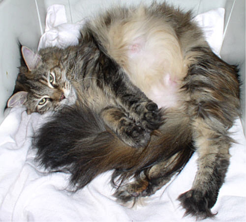
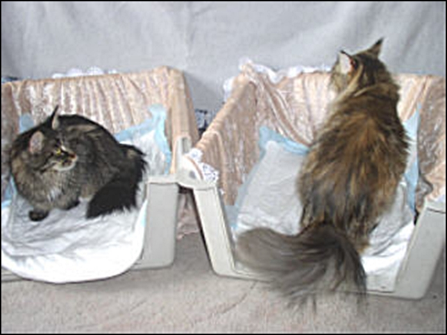
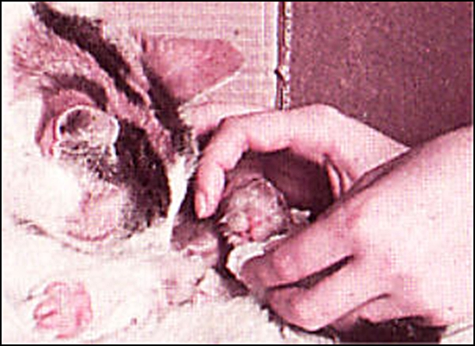
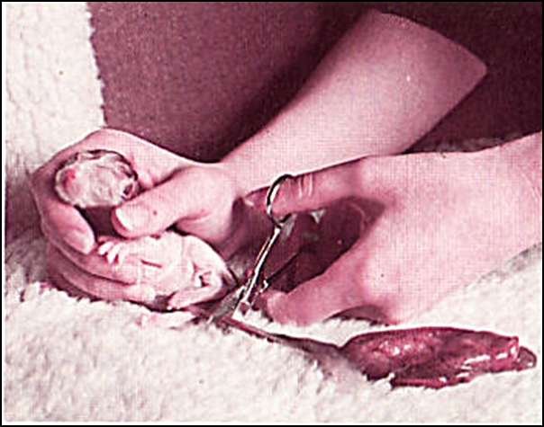

Es ist soweit, der langersehnte Katzennachwuchs kommt, die Geburt steht an.

Seit Tagen wächst die Spannung und die Mutterkatze sucht nun öfter die Wurfkiste oder das Körbchen auf. Nun beginnen die einzelnen Geburtsphasen. Bei Beginn der ersten Phase beschleunigt sich der Atemrythmus und die Kätzin wird anfangen durchs Maul zu atmen und dabei rythmisch zu schnurren. Dieser Zustand kann viele Stunden anhalten und sollte nicht gestört werden. Solange die Kätzin dabei zufrieden scheint und entspannt daliegt, (selbst wenn sie mal zwischendurch unruhig wird und im Nest kratzt) braucht man sich nicht zu sorgen.

Eine unserer Kätzinnen kurz vor der Geburt mit Vorwehen

Meistens wird ein paar Stunden vorher die Mahlzeit verweigert. Aber es gibt Kätzinnen die bis kurz vor den Wehen fressen. Wir hatten sogar eine, die ist zwischen den Wehen fressen gegangen. Alle Dinge sollte man nun für die Geburt zusammen haben. Schere für die Nabelschnur abzuschneiden (alles vorher heiß abwaschen und desinfizieren). Zwirn oder OP-Fäden um die Näbelchen abzubinden. Jede Menge ausgekochte Frottetücher zum Abrubbeln der Babys (vorher auskochen). Antiseptikum um die Näbelchen zu desinfizieren. Alles in ein ausgekochtes Handtuch eingeschlagen, sollte es bereitliegen. Und natürlich eine Waage. Anfänger sollten sich ein Protokoll erstellen für Uhrzeit, Gewicht, Geschlecht und Farbe der einzelnen Babys, sowie Anmerkungen für Probleme usw. so können sie bei den nächsten Geburten darauf zurückgreifen.

Bei mir liegen noch bereit:\
Wehenspritzen\
Calcium Frubiase\
Ampullen für Mutterkatze während der Geburt

Die Raumtemperatur sollte 22° betragen, bei Kurzhaar kann es ruhig ein bisschen wärmer sein. Eigenwillige Katzen werden ihre Geburt alleine bewerkstelligen wollen, man sollte das akzeptieren und aus einer Distanz gut beobachten und nur eingreifen wenn es zu Problemen kommt.

Meine gesamten Zuchtkätzinnen wollen mich am liebsten bei der Geburt in der Wurfkiste dabeihaben. Alle sind sehr vertrauensselig, das sie dulden, das ich die erste bin die das Baby in die Hand nimmt um zu sehen ob alles in Ordnung ist, abnabel und auf die Waage lege und sie es dann erst kriegen.

Bei fortschreitender Geburt, in der 2.Phase werden die ersten Vorwehen zu sehen sein und ein Schleimpfropf geht ab, der die Geburtswege gleitfähig macht und anzeigt, Achtung, Jetzt wirds ernst.\
Mit heftig werdenderen Wehen, wird die Kätzin unruhiger und klagt, kann gelegntlich schonmal hecheln und das Fruchtwasser geht ab. Es ist klar, fast wie Wasser. Ist das Fruchtwasser blutig, miesfarben oder gar grünlich kann es ein Anzeichen für Komplikationen sein.

Hier warten wir gerade auf eine Doppelgeburt

Die 3. Phase sind die Presswehen, die manche Kätzinnen sehr plagen können. Eine Blase wird sichtbar, die schonmal verschwinden kann und wiederkommen kann. Keine Panik das ist oft so. Es gibt Katzen die arg schreien beim Austreiben der Welpen und welche die ganz ruhig gebären.\
Im Idealfall kommt das erste Baby 15 - 20 Minuten nach Fruchtwasserabgang, kann aber auch bis eine Stunde dauern. Ich hatte auch schon ein bisschen länger. Zwischen den Geburtsphasen der einzelnen Babys sind optimalerweise 15 - 20 Minuten. Ich hatte aber auch schon 5 Minuten dazwischen liegen, sowie 2 Stunden dazwischen. Sogar das 12-24 Stunden danach noch ein oder 2 Nachzügler geboren werden, hatten wir - und ist auch gar nicht so selten.

Verhält sich die Katze normal, ist das alles nicht beunruhigend. Wird das Baby in Kopflage geboren, geht es meist ganz schnell, wenn der Kopf dick ist, kann es die Kätzin schonmal ein bisschen plagen und dann VORSICHT, die Kätzin kann in ihrem Schmerz schonmal zubeissen, dann Hände aus der Wurfkiste nehmen. Dann gibt es die sehr häufige Rückenlage (nicht zu verwechseln mit der Steisslage). Man sieht zuerst ein Schwänzchen oder ein Pfötchen was herrausschaut (das ist aber keine Steisslage). Beschreibung mit Fotos dazu siehe hier.

Nun heisst es Ruhe bewahren, ist nichts Schlimmes! Geht es mit der nächsten Wehe nicht voran, kann man versuchen mit einem Küchenkrepp das was herrausschaut festzuhalten, um bei der nächsten Wehe zu unterstützen und leicht ziehen (aber bitte ganz vorsichtig und nur bei der nächste Wehe!!), meist reicht das festhalten schon. Wenn man noch nicht die Erfahrung und die Routine hat, bitte nicht ziehen, denn das muss man sich vom Tierarzt zeigen lassen. Es ist nicht einfach und man kann sehr viel kaputtmachen!! Eine ganz wichtige Sache ist die Austreibung der Nachgeburten. Zu jedem Baby gehört eine Nachgeburt, die unbedingt raus muss!! Nachgeburten die drin bleiben verursachen Infektionen bei der Mutterkatze mit Fieber und Aphatie und es gibt Probleme mit den Katzenwelpen im schlimmsten Fall können sie sterben.

Ich habe es bei einer Geburt von 6 Babys gehabt, das die Nabelschnüre der beiden Erstgeborenen rissen und die Nachgeburten drin blieben. Darauf folgten die nächsten 4 Babys mit Nachgeburten. Der ganze Geburtsvorgang war beendet, da fehlten immer noch die beiden ersten Nachgeburten, die endlich nach 2 Stunden mit leichten Wehen rauskamen. Wenn das passiert sollte man sich nicht von der Wurfkiste entfernen. Man muss es unbedingt kontrollieren ob sie noch ausgestossen werden.

Sollten die Nachgeburten nach mehr als 2 Stunden immer noch nicht gekommen sein, sollte man einen Tierarzt um Rat fragen, ihn ggf. konsultieren und mit einer leichten Wehenspritze werden sie dann ausgestossen. Das die Kätzin die Nachgeburten fressen sollte ist Ansichtssache, ich tu sie immer sofort weg und sehe nur den Sinn darin bei freilebenden Tieren, wo es vorerst der Sättigung dient und die Mutterkatze die nächsten 2 -3 Tagen das Lager nicht verlassen muss. Ich habe aber gerne wenn meine Kätzin schon nach der ersten Säugung herumläuft, fressen geht und das Katzenklo aufsucht.

Muss man selber abnabeln, weil es die Katze nicht macht oder schon mit der nächsten Wehe beschäftigt ist, bindet man ca. 1 cm vom Bauch die Nabelschnur fest mit einem OP-Faden die Nabelschnur ab und nochmal 1 cm weiter schneidet man sie mit einer scharfen desinfizierten Schere ab, ein Tropfen Desinfektion drauf und gut ists.\
Ein geübter Züchter der schon einige Geburten miterlebt hat, macht es ohne Abbinden

Wenn das Kätzchen mit dem Köpfchen zuerst kommt und der Rest noch feststeckt,\
kann man, damit es nicht erstickt, schonmal das Mäulchen freireiben.

Abnabeln des Babys von der Nachgeburt, mit bitte vorher, wenn man noch nicht geübt ist, abgebundenem sterilen Zwirns oder OP-Faden. Ruhe bewahren!!

Ist die Geburt normal verlaufen, können Katzenmutter und Züchter entspannen. Die Kätzin und die Welpen sind in den nächsten Tagen mit Argusaugen zu beobachten. Die Kitten sollten prall und zufrieden und ruhig zusammenkuscheln, wenn die Mutter das Nest verlässt, was sie auch mehrmals am Tag machen sollte. Sie sollte mit Appetit fressen und ihr grosses und kleines Geschäft innerhalb der nächeten 24 Stunden nach Geburt gemacht haben. Und sie sollte sich nach Geburt ausgiebig pflegen und putzen. Auch sollte man in den nächsten Tagen mal vorsorglich Fiebermessen, falls man das Gefühl hat, sie ist sehr ruhig. Ist alles in Ordnung, Welpen und Mutter unauffällig und zufrieden, dann steht dem nächsten Schritt, der Jungtieraufzucht nichts im Wege. Aber es gibt auch leider die andere Seite, Schauen Sie mal unter Geburtsprobleme.
