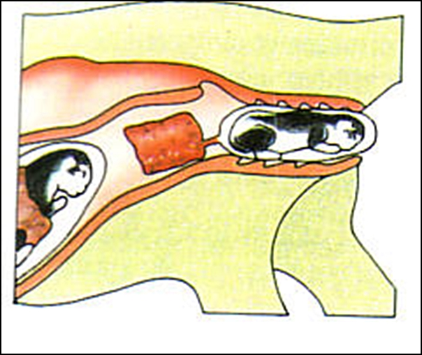

Die Geburt\
Die 3 verschiedenen Geburtslagen:

Die Kopflage ist die häufigste, die optimalste und die normale Lage, da kann es schonmal Probleme geben, wenn der Kopf des Welpen recht gross ist.

Die Rücklage ist mit den Hinterbeinchen zuerst. Meist ist nur ein Schwänzchen sichtbar, dann ein Beinchen. Es lässt nur Probleme entstehen, wenn die Katze Wehenschwach ist. Da muss man helfen. Diese Lage ist keine Steisslage!!

Am schwierigsten ist die Steisslage, bei dem das Kätzchen zuerst mit dem Hinterteil und am Körper angelegten Beinchen kommt, es ist auch kein Schwänzchen sichtbar.
