Und SO kriegen WIR unsere Babys. Ich habe mal die Geburt einer unserer Kätzinnen fotographiert. Da ich die Kätzin immer ganz alleine bei der Geburt betreue, war es ein bisschen schwierig. Man kann dies nur in Bildern festhalten, wenn die Kätzin ganz ruhig ist und sich die Geburt als komplikationslos ankündigt und auch fortsetzt. Dieses war eine Bilderbuchgeburt!

Es ist frühmorgens um 4:10 Uhr, sie lässt mich seit 3 Stunden schon nicht schlafen, maunzt - ich soll bei ihr sein. Das heisst? Frauchen... ich krieg Babys, bleib hier!!

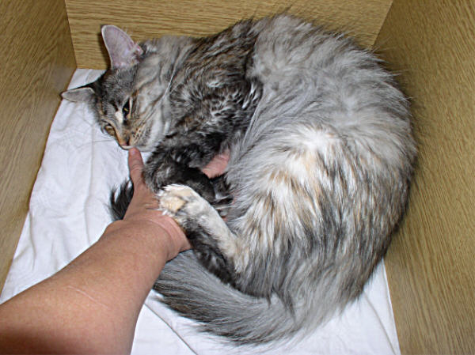

7:30 Uhr, sie ist ganz ruhig und hat seit 20 Min. Wehen, die nun in Presswehen übergehen, jetzt kann alles ganz schnell gehen. Wir sind beide bereit für das 1. Baby. Die Spannung steigt!

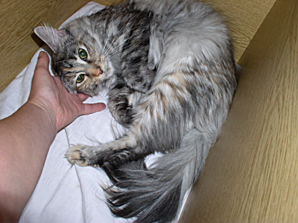

8:10 Hier tritt das Baby schon fast aus. Man sieht die Fruchtblase. Jetzt noch 3-5 Wehenschübe und es ist geboren.

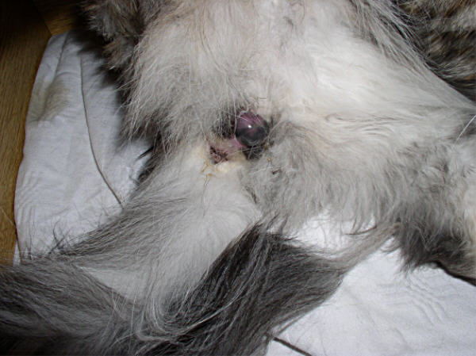

Das ist die optimale Lage, mit dem Köpfchen zuerst. Wer genau hinschaut, sieht hier schon das kleine Schnäuzchen

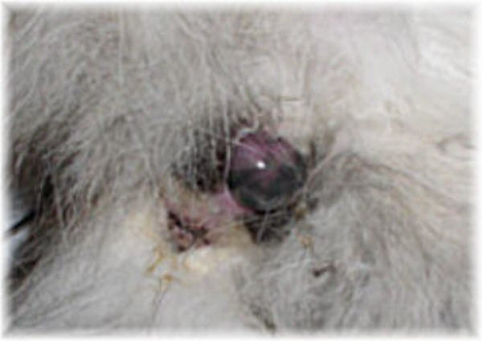

8:20 Uhr. Eine letzte sehr heftige Wehe und das erste Baby ist geboren und wird sofort von Mutter in Empfang genommen, die eifrig beginnt ihr Kind zu lecken.

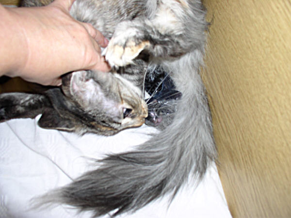

Sie hat vorsichtig die Fruchthülle aufgebissen und das Baby freigeleckt, derweil habe ich die Nabelschnurdurchgeschnitten und die Nachgeburt entfernt.\
Ich lasse Nachgeburten nicht fressen.

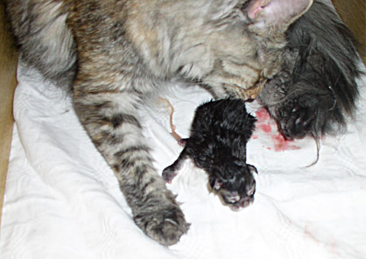

Es ist ein kleiner Kater, black tabby, 136g. Er ist gesund, atmet gut, es stimmt alles an ihm und er ist sehr rege! Jetzt werde ich ordentlich die Nabelschnur kürzen und desinfizieren.

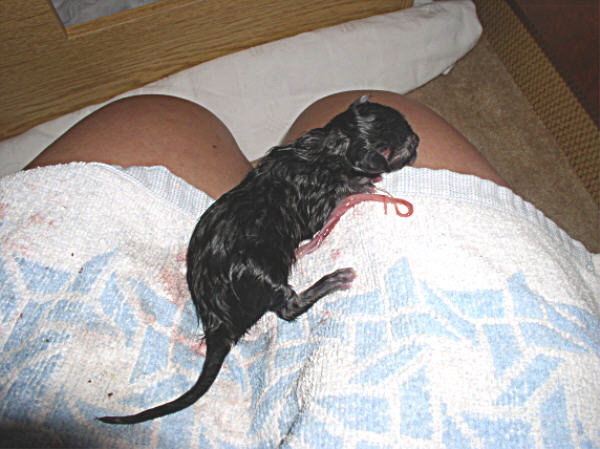

9:15 Uhr, kurze heftige Wehen und das 2. Baby ist ausgetreten, ein Mädchen. Derweil trinkt der kleine Kater schon schmatzend und zufrieden an der Milchbar!

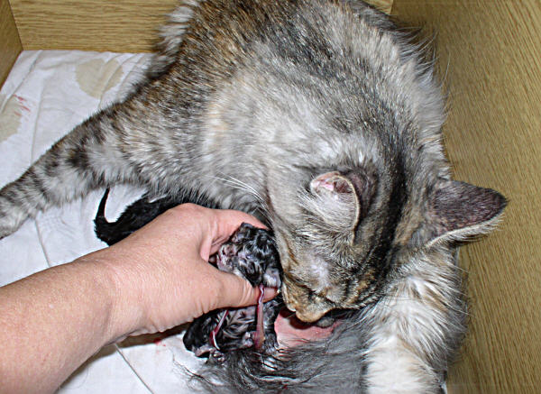

Sofort kümmert sich Katzenmama um ihr Töchterchen in black tabby, 128g. Auch sie atmet gut und auch an ihr stimmt alles! schon schmatzend und zufrieden an der Milchbar!

Gut abgeleckt, abgenabelt und hungrig. Auf gehts an die Milchbar. Es ist eine relativ unblutige, sehr leichte Bilderbuchgeburt.

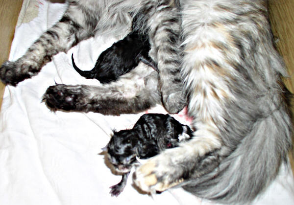

10:30 Uhr. Sie macht eine gute Stunde Pause. Sie ruht, pflegt ihre Babys und dann kommen die nächsten Wehen. Und noch ein Kater in red tabby ist geboren. Das ging zu schnell für die Kamera. Auch bei ihm ist, genauso wie bei den anderen beiden, alles in Ordnung. Er ist ein extrem kräftiger Bursche von 145g, man sieht schon riesige Schaufelpfötchen!

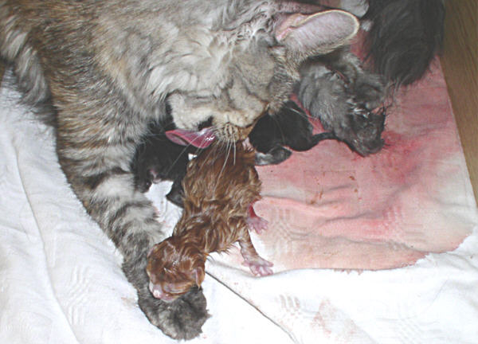

11:00 Uhr Geburt geschafft!

Mutter mit ihren 3 Kindern viele Stunden später\
Es sind, wie bei ihrem letzten Wurf, sehr große gutentwickelte Kitten. Wir sind begeistert!!

12 Uhr.\
Ich habe alle Babys nochmal angeschaut, nochmal gewogen und die Näbelchen versorgt saubere Laken gewechselt, einen Vitamindrink für die Mutterkatze gereicht und selber zwei Tassen Kaffee getrunken.

Derweil hat sie sich top saubergeleckt schnurrt und die Babys haben ihre erste Milch schmatzend zu sich genommen. Nun können wir alle entspannen.\
Sowas macht eine gute Zuchtkätzin aus. Was sind dagegen Ausstellungserfolge?!

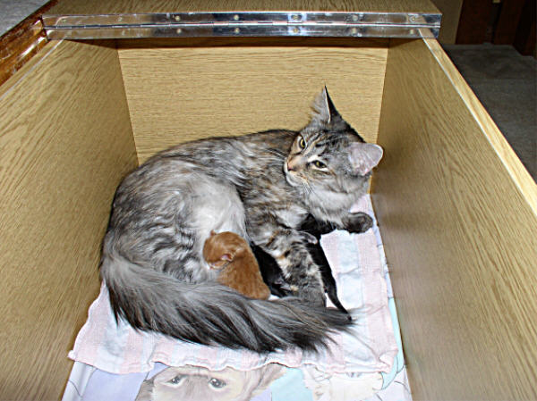
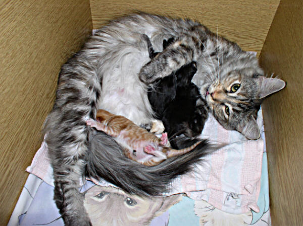
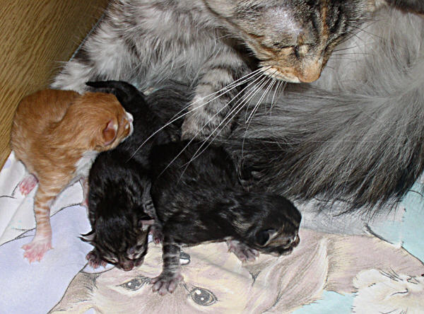

Und das sind sie. Mit 3 Wochen

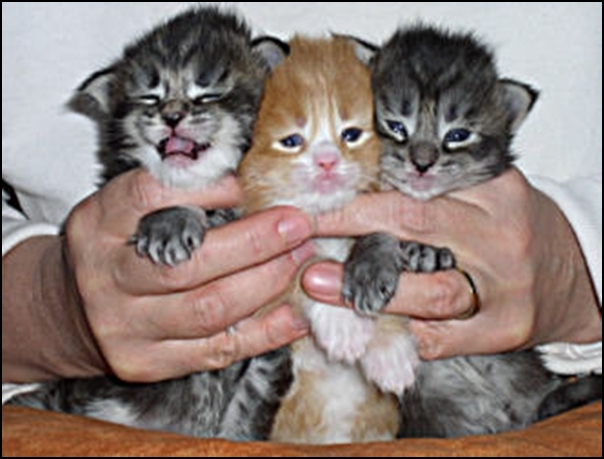

und mit 12 Wochen

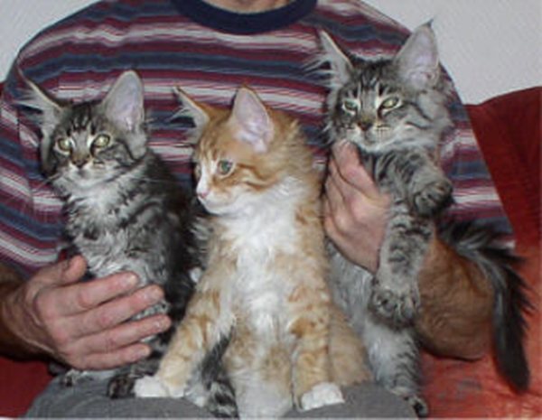
