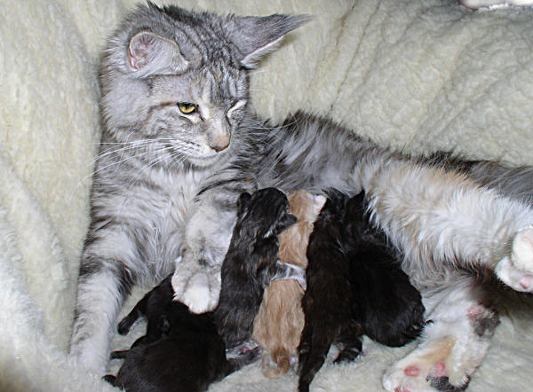
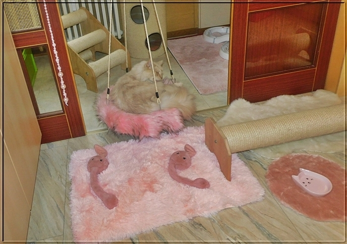
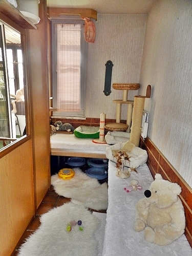

**Die Aufzucht und insbesondere die Sauberkeit der Babys**

Die Babys sind da und die Aufzucht beginnt.\
In den ersten 3 - 4 Wochen ein Bild der Glücksseligkeit, vorrausgesetzt die Mutter ist gesund. Kränkelnde Babys in diesem Alter gehen aus einer evtl. kränkelnden Mutter hervor. Oftmals schlummern auch bakterielle Infekte oder Viren in einer Kätzin was die Babys mickern und kränkeln lässt. Es ist nicht immer sichtbar und feststellbar und die Mutter kann optisch vollkommen o.K. sein. Die Kitten sollten eigentlich schon ab dem ersten Tag zunehmen.

Nun kann es aber sein, das sie in den ersten 2 Tagen auf ihr Geburtsgewicht stehen bleiben oder auch ein paar Gramm abnehmen. Nicht sofort in Panik geraten!! Aber spätestens am 3. - 4. Tag sollten sie die Kurve gekriegt haben und ständig zunehmen und wenn man sie in die Hand nimmt, pralle zufriedene Welpen sein. Mickern sie in den ersten Tagen und trinken nicht bei der Mutter und verweigern auch konsequent die Ersatzmilch, sind sehr unruhig und schreien ständig, ist es ein ALARMZEICHEN und die Mutter muß untersucht werden ob sie evtl zu wenig Milch hat oder das Gesäuge nicht in Ordnung ist (Mastitis??) Aber das ist ein anderes Thema, da will ich hier nicht näher drauf eingehen, das ist ein Fall für den Tierarzt!\
Aber gehen wir mal davon aus, das alles gesund ist!!!

Ab der 3. Woche werden die Babys aktiv, ab der 4. Woche krabbeln sie schon in die bereitgestellten Miniklöchen, probieren und fressen am Katzenstreu. Das Futter wird angeknabbert, aber Hauptquelle ist Mama, dort holen sie sich noch alles was sie brauchen. Dann ab der 5. Woche wird schon öfter und mehr am Futter probiert und das Klöchen öfter besucht. Nun beginnt die Schweinerei, es beginnt die Sauberkeitsphase. Die Mutter macht sie nicht mehr sauber und nun wird es NICHT IMMER unproblematisch!!

4 Wochen alt und neugierig. Und, die ersten Pipis.

Es sollten unbedingt ausreichend Klos aufgestellt werden in verschiedenen\
Stufen. Diese Menge ist für 4 Babys.

Die Kleinen nehmen die Klos erstmal als Spielplatz. Das ist völlig o.K. denn nur darüber lernen sie auch die Benutzung. Manchmal schlafen sie auch im Klo ein. Das ist auch nichts ungewöhnliches. Auch Spielzeug und Mäuse werden mitgenommen.

Ich habe Würfe gehabt, die stapften hinter Mama her ins Katzenklo und waren fortan sauber, es gab 0 Probleme, ab der 5. Woche landeten alle grossen und kleinen Geschäftchen ins Klo.\
Aber dann hatte ich auch Würfe, die wollten es einfach nicht lernen, pieselten und häufelten in die Ecken oder neben das Klöchen, traten in ihr eigenes Geschäftchen so richtig kleine Schweinchen und mein Putzeimer wurde gar nicht mehr trocken. Ich hatte einen kleinen Kater aus meinem Wurf, den sein grosses erstes Geschäft so anstrengte, das er auf seinem Haufen eingeschlafen war und mit dem Bauch drauflag, es war doch so schön warm. So fand ich ihn. Eine Episode hatte ich, als ein Kitten sein grosses Geschäftchen erledigte und Brüderchen musste ganz interessiert schauen, was da passierte. So ging das was ins Klo sollte, leider auf den Kopf des Bruders. In der Umstellungsphase ist der Kot manchmal breiig und so fing mein Tag wieder perfekt an!!\
Da muss man natürlich Hand anlegen können und darf sich nicht ekeln. Das sind Episoden, die die Jungtierkäufer die in eine saubere Kittenstube kommen und alles niedlich finden, natürlich nicht sehen und mitkriegen. Und ich muss immer in mich reinschmunzeln, wenn der Ausspruch kommt. OOHH haben sie ein schönes Hobby, das würde ich auch gerne erleben.

Aber nun zurück zu den kleinen Schweinchen

Nun heisst es Geduld und Nerven behalten und Zeit investieren. Der Züchter ist gefragt, denn der Mutter ist es ziemlich egal, ob die Kinder in die Ecken machen. Der Züchter muss die Lernrolle übernehmen, denn hält das Katzenkind es erstmal für selbstverständlich überall hinzumachen, gibt es Probleme auch eventuell nach Abgabe des Jungtieres bei dem neuen Besitzer.

Als erstes müssen die Kleinen eingegrenzt werden und dürfen auf keinen Fall in der ganzen Wohnung rumlaufen. Ein Kittenbereich bis 8 Wochen ist sowieso generell zu empfehlen. Man muss sich die Zeit nehmen und die Minis überwachen und immer und immer wieder in Klo setzen, wenn sie die Ecken aufsuchen oder quickig oder unruhig werden. Es empfiehlt sich eine Klo Landschaft aufzubauen, mit mehreren kleinen flachen Schalen in verschiedenen Höhen.

Ich hatte da schon hartnäckige kleine Dickköpfe, die immer wieder aus dem Klo rausrannten und eine Ecke aufsuchten. Aber meine Hartnäckigkeit ist auch nicht zu unterschätzen.Mit 8 Wochen sollten auch Nachzügler und Mäkler selbständig fressen und absolut sauber die Katzentoilette aufsuchen, ansonsten ist was verkehrt gelaufen. Der Nachtisch wird noch bei Mama geholt, es ist aber mehr Sozialpflege wie Hunger. Die Babys sollten sich jetzt hauptsächlich unter den Geschwistern beschäftigen und toben toben toben!! Babys sind mit 8 Wochen süss und lustig anzusehen, können aber sehr stressig sein und manchmal die Nerven strapazieren, da sie alles entdecken wollen.

Am besten ist für die Aufzuchtszeit, wenn man einen eigenen Bereich für die Babys herrichtet, so können sie am besten und schnellsten stubenrein werden und sind geschützt und die grossen Katzen haben ihre Ruhe vor diesen kleinen Gremlins.

Beispiel\
Hier Fotos vom Kittenbereich

Hat ein Züchter seinen ersten Wurf von 4 - 5 Babys aufgezogen und umsorgt mit allen Höhen und Tiefen, mit allen Sorgen und Freuden - und alle gut untergebracht und er sagt sich, es war doch überwiegend eine schöne Erfahrung und hat Spass gemacht und er plant schon wieder im Kopf den nächsten Wurf, dann - ja dann, ist er vom Virus \>ZÜCHTEN\< infiziert

[**Zurück**](/interessenten/zuechterseite/)
