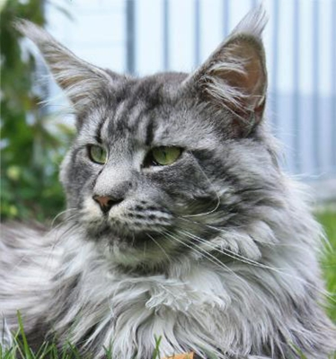
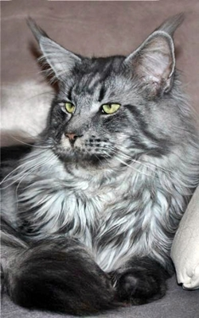
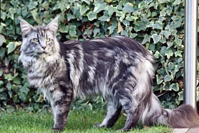

Ein Wort zu unseren Zuchtzielen

Als erstes muß ich vorab sagen, das ich mich zwar immer an den vorgegebenen Standard der Rasse Maine Coon halte, ich aber nicht für die Ausstellungsrichter züchte, denn jeder Richter sowie auch jeder Züchter hat andere Vorlieben bei der Rasse Maine Coon. Der eine mag die langhaarigen, der andere mag lieber etwas kürzeres Fell. Der eine mag den alten, der andere den modernen, der nächste den Extremtyp.\
Und jeder Züchter hat es schon irgendwann einmal erlebt das der Kater der vor kurzem ein best in Show und best of best machte auf der nächsten Ausstellung eine Bewertung bekommt, das man glaubt man fährt mit einem Meerschweinchen wieder nach Hause.

Ich für mich gehe da meinen ganz eigenen Weg. Ich habe einen ganz bestimmten Typ vor Augen, den ich immer weiter anstrebe, perfektionieren möchte und teilweise auch schon über die vielen Jahre erreicht habe, manchmal hats nicht geklappt oftmals hats geklappt und die Ergebnisse haben mich zufrieden gemacht.

Der Look den ich bei meinen Coons und dessen Nachwuchs sehen will, ist ein ganz bestimmter Ausdruck im Gesicht, das ein Gemisch aus Wildlook, Schmusegesicht und leichter Arroganz zeigt mit relaxter Ausstrahlung.

Das ist der Look den ich bevorzuge und den ich\
immer weiter festigen und perfektionieren möchte

Ich bevorzuge zwar sehr große Ohren mit Pinsel, mal etwas weniger (gerne mehr), aber nicht die Ohren die Kerzengerade hochstehen wie bei einem Schäferhund, sondern für mich dürfen sie ganz leicht abgeneigt sein, sonst verliert sich mein Look den ich bevorzuge.

Ich mag und züchte die extrem hochbeinigen und langgestreckten Körper, aber mit kräftigem Bau, denn für mich ist Größe Hochbeinigkeit und nicht Gewicht. Gedrungene massige Köper die viel Gewicht haben, wie es bei manchen heutigen Maine Coons noch zu sehen ist, ist nicht mein Zuchtziel.

Das ist der Maine Coon-Wuchs den ich sehen\
will bei meinen Nachwuchstieren

Wenn ich selektiere und Nachwuchs behalte, ist das größte dickste und das Kitten das am besten gedeiht gerade gut genug. Wenn dann bei der Entwicklung alles andere auch noch stimmt, wie Typ, Profil (klappt nicht immer, aber meistens) und Charakter, ist es für mich perfekt.

Ich bevorzuge sie nicht, die extrem langhaarigen Coons mit überdimnesionaler Halskrause. Für mich ist eine Coon immer noch eine Halblanghaarrasse und keine Halbperser. Ich sehe lieber einen dicken Backenbart, der den Kopf umrahmt.

Ich achte unbedingt auf, für meine Zucht beste Linien. Natürlich ist das für mich einfach nach so langen Jahren, denn ich kenne sie fast alle, die Guten, die Besten und die von denen ich besser Abstand halte. Linien die ich nicht über Jahre beobachtet habe und überhaupt nicht kenne werden bei mir nicht eingeflochten.

Nicht immer klappen die hochgesteckten Zuchtziele und Kitten aus Würfen sind schonmal unterschiedlich. Auch bei Menschenkindern gibt es bei den Geschwistern Unterschiede, das eine Kind ist ein sehr selbstbewußtes in sich ruhendes Kind, das Geschwister ein ängstlicher Zappelphillipp. Sonst wären sie geklont. Und auch aus noch so gesunden Linien treten hier und da Krankheiten auf von denen man nichts ahnt, trotz aller Gesundheitsvorsorgungen, Schallungen, Bluttests und Gentests.

[Zurück](/)
