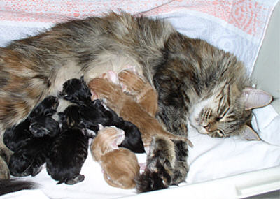

Diese Seite habe ich mit viel Mühe aus meiner fast 30jährigen Zuchterfahrung erarbeitet,\
für Zuchtanfänger und Einsteiger mit vielen Bildern, Tipps usw.\
**Alle Inhalte, Fotos und Texte auf diesen Seiten, unterliegen meinem Copyright und dürfen nicht kopiert oder verwendet werden. Dies stellt eine Urheberrechtsverletzung und somit einen Straftatbestand da.**

Zuchtplanung

Deckkaterhaltung

Verhütung oder rollen lassen?

Die Geburt. Freude oder Probleme?

Die Geburt in Wort, Zeichnung und Fotos

Geburtsprobleme

Die Geburt der Kitten unserer Branda

Kittengewichtstabelle

Die Aufzucht - insbesondere das Erlernen der Stubenreinheit

[Welche Farben können im Wurf fallen?](/interessenten/ahnentafel/)

Baden für die Show

[Was ist ein Zuchtziel ?](/interessenten/geburtc/)

[Kleine Waisen. Die Flaschaufzucht](/interessenten/indexfoto/)

[Mahagonys Frühgeburt](/interessenten/award2/)

Meine Einstellung zur Zucht muß nicht mit Ihrer Einstellung konform gehen und darum bitte keine Emaildiskussionen\
mit mir, wenn Sie anderer Meinung sind, andere Erfahrungen und andere Richtwerte für Ihre Zucht haben. Danke!

[Zurück](/)
