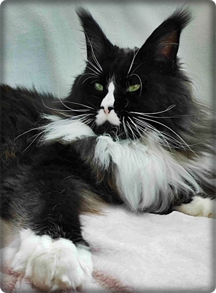
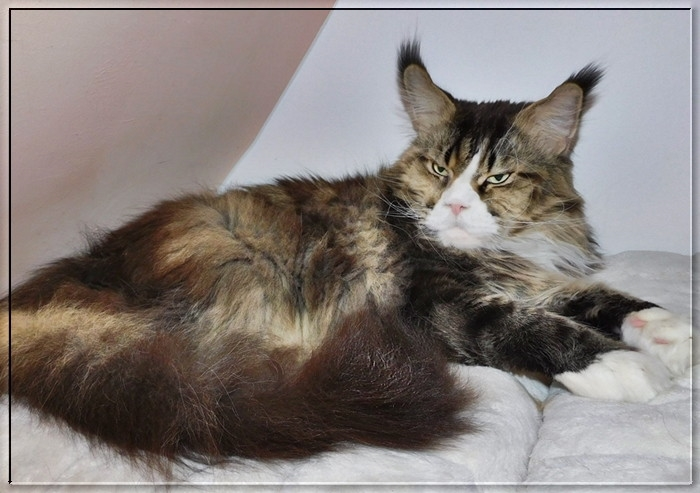

Unsere Kater

Klicken Sie die Fotos an um mehr zu erfahren

**Die Schallergebnisse und Gentests sind hier bei mir einzusehen!!**

\>Big Giant Resort Ouzo for me\<\
black/white

1 Schallung HCM/PKD negativ\
am 7.5.2019 bei Dr. Kresken\
und dann fortlaufend:\
2\. Schallung 23.7.2020 HCM negativ\
3\. Schallung 14.10.2021 HCM negativ\
4\. Schallung 8.12.02022 HCM negativ\
5\. Schallung 8.8.2024 HCM negativ

Gentests\
HCM - N/N\
SMA - N/N\
PKdef - N/N\
Factor 11 - N/F11\
Blutgruppe - N/N

(Klick auf das Foto)

**Mein Zacko, mein Herz**

12 Jahre alt\
Vater, Großvater und Urgroßvater vieler vieler Starbushway Kinder.\
Eine seiner Töchter und zwei seiner Enkelkinder leben in unserer Zucht\
und sorgen hier für Nachwuchs\
**Auch er ist mehrmals HCM/PKD negativ geschallt**\
**HCM/SMA/PKdef Gentests N/N**

[Hier unsere Zuchtkater aus den vergangenen Jahren 1983 bis 2019 Klick hier](/kater/zuchtindex1oldi/)

[Zurück](/)
