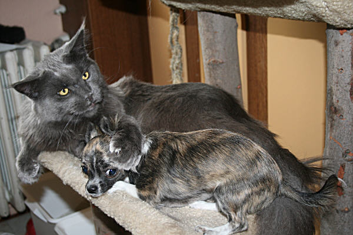
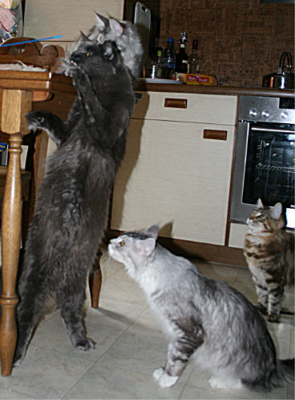
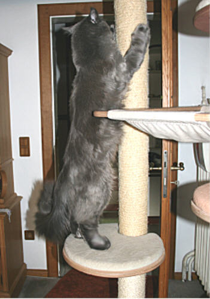
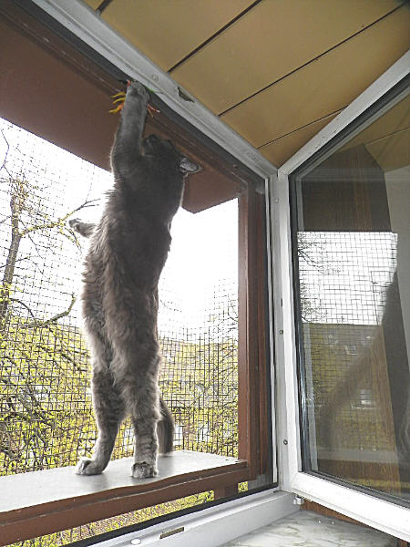

Starbushway Blue Bambule\
Farbe: blue smoke

Ein Riese seiner Rasse!! Wir züchten mit 2 seiner Töchter weiter.

Sein Typ ist sehenswert, seine Grösse, sein langgestreckter massiger Body auf extrem hohen Beinen, mit einem Gewicht das uns beeindruckt. Er ist kein Zufall, Bambi ist das Produkt einer Linienkombination die uns Größe versprach, denn seine Mutter Xanadu ist ein riesiges Mädel im Katerformat von 7 Kg!! Dazu das Wesen eines Teddybären im Gegensatz zu seinem Outfit, das einer Raubkatze gleicht. Bambi ist als Deckkater leicht zuhalten, er katert nicht,spritzt nicht und ist mit allen (auch unseren anderen Katern) immer gut Freund, ein sehr sanfter ruhiger angenehmer Kater, der genügsam ist. Er ist einfach mit allem zufrieden. Alles was im Stammbaum seiner hervorragenden Eltern steckt, zeigt Bambi uns - und das jeden Tag mehr!\
Unser Knuddelteddy erfreut uns mit seinem Aussehen und seinem Charme.Seine Kinder sind einzigartig, traumhaft\
schön und sehr sehr lieb!!!\
Am 09.Dez.2011 wurde er in der Duisburger Tierklinik Kaiserberg (Dr. Kresken) das 2. mal HCM negativ geschallt, mit besten Werten. Gentest: N/N (Bluttest bei Laboklin)

Bambi mit unserem Hündchen Chiqua

**Stammbaum von Blue Bambule**

Geschlecht :

**männlich**

Farbe :

**blue smoke**

Eltern

Großeltern

Urgroßeltern

Vater:\
Jack Daniels\
of Saxony Forest\
black smoke

Valentino\
of Baydar\
black tabby cl/white

**WillowplaceShakari**

**Rhapsody in Blueof Baydar**

Sweet MaNas\
Amy Lou\
black silver cl torbie

**SunweaselsAl Capone**

**MichigansBlack Babette**

Mutter:\
Big Giants\
Xanadu\
blue

Top Gun\
of Summerplace\
blue smoke

**WitchcatsSergeant Pepper**

**TailchaisersMrs. Doubtfire**

Xena\
of Gentle Lions\
black tortie

**AloasTullmoon Crusader**

**Mountaineers Pink Lady**
