Ehemalige Deckkater bei Starbushway 1983 - 2022\
Alle diese Kater haben bei uns für Nachwuchs gesorgt und wurden nach ihrer Zuchtzeit kastriert und leben bei\
Liebhabern - oder sind altersbedingt über die Regebogenbrücke gegangen\
**(von unten nach oben lesen)**

\>Starbushway Deputi\<\
wurde 11 Jahre alt\
cream smoke\
**HCM/PKD negativ geschallt bis 8 Jahre**\
HCM/SMA/PKdef - Gentests N/N\
Vater, Großvater und Urgroßvater\
vieler vieler Starbushway Kinder. Eine\
seiner Enkelinnen lebt in unserer Zucht

[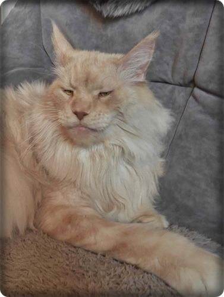](/kater/zuchtkater6/)

\>Mainefield Sgt. Pepper\<\
ist 14 Jahre alt\
cream smoke\
**HCM/PKD negativ geschallt bis 8 Jahre**\
HCM/SMA/PKdef - Gentests N/N\
Vater, Großvater und Urgroßvater\
vieler vieler Starbushway Kinder. Eine\
seiner Urenkelinnen lebt in unserer Zucht

[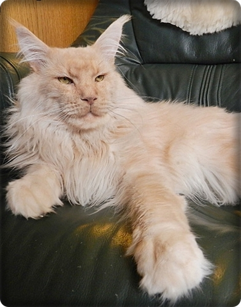](/kater/zuchtkater2/)

Starbushway Nashota\
ist 15 Jahre alt\
N/N

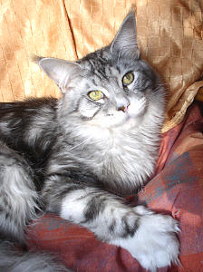

**zeugte bei uns 4 Würfe nur im Jahr 2008**

Renommee vom Blautopaz\
ist 15 Jahre alt\
N/N

[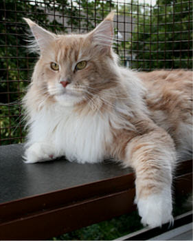](/kater/zuchtkater1/)

**zeugte bei uns 4 Würfe im Jahr 2009**

Starbushway Blue Bambule\
ist 17 Jahre alt\
N/N

[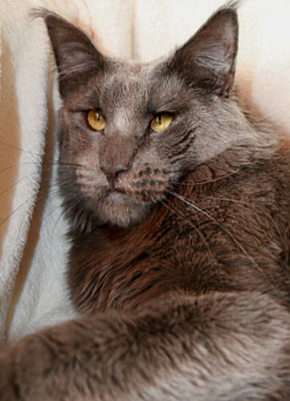](/kater/zuchtesperanza/)

**zeugte bei uns 7 Würfe**

Superstar Sajan

wurde ?? Jahre alt

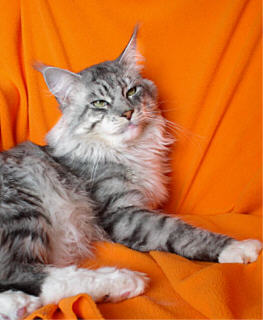

**Er deckte bei uns 2007**

Langstteich CaBonero

wurde 12 Jahre alt

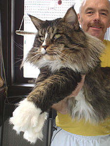

**war 9 Jahre ab 2000 unser Deckkater**

Jack Daniels of Saxony Forest

wurde ?? Jahre alt

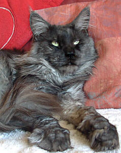

zeugte bei uns 4 Würfe

Chico vom Elfengarten

wurde 19 Jahre alt

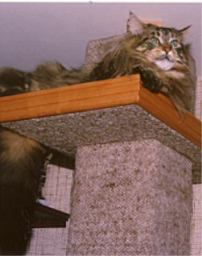

Er war bei uns 10 Jahre Deckkater

Cuddle Bears L.Joe

wurde 14 Jahre alt

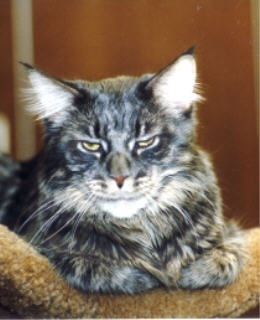

Er deckte bei uns 2001

Langstteich O´Hio

wurde 14 Jahre alt

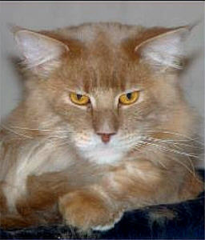

**Er zeugte bei uns 4 Würfe im Jahre 2003**

1990 - 1998

The Dream Coon King Dark

wurde 21 Jahre alt

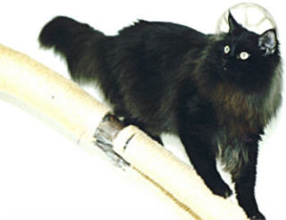

**Er deckte bei uns 1997**

Starbushway Rebound

wurde 11 Jahre alt

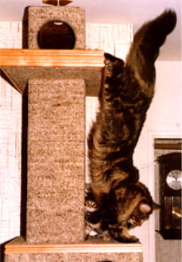

1983 - 1990

Tolkat Wizard G. (aus USA),

wurde 18 Jahre alt

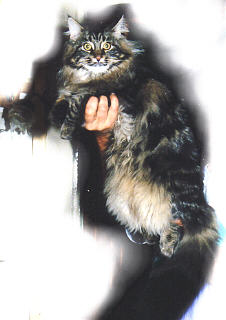

Er deckte bei uns\
bis 1992

Tanstaafl Barry (aus USA)

wurde 9 Jahre alt

Er zeugte bei uns 3 Würfe im\
Jahre 1989

Earl of Devonshire

wurde ?? Jahre alt

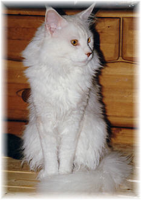

er zeugte bei uns 2 Milleniumswürfe\
im Jahr 2000

Campari of Fairygarden\
Unser 1 Deckkater\
geb.1983.....gest.2003

wurde 20 Jahre alt

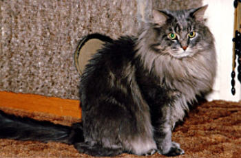

Er war ab 1983, 10 Jahre unser Deckkater, nach\
der Kastration mit 10 Jahren lebte er als Kastrat\
nochmal 10 Jahre bei uns. Mit 20 Jahren ging er
