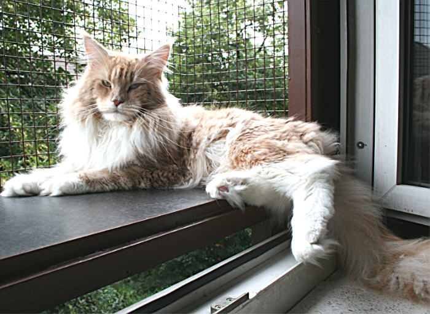
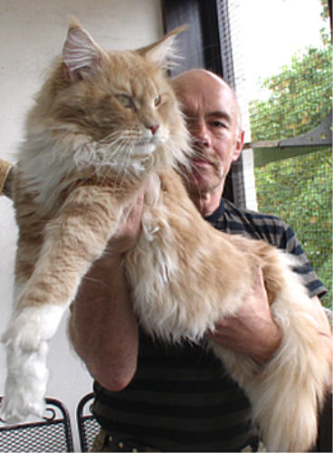
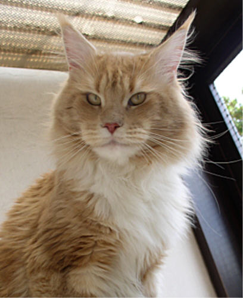

Renommee von Blautopaz\
cream tabby classic/white\
Renommee mit seiner umwerfenden Ausstrahlung!!\
Renommee hat uns wunderschöne Babys mit verschiedenen Kätzinnen gebracht. Nun ist es wieder an der Zeit züchterisch neue Wege zu gehen und so ist dieser traumhafte Junge kastriert. Seine Tochter Townwalk ist bei uns geblieben.

Ein mächtiger Kater mit einem riesigen Kopf und einem Wildlook der besonderen Art

Sein Wesen ist sanft, lieb, gesprächig und anhänglich wie ein Hund

**Stammbaum von Renommee vo Blautopaz**

**\*24.04.2008**

Geschlecht :

**männlich**

Farbe :

**cream tabby cl/white**

Eltern

Großeltern

Urgroßeltern

Vater:\
Langstteich\
P´Explosive\
blue tabby cl

Langstteich\
CC.O´Predicat\
blue smoke

**Langstteich C.Countdown**

**Langstteich O´Perah**

Emy Shou\
vom Mönchswalder Berg\
black tabby cl

**Superstar Buddy**

**Xena of Starbushway**

Mutter:\
Firedevils\
United Colours\
bllack tortie/white

Overlord\
Sparrow of Firedevils\
black/white

**Overlord Nutchezz**

**Overlord Exotica**

Amerrykoon\
Elektra P.\
blue torbie cl/white

**Charlemaine P.Finest**

**Amerrykoon P. Elizabeth**
