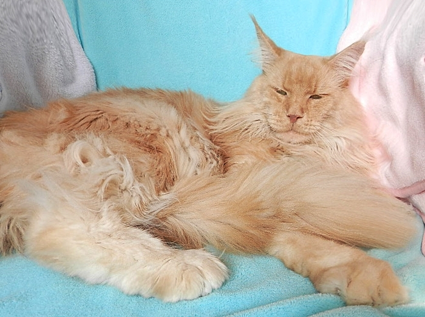
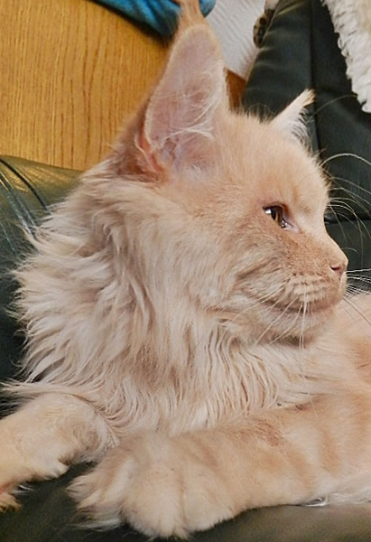
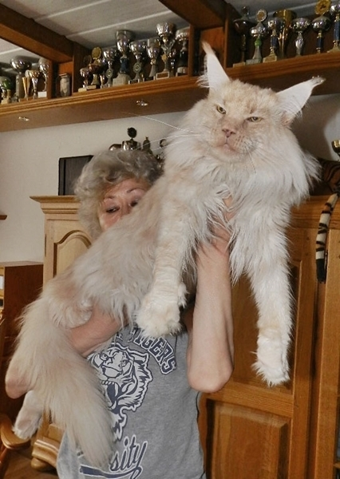
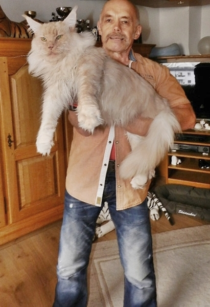

\>Mainefield Sgt. Pepper\<\
Farbe: cream smoke

Bei uns wird er liebevoll Peppi gerufen. Er ist ein Schatz in jeder Beziehung. Er zeichnet sich nicht nur durch einen außergewöhnlich extremen Luchstyp, durch seine Größe und seiner atemberaubenden Ausstrahlung aus, sondern vorrangig hat er ein Wesen das für einen Deckkater einfach nur ein Glücksfall ist.\
Er ist HD geröngt und hat einwandfreie Hüften. Er ist HCM/PKD geschallt, das letzte mal (zum 5. mal) mit 6 Jahren, mit allerbesten Werten.\
Laut Aussage von Dr. Kresken, braucht er keinen Schall mehr. O-Ton: Der hat nix und der kriegt auch nix mehr!\
Wir schauen auf zahlreiche traumhafte Kinder, Enkel, Urenkel .......und und und zurück.

Stammbaum Pepper

Eltern

Grosseltern

Urgrosseltern

UrUrgrosseltern

Vater:\
Summerplace\
Avalon\
red smoke

Q´s Blue Bear\
of Magic Love\
blue smoke

Eyck from\
Glowing Eyes

TimberhillsMadrs

Svenja vom Altwasser

DK\* Mountaineer´s\
Pink´n Ink

Belushis Utah

DK\* Shantys AutummBliss

Summerplace\
Tessa\
black tortie

DK\* Shantys\
Hijacker

DK\* Shantys Blackout Bounty

S\* Glowcoons Ballerina

A\* El Dorado\
Nelly Yattu

A\* Big Geronimo of El Dorado

A\*Hakada of El Dorado

Mutter:\
A\* Mainefields\
Amelie Poulain\
black silver torbie mc

A\* Mainefield´s\
Camelot\
red silver tabby cl

PL\* Top Coon\
Caruso

CZ\* ZZ Top of Gentle Lions

PL\* Anya Avica Wiktoria

PL\* Galadriela\
Silvi-Cola

FIN\* Escape Never Ending

PL\* Chickabee Sivi Cola

A\* Island in the Sun\
The Purfect Coon\
**black** **smoke**

A\* Gangsta Guy\
the Purfect Coon

Cooncolonia Jackson

Wildborn Jolena

DK\* Castle Rocks\
Veronica Fever

Windwalker Blue Thunder

DK\* Guldfakse Boppin Out
