\>Starbushway Deputi\<\
cream smoke \<

Ein unvergleichlich schöner Sohn von unserer Nachwuchskätzin "Baby Jane" und unserem "Blue Bambule". Vom Outfit braucht man nun wirklich gar nichts zu schreiben, die Bilder geben ihn ganz genau her. Maine Coon Freaks die diesen Typ mögen und dazu auf Größe stehen, sind in ihn vernarrt und ich hatte mit Sicherheit mehr als 10 Anfragen für den herrlichen Jungen schon als Jungtier und bei Besuch war abschließend immer eine gründliche Taschenkontrolle nötig. Heute ist das nicht mehr möglich, da brauchts schon einen Koffer.\
Diese Puderquaste ist nicht nur groß und megahochbeinig und sehr sehr schwer, sondern auch lieb lieb lieb. Wer seinen Vater Bambi und seine Mutter B.J. kennt wird es wissen. Mit tollen Ohren versehen, dicken, ständig tretelnden Pfoten und einer Schnauze die man immer knutschen könnte, ist er ein perfekt gelungenes "Produkt" aus Starbushway!! Ein Riesenteddy mit einer ausgeprägten Löwenschnauze.

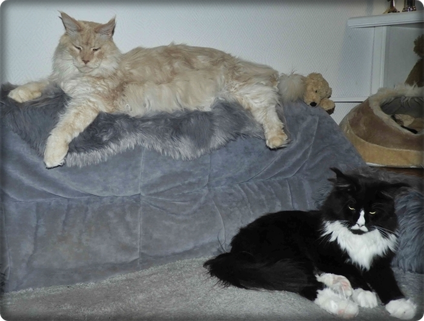
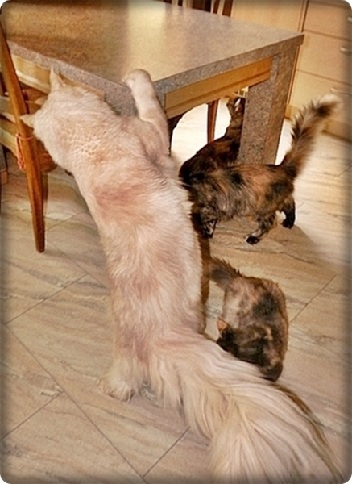

Jedem Besucher der zu uns kommt bleibt er unvergesslich, alle mögen ihn nicht nur wegen seines schluffigen Charakters, sondern auch die imposante Größe, läßt die Besucher immer wieder fragen: "Darf ich den mal hochheben??" Er hatte schon als Baby seine Fans und so ist es auch geblieben.\
Gewicht mit 3 Jahren (unkastriert!!!): 12,5 Kg

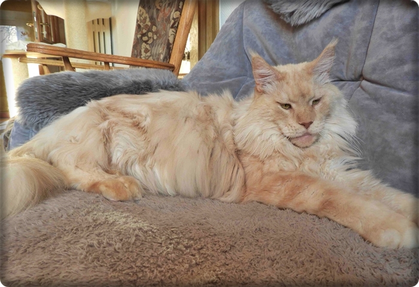
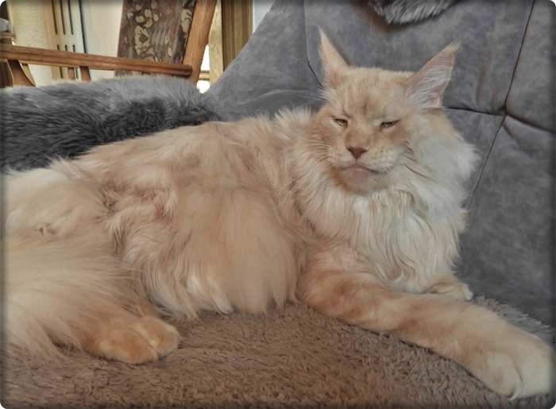
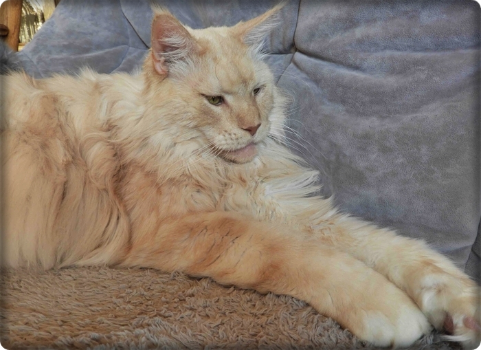

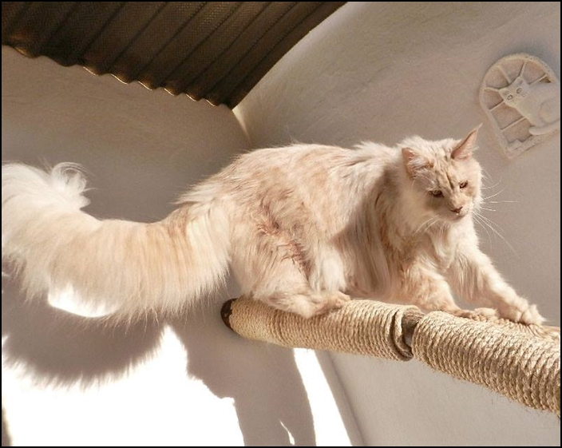

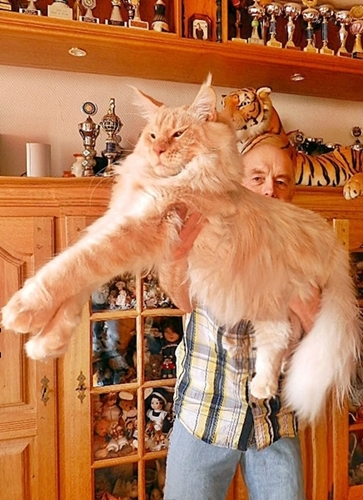
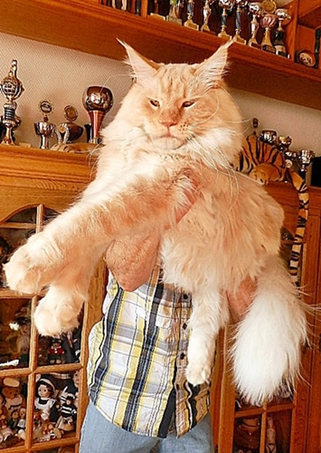

Auf einen Stuhl oder gar auf einen Schoß passt er schon längst nicht mehr,\
obwohl er es mit einer unglaublichen Hartnäckigkeit immer wieder versucht

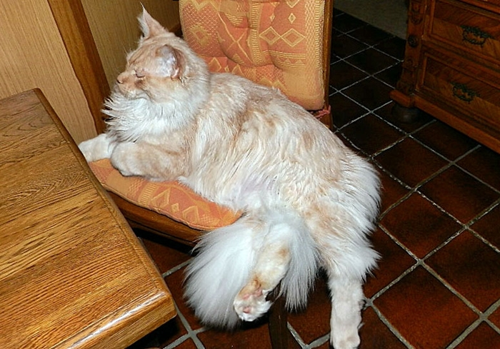

Riesenpfoten schon hier mit 4 Monaten

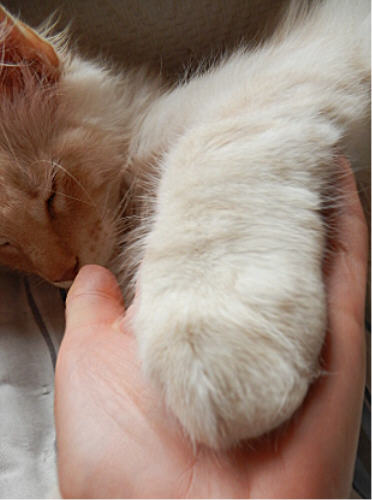
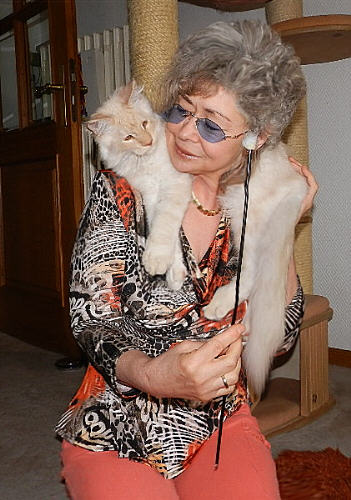

12 Wochen

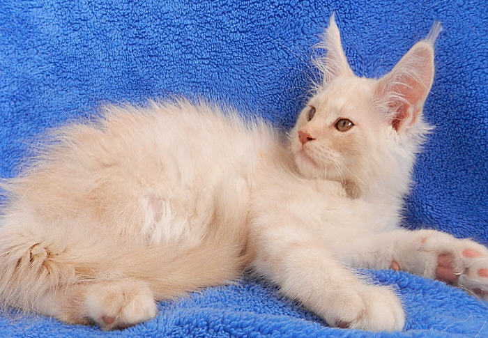

Mit seiner Mutter "Baby Jane" B.J. genannt\
B.J. mit ihrem unvergleichlichen Charakter!!

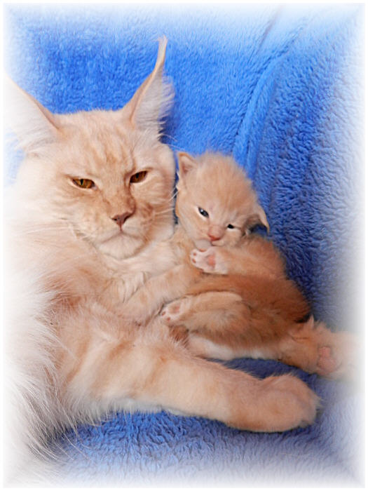

Hier mit Iris im Alter von 10 Tagen,\
da sieht man schon sein Potential

[Stammbaum Deputi](stammdepi.jpg)
