Big Giant Resort "Ouzo for me"\
black/white\
**[Stammbaum Pawpeds](https://pawpeds.com/db/?a=p&id=1480175&g=4&p=mco&o=ajgrep)**

Ein Herzbube in schwarz/weiß **Ouzo for me** war mein Wunschname.\
Was soll ich sagen, er ist sowas von klasse und ich kann mich nicht an ihm sattsehen. Sein Look mit langer Schnauze, gutem Profil und perfekter Nasenlinie. Die Ohren sind der Brüller. Sehr große Ohren mit Bürsten drauf. Ganz genauso wie ich sie sehen wollte!! Ein einzigartig ruhiger Charakter.

Er ist ein Schatz in jeder Beziehung. Er zeichnet sich nicht nur durch einen außergewöhnlich extremen Typ und einer atemberaubenden Ausstrahlung aus, sondern vorrangig hat er ein Wesen das für einen Deckkater einfach nur ein Glücksfall ist. Unkompliziert und ohne Katerverhalten deckt er, wenn die Mädels rollig sind und lebt fast wie ein Kastrat, wenn kein Mädel rollt!! Als Deckkater ist er bis jetzt einfach zu halten und läuft ohne Probleme zusammen mit der Mädelsgruppe und unseren anderen Katern ohne sie zu dominieren und zu bedrängen, völlig ohne Katerallüren. Er ist sehr lieb, sanft und verträglich. Er markiert nicht und alle seine Söhne markieren auch nicht. Seinen Kitten ist er ein ganz liebevoller Papakumpel, er putzt sie, spielt mit ihnen und erzieht sie. Er hat hier nun schon viele Kitten mit einigen verschiedenen Mädels präsentiert und  hat bewiesen.... **er ist ein TOP Vererber**!!!

Seit 7 Jahren sorgt er hier bei uns für sehr schönen Nachwuchs. Mit 7 Jahren wurde er nochmals HCM geschallt, mit allerbesten Herzwerten! Nun braucht er nicht mehr geschallt werden.

Ouzo 7 Jahre alt

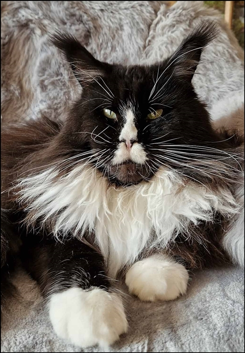

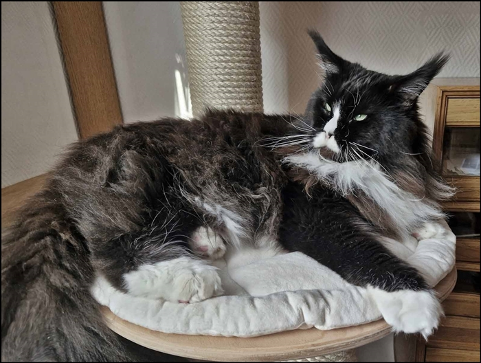

Perfekte Größe\
4,5 Jahre

Perfekter Kopf mit smaragdfarbenen grünen Augen\
auf dem Foto 3 Jahre alt.

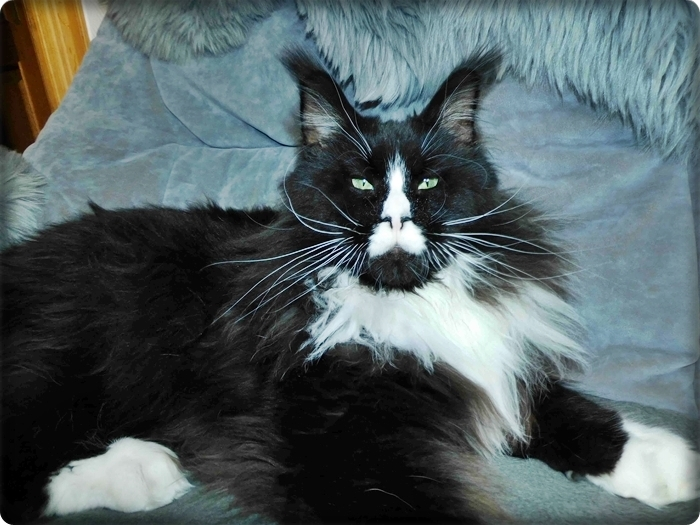
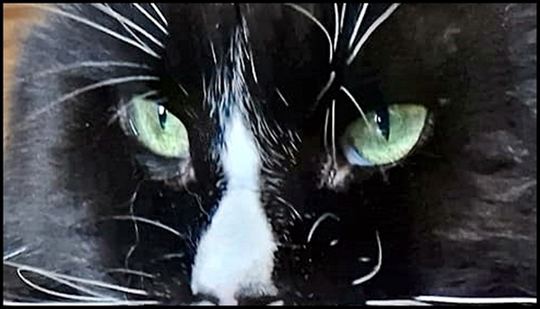

Perfektes Profil und Nasenlinie

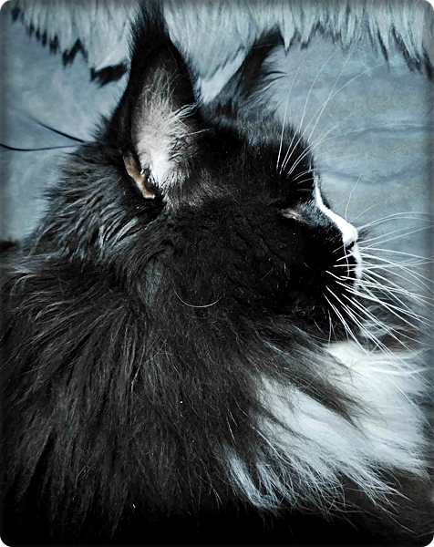

Perfekte Pinselohren

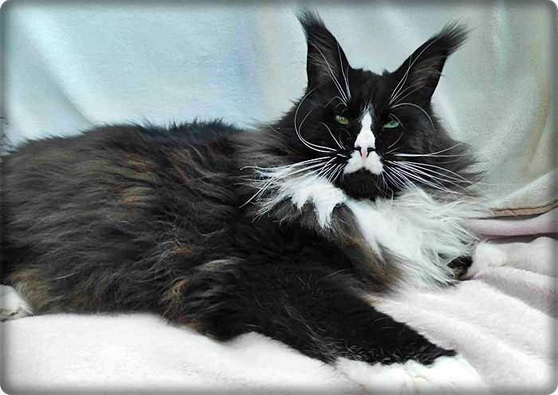

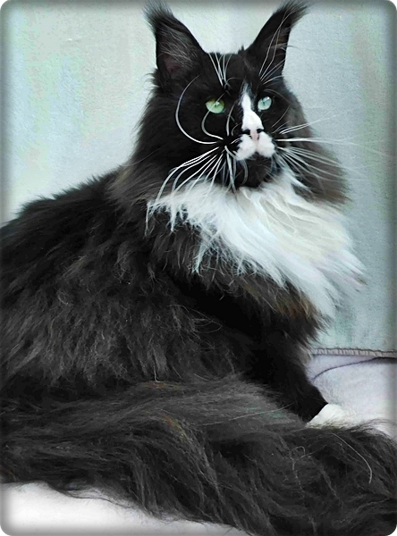
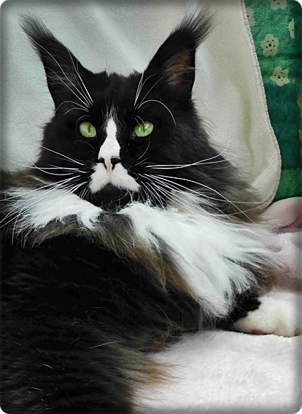

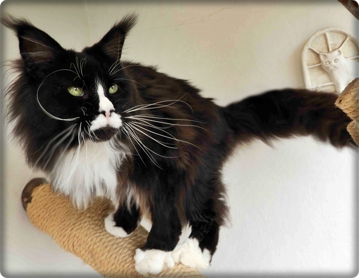

1 Jahr

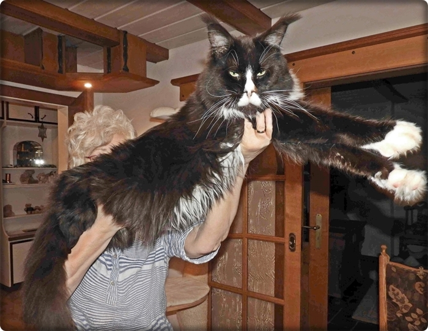

Ouzo links mit 15 Wch und rechts mit 10 Monaten

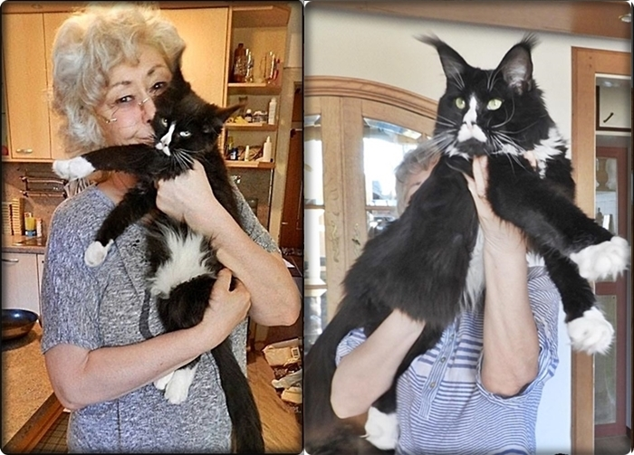

4 Monate

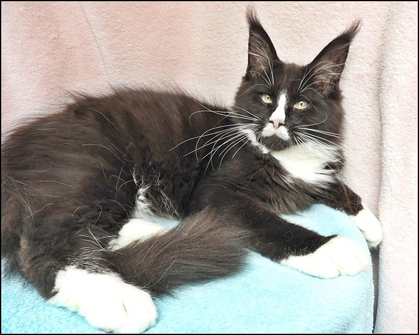

Der Vater, ein Import aus Rußland \*RU

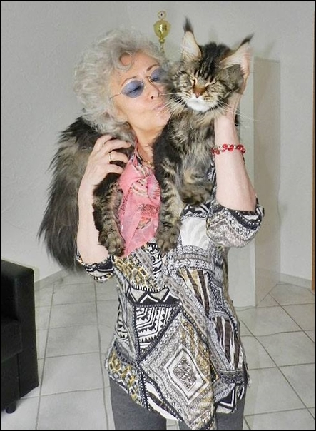
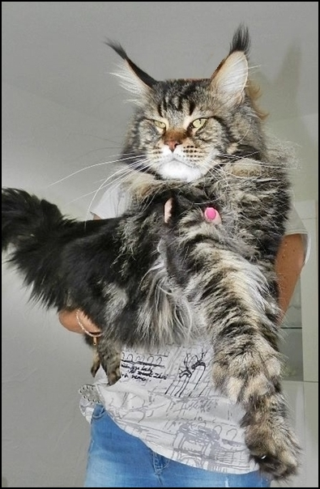

Seine Mutter ein Tschechienimport \*CZ

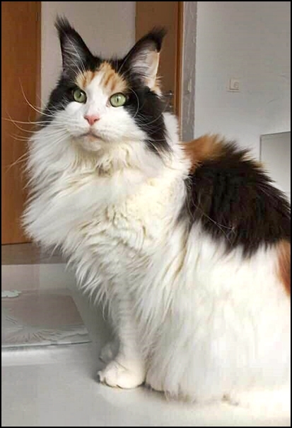
