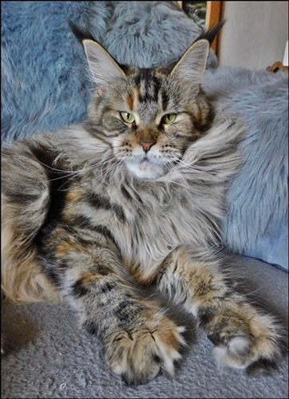
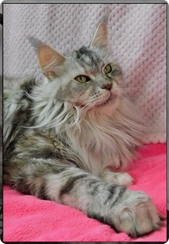
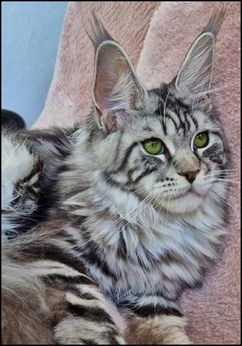
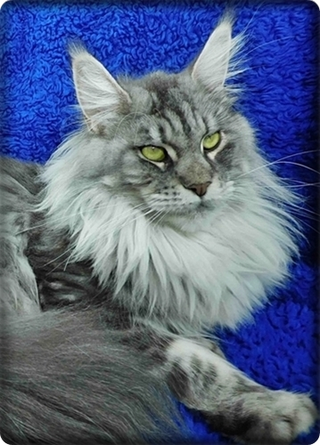

Unsere Mädchen

**Die Schallergebnisse und Gentests sind hier bei mir einzusehen!!**

Klicken Sie die Fotos an um mehr zu erfahren

Legendarys Chinook Blue\
**blue**

Jechaburger Weides Tamalika\
**black** **silver ticked tabby**

The Dream Coons Su\`Perla\
black ticked torbie

Coming Soon!

**Mädels** **die vor kurzem kastriert wurden**

Of Watermill Manor Be Love\
black tortie/white

HCM/PKD negative geschallt\
In allen Gentests N/N

Starbushway La Luna\
black **torbie cl**

1 Schallung HCM/PKD negativ\
am 2021 bei Dr. Kresken, dann fortlaufend jedes Jahr\
4\. Schallung mit 6 Jahren12.6.2024 HCM negativ\
Sie ist bei Laboklin getestet\
HCM - N/N\
SMA - N/N\
PKdef - N/N\
Factor 11 - N/N\
Blutgruppe - N/N

Starbushway Ari Zona\
black silver torbie cl

Wurde am am 23.4.2018 zum 1.mal\
HCM/PKD negativ geschallt, wurde fortlaufend jährlich geschallt\
6\. Schallung mit 7 Jahren am28.3.2024 HCM negativ\
geschallt bei Dr. Kresken\
Sie ist bei Laboklin getestet\
HCM - N/N\
SMA - N/N\
PKdef - N/N\
Factor 11 - N/N\
Blutgruppe - N/N

Starbushway Sa Hara\
black silver tabby cl/white

HCM und PKD negativgeschallt bei Dr. Kresken\
Sie ist aus Generation mehrmals negativ\
HCM/PKD geschallten Eltern, Großeltern\
Und aus, in allen Gentests N/N\
getesteten Elterntieren\
Laboklin Gentest:\
HCM - N/N\
SMA - N/N\
PKdef - N/N\
Factor 11 - N/N\
Blutgruppe - N/N

Cajana of Dantes Peak\
**blue silver tabby cl**

Sie ist mit einem Jahr HCM/PKD negativ geschallt.\
Laboklin Gentest:\
HCM - N/N\
SMA - N/N\
PKdef - N/N\
Factor 11 - N/N\
Blutgruppe - N/N\
Diese wunderschöne Katze hatte bei uns einen Wurf und ist jetzt leider kastriert

[Gallerie unserer kastrierten Mädels von 1983-2018](/katzen/zuchtoldiegirls/)

[Zurück](/)
