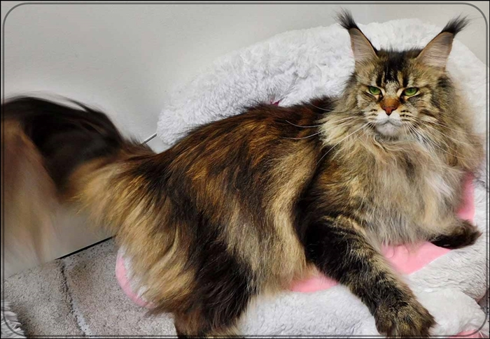
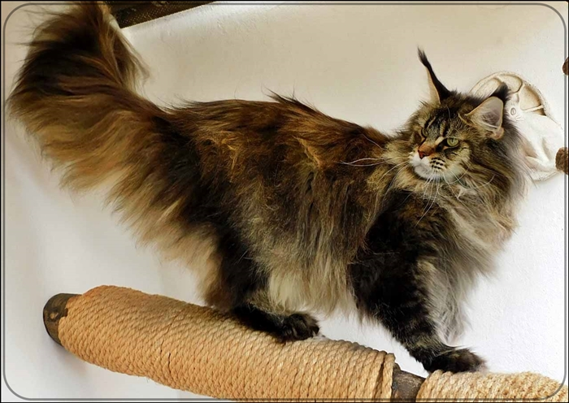
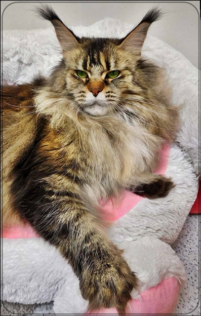
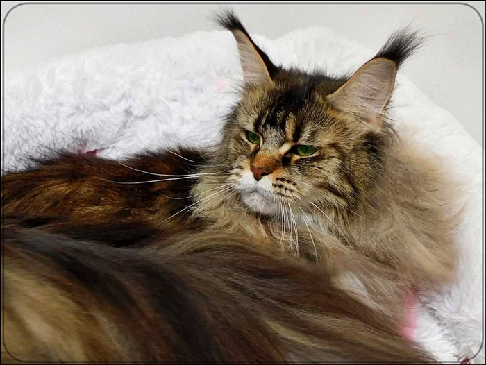
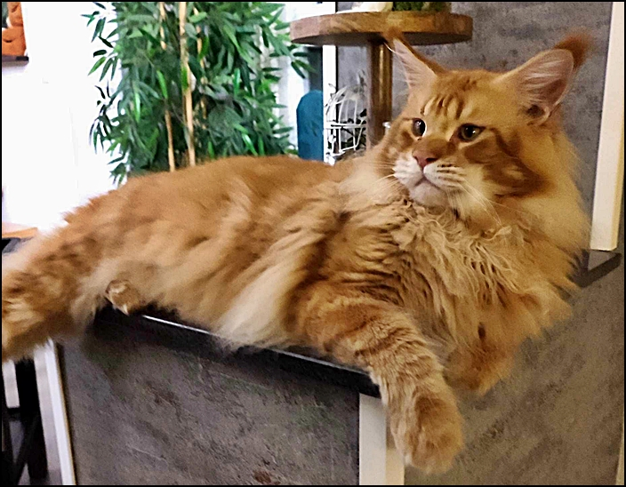
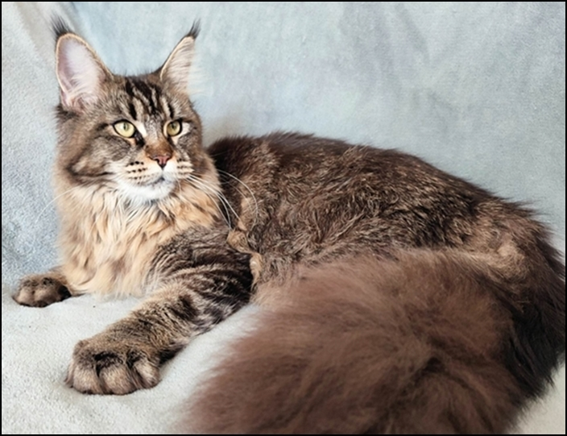

\>The Dream Coons Su´Perla\<\
black ticked torbie

Bei uns ist ihr Rufname **"Susi"**. Und wenn ich in dieses traumhafte Gesichtchen schaue, weiß ich warum die Rasse Maine Coon seit 44 Jahren so liebe und immer noch mit Begeisterung seit 44 Jahren züchte.Wunderschön ist sie und man wird sich noch wundern wie sie sich entwickelt, dazu ein neugieriges kleines Äffchen, frech und gleichzeitig lieb, verschmust und unglaublich temperamentvoll. Wir lieben diesen Schatz die uns immer an den Traumkater "Perfect" (Wizzy) erinnern wird.

[Stammbaum Pawped](https://www.pawpeds.com/db/?a=p&id=1801524&g=4&p=mco&o=elastic)

1\. Schallung HCM/PKD negativ am 2.42025 bei Dr. Kresken\
2\. Schallung HCM negativ am 17.8. 2026 bei Dr. Kresken\
Sie ist bei Laboklin getestet\
HCM / SMA / N/N / Factor 11 / Blutgruppe alles N/N\
PKdef - N/PKdef

**Die Eltern:**

Der Vater: Big Giant Resort Perfect (Wizzi)

Die Mutter: Legendarys Diamond Kiss (Ivy)

