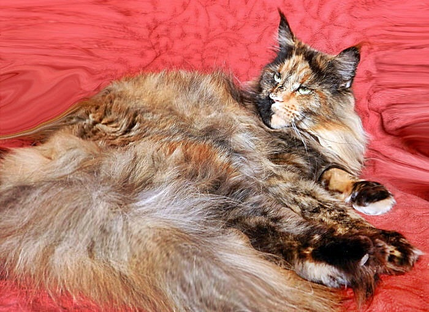
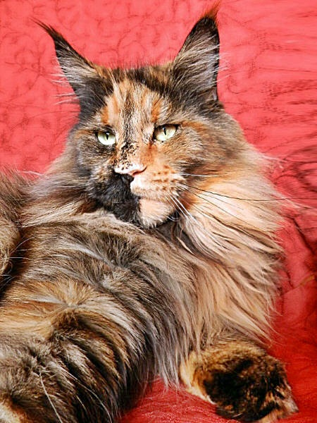
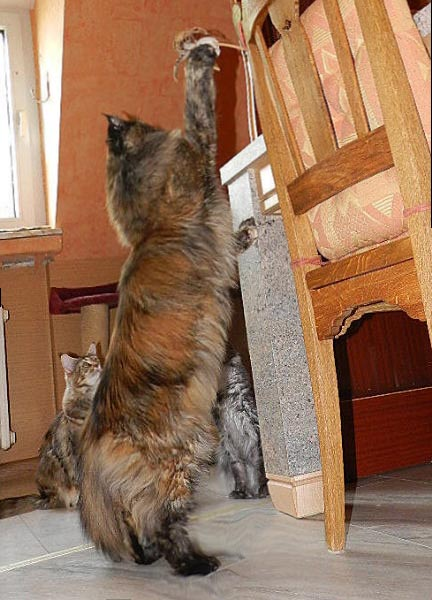
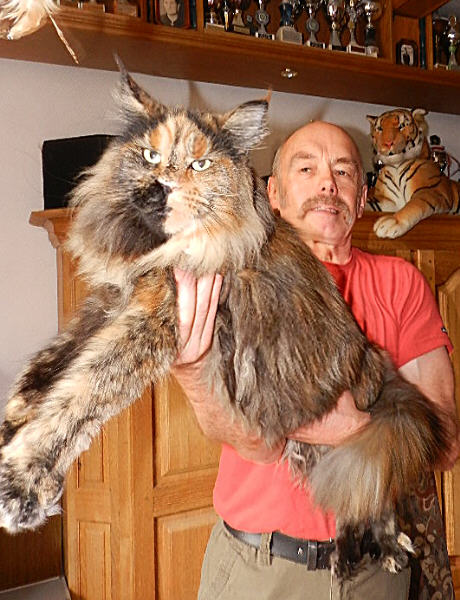

Big Giant Resort Wishing Well\
Farbe: black tortie

Unsere Wishi, ein Feuerwerk der Farben. Ein sehr kräftiges, extrem großes, massives Mädchen mit enorm schwerem Knochenbau, die sich rasant und gut entwickelt hat. Wer Wishi hier bei uns gesehen hat (falls sie sich zeigt, sie ist manchmal ein bißchen besucherunfreundlich), ist begeistert und wer sie auf den Arm nehmen durfte, ist beeindruckt von Gewicht und Größe. Sie steht immer gut im Fell und wenn ihre Babys flügge werden, sieht sie aus als könnte sie sofort wieder Babys haben.

Vom Typ ist sie natürlich eine Granate!!! Ihre Kombination hat für uns hochinteressante Vorfahren. Ein wirklich interessanter Linienmix aus Spitzentieren der:\
**USA/Dänemark/Ungarn/Polen /Deutschland**\
Ihr Wesen ist superlieb und anhänglich, unser Zuckermädchen. Mit Besuchern hat sie es aber leider nicht so sehr, es ist sehr selten das sie sich zeigt. Und es darf derjenige stolz sein, zu dem sie auf den Schoß kommt, das ist tatsächlich auch schon vorgekommen!!

[Stammbaum Wishing Well](stammwish.jpg)
