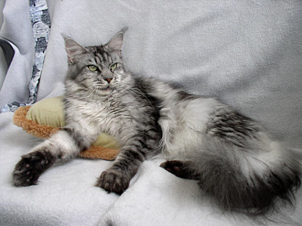
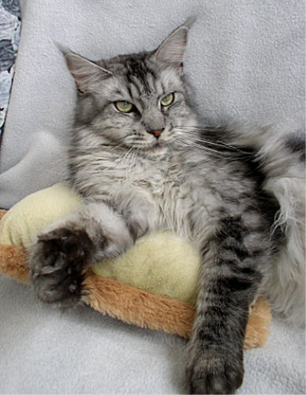

Starbushway Chocobon\
silver tabby mackerel\
Gentest N/N

Ein silbernes Bonbon das keine Wünsche offen läßt. Choco ist eine maskuline Kätzin mit sehr kräftigem muskulösen, schweren Körper. Das leuchtende saubere Silber hat sie von ihrem Vater, ansonsten hat sie ALLES - Typ, Charakter, Körperbau, langer Schwanz von ihrer riesigen 8 Kg Mama Zsa Zsa. Auch Chocos Gewicht ist nicht von schlechten Eltern. Ihr schöner Kopf, das ausdrucksstarke strenge Gesicht, dazu ihre auffallenden Pinselohren. Vom Charakter sehr kapriziös und eigenwillig, enorm selbstbewusst und anhänglich und sie liebt uns und ihre Mitkatzen sehr. Als Mutter ist sie unkompliziert mit leichten Geburten (allerdings immer kleiner Wurfzahl 2-3 Kitten). Ihre Babys begeistern uns immer wieder.

Stammbaum von Starbushway´s Chocobon

Eltern

Großeltern

Urgroßeltern

Vater:\
**Superstar Sajan**\
silver tabby mc/white

Quentino\
of Magic Lake\
red silver tabby/W

**St.Johns Avalon**

**Witchbreed Mauna Loa**

Masaitana (USA)\
Jasmin\
black torbie

**Napavalley Hatari**

**Willowplace Duma**

Mutter:\
Pillowtalk Zsa Zsa\
black torbie cl

Langstteich\
Maritim\
black tabby cl

**Langstteich CaLennox**

**Langstteich CaDemi**

Pillowtalk\
Omega\
blacksmoke/white

**Langstteich Mc Danger**

**Langstteich OEscada**

**Zurück**
