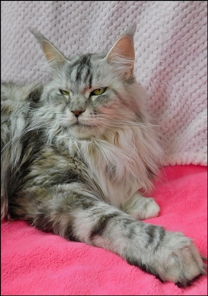
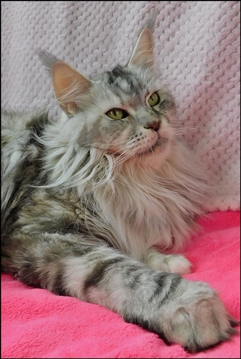
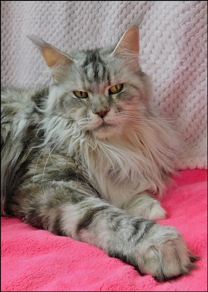
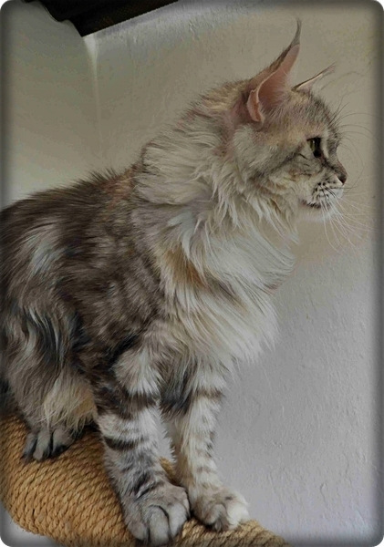
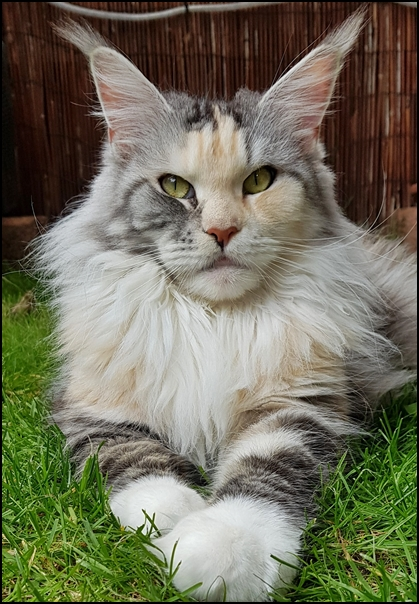
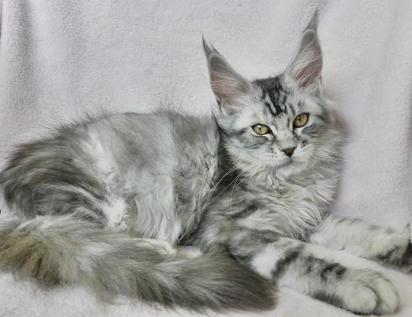
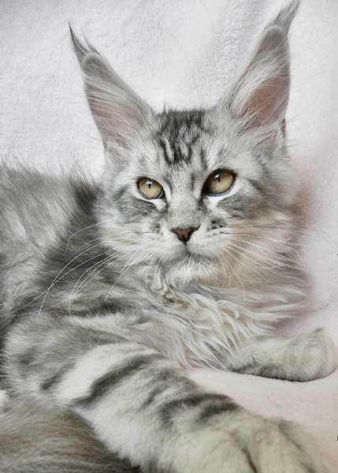
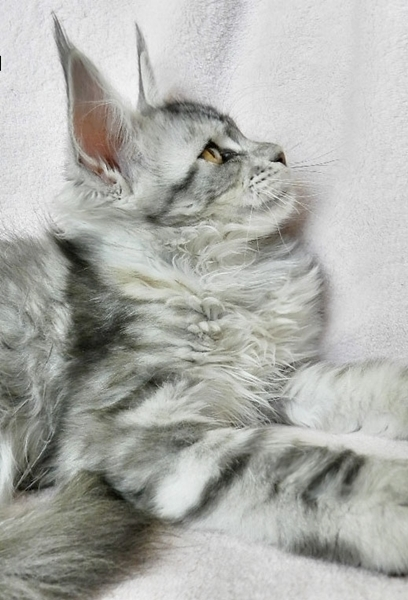

\>Starbushway Ari-Zona\<\
black silver torbie classic

Arizona ist am 10.03.2022 mit 5,5 Jahren zum 4. mal HCM/PKD negativ geschallt mit besten Herz und Nierenwerten. Mit 7 Jahren wird sie erneut geschallt.\
Sie ist aus generationsübergreifenden HCM/PKD negativ geschallten Tierenmit allerbesten Werten. Alle Ergebnisse können hier bei uns eingesehen werden!!\
Blutgruppe N/N\
**[Stammbaum Pawped](https://pawpeds.com/db/?a=p&id=1461546&g=4&p=mco&o=ajgrep)**

Mit Arizona haben wir uns ein ausgesprochen schönes Silberfischchen aus unseren eigenen Linien gezogen. Sie ist hier mit uns sehr menschenbezogen und hat ein schmusiges fast aufdringliches Wesen. Bei Besuchern ist sie aber zurückhaltend und beobachtet sie lieber von weitem aus ihrem erhöhten Versteck. Sie ist ein Traum in silber, eine Augenweide. Ein sehr helles Silber mit einem perfekten Kontrast. Eine Sgt. Pepper-Enkelin, eine Zacko/Perdita-Tochter, etwas ganz Besonderes für uns. Sie wird ihre Mutter hier bei uns ersetzen. Ihre Würfe mit verschiedenen Katern waren bisher sehr schön. Ein 6er Wurf, ein 2er Wurf, ein 10er Wurf und ein 7er Wurf. Keine Probleme in der Tragezeit und in der Aufzucht.

Eine ihrer schönsten Töchter lebt in der\
Maine Coon Cattery "Dantes Peak"

Hier mit 4 Monaten

