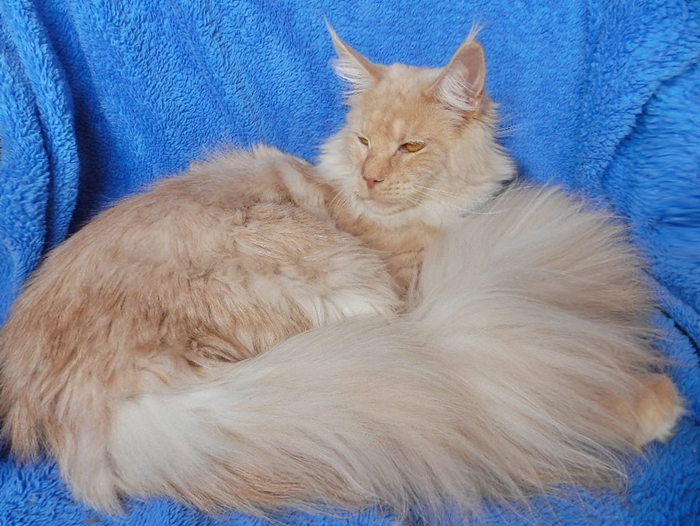
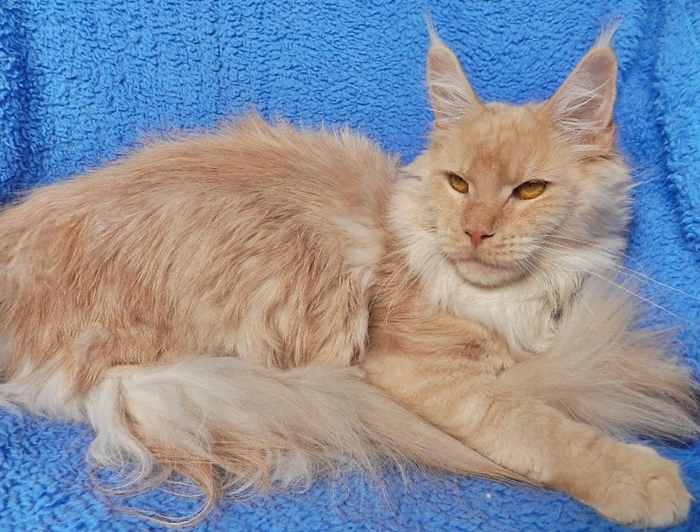
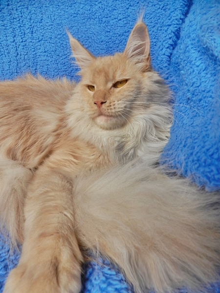
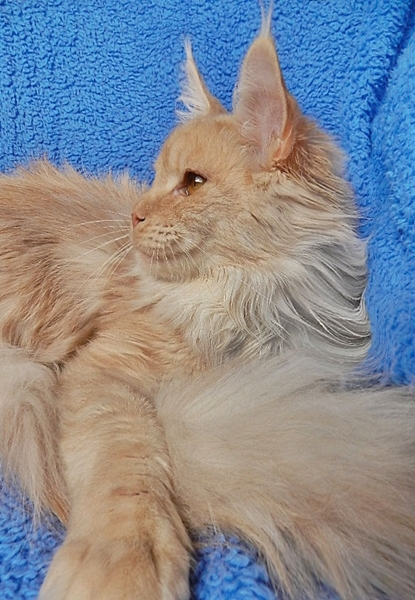
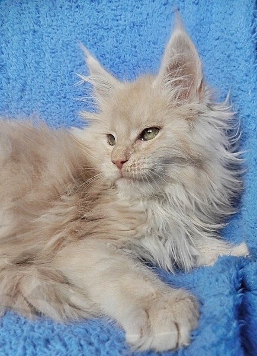
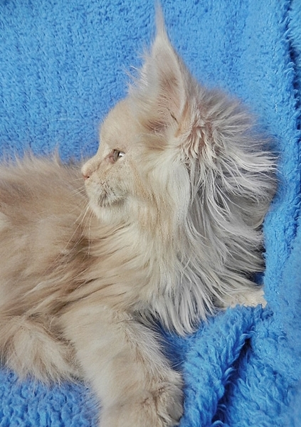

Starbushway Cara-Mella\
Farbe: cream smoke

Ein traumhaft schönes perlmutfarbenes Mädchen habe ich mir für meine Zucht gewünscht und zwar nur aus eigener Nachzuchtzucht. Pico-Lina erhörte meine Bitte und präsentierte mir dieses dicke Mädchen mit einem Geburtsgewicht von 155g. Cara-Mella ist eine Bombe. Perfektes Profil und ein originaler Ableger von Deputi mit schluffigem Charakter. DANKE an die beiden Starbushways, die mir diesen Schatz gebastelt haben!!Beide Elternteile sind über Generationen HCM/PKD geschallt sowie im Gentest bis zu den Urgroßeltern N/N\
Es gab einige wunderschöne Kitten von Mellchen!!

Hier mit 8 Monaten

Hier mit 12 Wochen

**Stammbaum Cara-Mella**

Eltern

Grosseltern

Urgrosseltern

UrUrgrosseltern

Vater:\
Starbushway\
Deputi\
**cream smoke**

Starbushway\
Blue Bambule\
blue smoke

Jack Daniels\
of Saxony Forest

**Valentino of Baydar**

**Sweet MaNas Amy Lou**

Big Giant\
Xanadu

**Top Gun of Summerplace**

**CZ\* Xena of Gentle Lions**

Starbushway\
Baby Jane\
cream smoke

A\*Mainefield\
Sgt. Pepper

**Summerplace Avalon**

**A\* Mainefields Amelie Poulain**

Starbushway\
Pewa Feral Baby

**Starbushway Wildlife**

**Starbushway Pataia**

Mutter:\
Starbushway\
Pico-Lina\
**blue tortie/white**

A\*Mainefield\
Sgt. Pepper\
cream smoke

Summerplace\
Avalon

**Q´s Blue Bear of Magic Love**

**Summerplace Tessa**

A\* Mainefields\
Amelie Poulain

**A\* Mainefield Camelot**

**A\* Island in the Sun the Purfect** Coon

Coonection\
Only you\
blue tabby/white

DK\* Neu Coons\
Optimus Prime

**DK\* Aloas Romeo**

**DK\* Dueleds Hazel O´Connor**

B\* Racoone\
Sweet Poison

**B\* Racoon Don Juan**

**Superstar Laluna**
