Legendarys Chinook Blue\
blue

Bei uns wird sie Chini gerufen. Eine hochbeinige Highheel Kätzin mit einem sehr langestreckten schweren und großrahmigen Körper und einem traumhaften extrem langen Schwanz. Ein wunderschönes Blau und zwar mit grünen Augen wie Smaragde, einem perfekten, sehr speziellen Feraltyp **(man muß ihn mögen, es ist kein Sweettyp!!**) mit gut sitzenden großen Pinselohren. Aber mit das allerwichtigste neben Aussehen ist ihr herzerwärmender Charakter. Lieb und sozial aber sehr sehr temperamentvoll und manchmal doch ein bißchen zuviel in ihrer Neugier denn ohne sie geht nichts hier. Besucher die sie hier schon kennengelernt haben sind begeistert. Sie hat mittlerweile drei sehr schöne Würfe von unserem Ouzo gehabt mit großen Kitten. Der nächste Wurf ist geplant Ende 2026

[**Stammbaum Pawped**](https://pawpeds.com/db/?a=p&id=1615344&g=4&p=mco&o=elastic)

1 Schallung HCM/PKD negativ am 8.12.2022 bei Dr. Kresken 2. Schallung am 12.6.2024\
3\. Schallung megativ am 18,3.2026

Sie ist bei Laboklin getestet\
HCM / SMA / PKdef / Blutgruppe N/N\
Factor 11 - N/F11

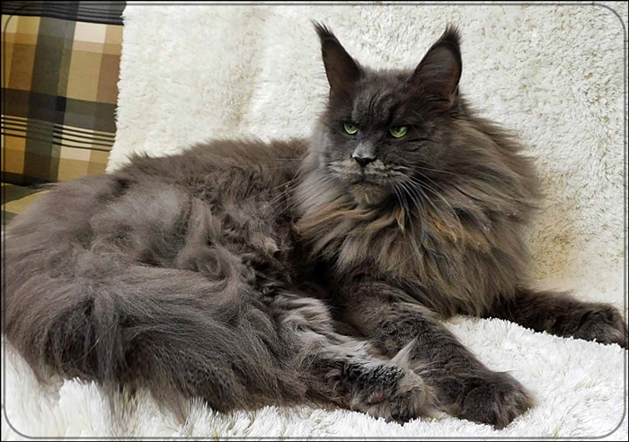
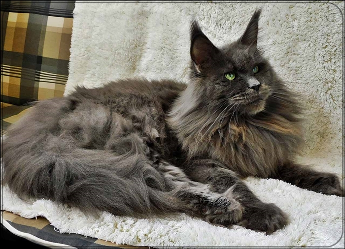

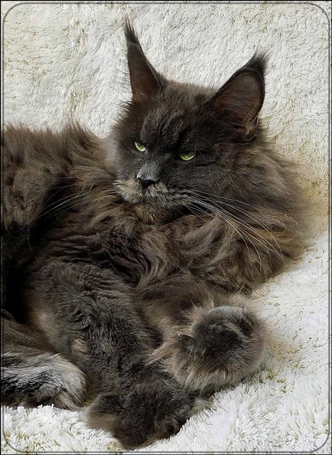
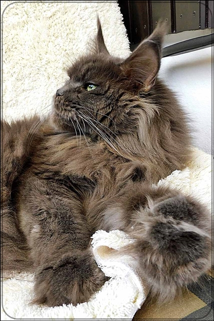

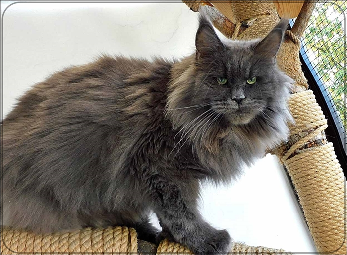
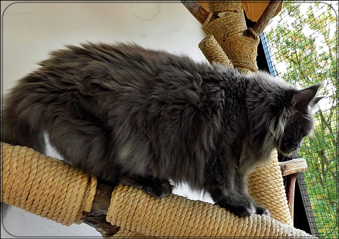

Chinook 2,5 Jahren mit Töchterchen\
aus einem 5er Wurf

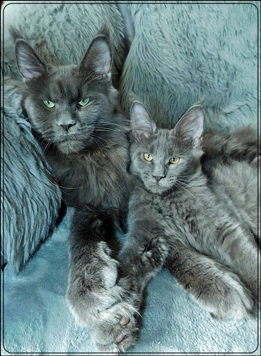

hier mit eine ihren ersten Töchtern

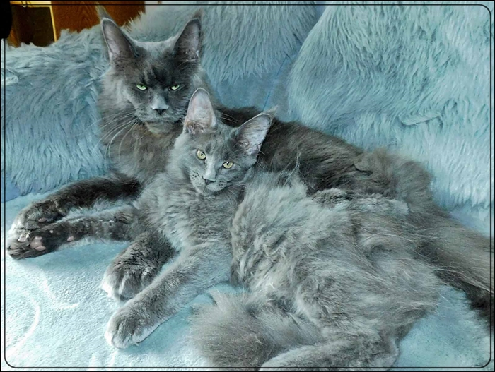
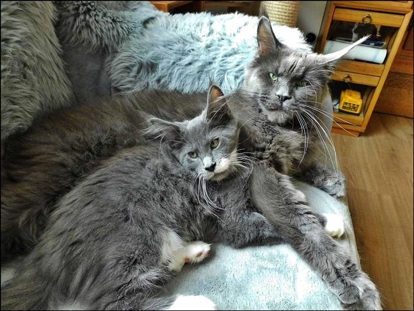

Mit 10 Monaten

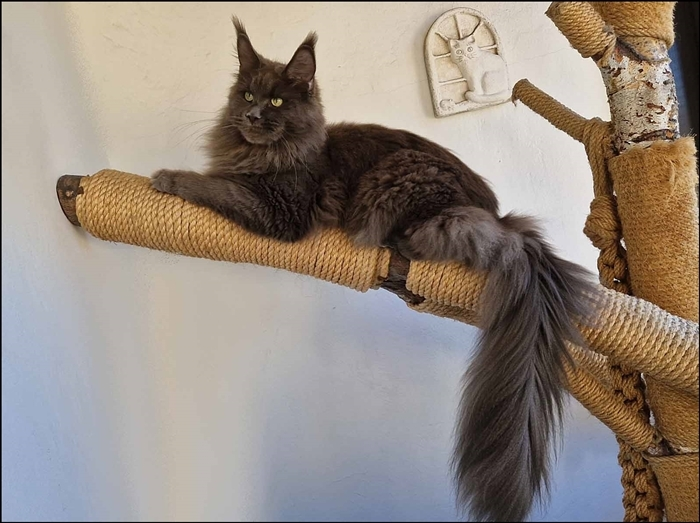

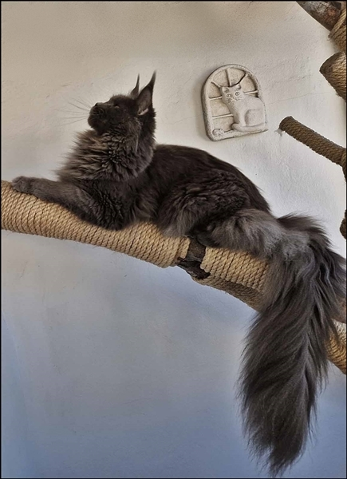
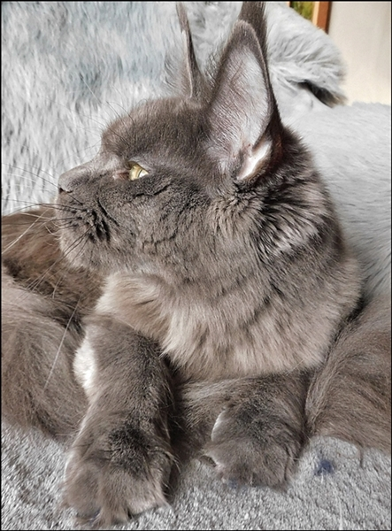

Chinook 16 Wochen

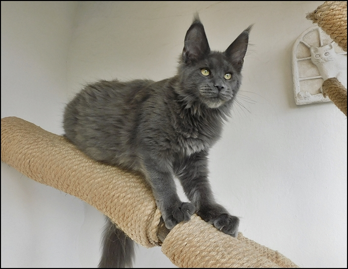
