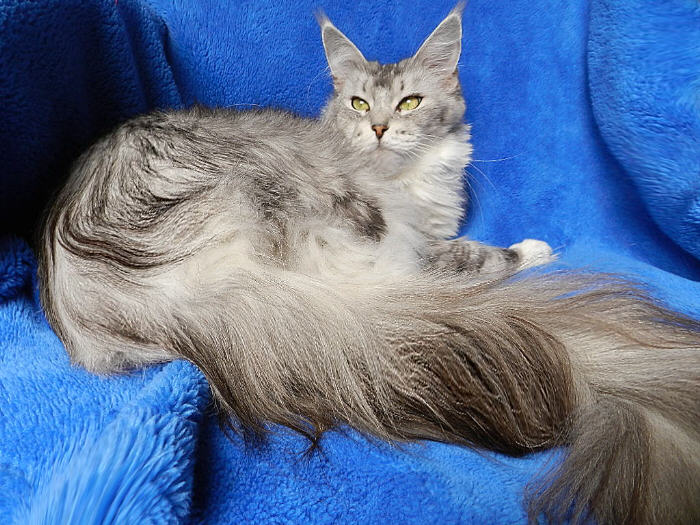
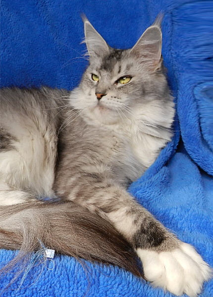
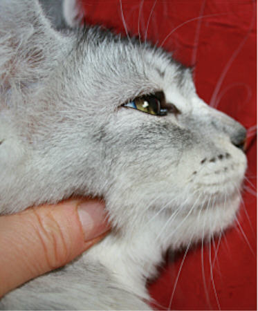
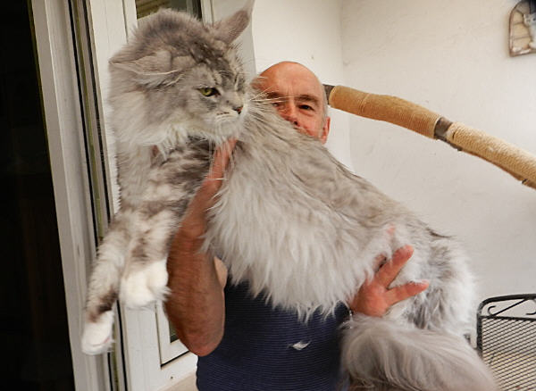
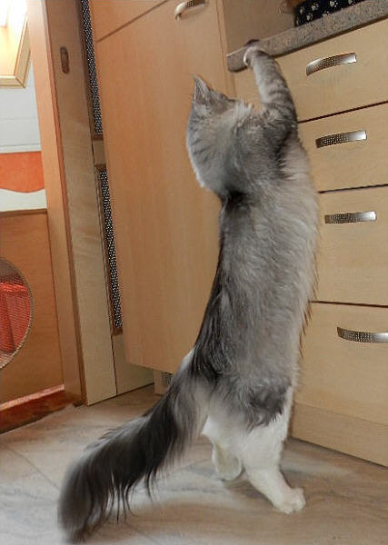

Starbushway Minerva Bell\
Farbe: black silver ticked tabby/white

Die traumhaft schöne Tochter aus der einzigartigen nicht wiederholten Kombination von unserem Nashota und unserer Faible hat sich genauso entwickelt wie wir es aus dieser Verbindung erwartet hatten. Minerva hat einen markanten Typ mit riesigen leicht bepinselten Ohren, magischen grünen Augen und wenn sie richtig im Fell steht ist sie ein Augenschmaus!! Ihr Silber ist hell und sauber, ohne ein einziges braunes Fleckchen (Rufismus).\
Das Ticked gibt gerade einer silbernen Katze etwas ganz Besonderes!\
Eine sehr große feminine Kätzin die sich ihrer Schönheit bewusst ist und majestetisch vor der Kamera posiert. Ihr Körper ist lang und man beachte die enorm langen kräftigen Beine mit dicken Schneepfoten. Wir sind einfach nur zufrieden mit diesem tollen Mädchen!!\
Ihre Töchter und Söhne sind zu finden in einigen Catterys Deutschlands sowie in der Schweiz, Tschechien und Polen\
Und eine der schönsten und größten Töchter lebt hier bei uns "Starbushway Townwalk"\
6 Würfe hat Minerva bisher hier bei uns gehabt, mit 5 verschiedenen Katern. Jeder Wurf war kräftig und gesund, nicht ein schwächliches leichtgewichtiges Kitten war dabei. So ein Mädel macht uns Freude!!!\
Gewicht mit 5 Jahren: 6,0 Kg

Im Profil

Ein großes Mädchen

[Stammbaum Minerva Bell](stammmine.jpg)
