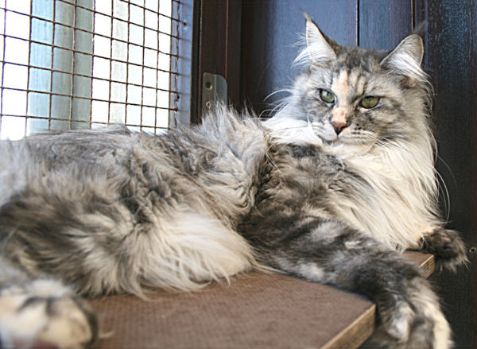
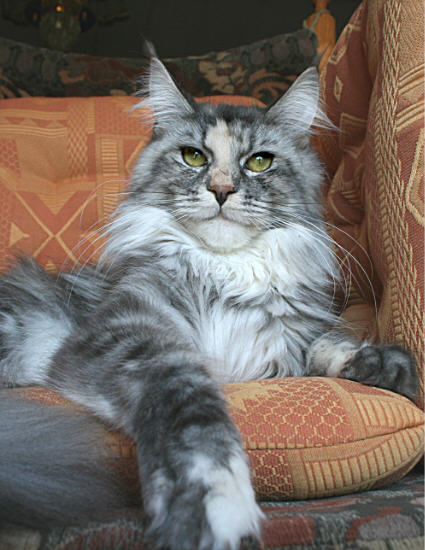
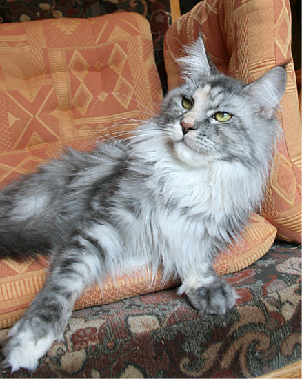
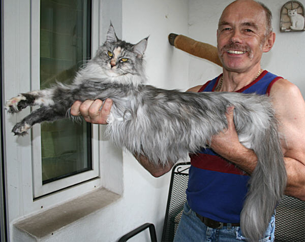

Oxygen of El Dorado

**Kastriert**

Oxygen, unsere Fellkugel, ein Augenschmaus für jeden Betrachter!!\
Oxi hat uns zwei wunderschöne Würfe geboren.\
Lebt bei netten Liebhabern

Oxygen, eine sehr kleine Kätzin

**Stammbaum von Oxygen**

Geschlecht :

**weiblich**

Farbe :

**blue silver torbie**

Eltern

Großeltern

Urgroßeltern

Vater:\
Durango\
of El Dorado\
black silver tabby mc

Love Hulens\
Bacchus\
blue silver tabby cl

**Goling Light Bodyguard**

**Funny Mae von Hummelwiese**

Tuscarora\
of El Dorado\
black silver torbie

**Jaguar of El Dorado**

**Amacoons Menominee**

Mutter:\
Summerplace\
**Xyna**\
blue tortie

Q´s Blue Bear\
of Magic Love\
blue smoke

**Eyck from Glowind Eyes**

**DK Mountaineers Pink´n Ink**

Latoya\
of Koi Pond\
blue torbie cl

**Undercover of Koi pond**

**Fea of Koi Pond**

Zurück
