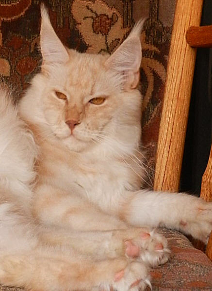
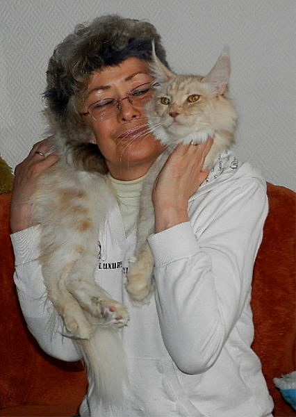
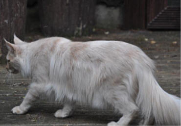
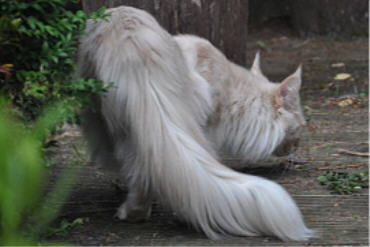

\>Pewa´s Baby Jane\<\
Farbe: cream smoke

Solch einen Schatz in cream smoke suchten wir schon seit Jahren, nun haben wir uns selber dieses Zauberwesen gezogen. Zusammen mit meiner Freundin Petra Wagner (Pewa) habe ich diese Verbindung geplant.

Baby ist einfach nur nur ein Traum der sich verwirklicht hat. In jeder Hinsicht. Die Mutter ist unsere riesige "Feral Baby" die sehr liniengefestigt ist. Ich kenne den Hintergrund (und ich meine damit wirklich. **ICH KENNE IHN**) bis hin zu der kompletten 6. Generation haben wir mit diesen Tieren gezüchtet und ich kann sagen, 1.gesunde und langlebige Tiere 2.fruchtbare unkomplizierten Mütter bei Geburt und Aufzucht 3.sehr sehr schöne und grosse Coons und vom Wesen haben wir da wirklich nur das BESTE selektiert!! Und dann auch noch kombiniert mit unserem typvollen und sehr sehr sanften und lieben Pepper, das kann nur spitzenmässig werden. Dieses alles spiegelt sich in unserer \>Baby Jane\< wieder.

Ein markanter Typ, in diesem jungen Alter und das als Mädchen. Dazu diese\
wahnsinns Karakalohren\
Gerade bei dieser hellen Farbe, war uns ein bestimmter Look sehr wichtig, denn es ist wie bei den weissen Maine Coon Katzen. Haben sie nicht einen markanten Look, wirken diese Coons oft nichtssagend und fahl

Ein absolut perfektes Profil. Eine top Nasenlinie, die bei den längeren Gesichter nicht immer selbstverständlich ist. Schöne grosse hochstehende Pinselohren. Trotz Wildlook, hat sie immer ein Schmusegesicht. Immer wird geschnurrt, getretelt und Pfötchen gegeben.\
Alles in Allem, wir dürfen uns mal wieder auf die Schulter klopfen.

Stammbaum von Baby Jane

Geschlecht :

**weiblich**

Farbe :

**cream smoke**

Eltern

Großeltern

Urgroßeltern

Vater:\
Mainefield\
Sgt. Pepper\
cream smoke

Summerplace Avalon\
red smoke

**Q´s Blue Bear of Magic Love**

**Summerplace Tessa**

A\*Mainefields Amelie Poulain\
black silver torbie mac

**A\*Mainefield´sCamelot**

**A\*Island in the SunThe Purfect Coon**

Mutter:\
Starbushway\
Pewa Feral Baby\
black torbie cl

Starbushway Wildlife\
black tabby mc/white

**Elfengartens Chico (gezogen aus Starbushway)**

**StarbushwayPrincess**

**Starbushway Pataia**\
blue silver torbie cl/white

**Elfengartens Chico (gezogen aus Starbushway)**

**Starbushway Evangeline**
