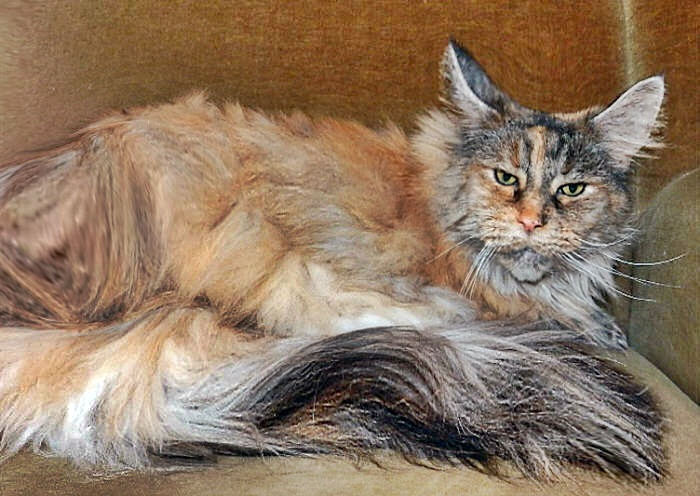
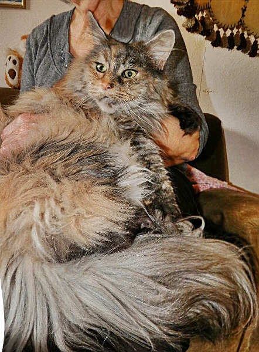
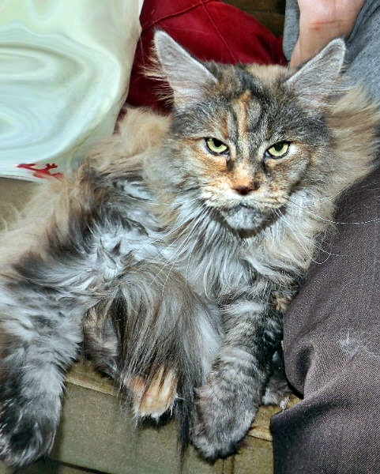

\>Starbushway Pewa Brae-Burn\<\
**black silver torbie mc**

Die Riesin unter unseren Mädchen!!\
Nach ihren Würfen die sie hier aufgezogen hat, wiegt sie glatte 9 Kg und passt schon längst nicht mehr auf den Schoß. Sie stammt aus einer einmaligen Bomben-Verpaarung mit Linien im Hintergrund die extreme Göße mit sich brachten und hat alle Vorzüge ihrer kompletten Ahnenreihe mitbekommen, sie hat sehr sehr große Eltern, die alle Gesundheitschecks bestanden haben. Sie hat ein langes, aber pflegeleichtes Maine Coon Fell. Ihr Grossvater Chico ist mittlerweile15 Jahre alt, hat bis 9 Jahre gedeckt und ist ein wahrer Riese. Ich bin ja nicht so ein Fellfan, für mich darf es gerne weniger sein. Aber an dieser Kätzin kamen wir nicht vorbei, sie zu behalten, sie ist einfach ein Urviech mit einem dicken Katernacken.

Riesengroß und ein Traum!!!!!!!!!!!!!!!!!!!!!!!\
Ein Traum vom Outfit, Background und vom Wesen ist sie lieb ruhig und schmusig. Hier auf dem Schoß meiner Mutter. Wir haben uns wirklich mehrmals sehr bemüht, aber sie ist für ein ordentliches Fotoshootings nicht zu überreden.

Stammbaum von Brae-Burn

Eltern

Großeltern

Urgroßeltern

Vater:\
Starbushway\
Wildlife\
black tabby mc/white

Elfengartens Chico\
black tabby cl

**Starbushway Hoogan**

**Cuddle Bears Candy**

**Starbushway** **Princess**\
black silver torbie mc

**Brian of Green Valley**

**Beauty Girl of Flagstaaf**

Mutter:\
Starbushway\
Candle Light\
black silver torbie mc

Starbushway Hooligan\
silver tabby mc

**Starbushway** **Big Silver**

**Tree Tops Branda**

Starbushway Ginger Ale\
silver tobie mc

**Earl of Devonshire**

**Blackmoons Happy**
