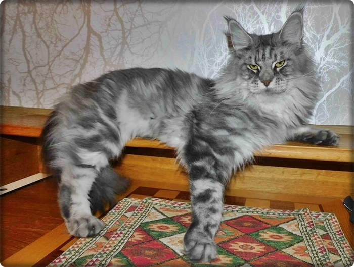
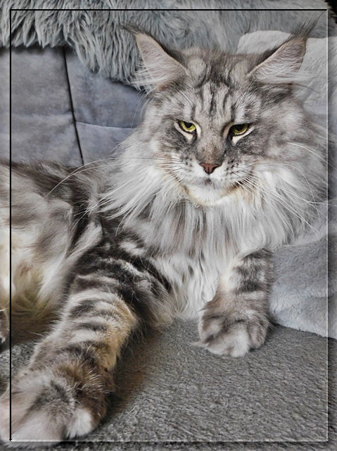
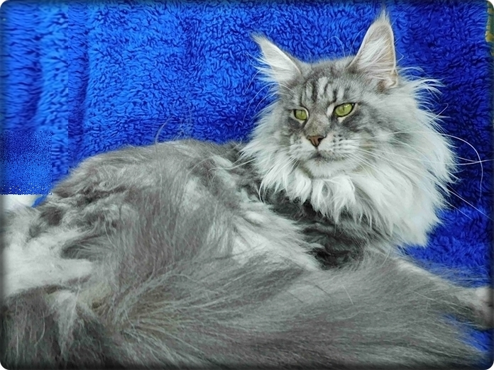
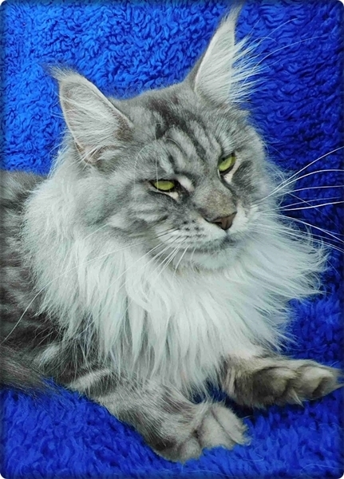
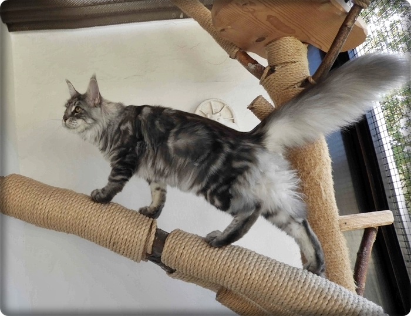
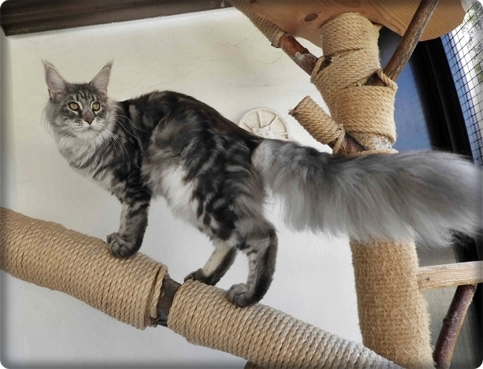
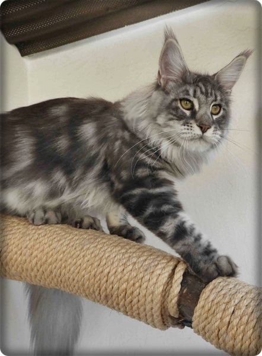
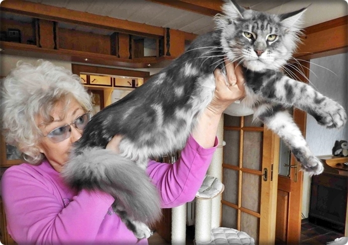

Cajana of Dantes Peak\
blue silver tabby classic

Bei uns wird sie Heiki gerufen. Heiki mit dem Raubtiergesicht. Ein wirklich großes und extrem schweres Mädchen bei schlanker Figur hat sie **wirkliche 8,2 Kg!!** Ein sehr liebes und angenehmes Wesen. Aber sie kann auch richtig aufdrehen. Edel von der Farbe, mit einem fantastischen kontrastreichem classic tabby. Ihre Augen sind wie grüne Perlen. Sie hat sich zu einem Traum entwickelt. Ihr erster Wurf mit Ouzo war ein sehr kräftiger 7er Wurf. Alles schwere Kitten mit süßem Wesen.

Cajana ist am 23.02.2021 mit 1 Jahr zum 1. mal HCM/PKD negativ geschallt mit besten Herz und Nierenwerten. Mit 2 Jahren wird sie erneut geschallt.

Sie ist aus generationsübergreifenden HCM/PKD negativ geschallten Tieren mit allerbesten Werten. Alle Ergebnisse können hier bei uns eingesehen werden!!\
Blutgruppe N/N

[Stammbaum Pawpeds](https://pawpeds.com/db/?a=p&id=1549462&g=4&p=mco&o=elastic)

2.5 Jahre

2 Jahre alt, nach ihrem 1. Wurf

Mit 1 Jahr im Winterpelz

Im kurzen Sommerfell mit 9 Monaten, da wog sie schon 6 Kg\
bei sehr schlanker Figur

7 Monate

