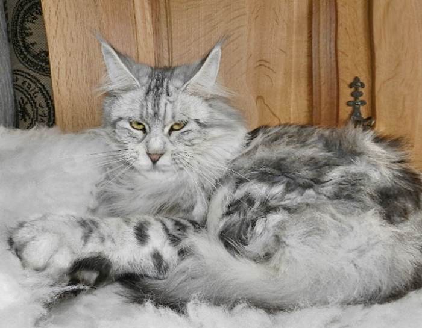
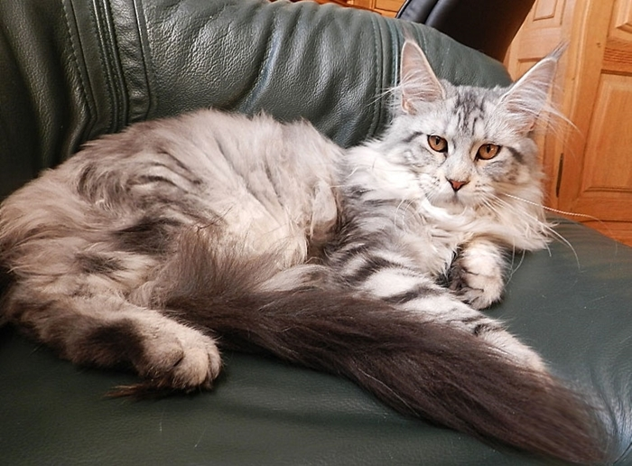
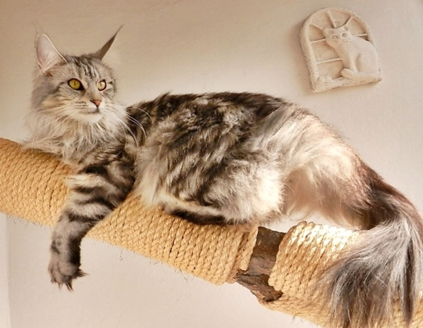
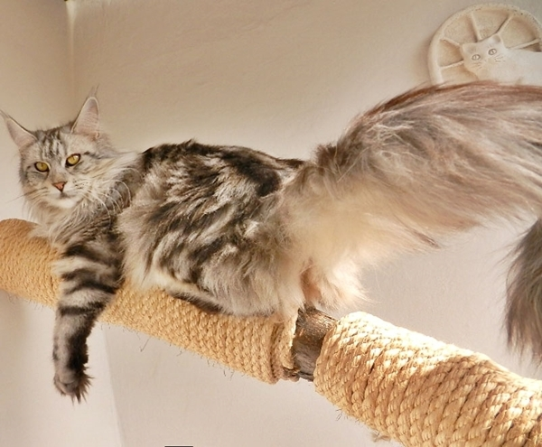
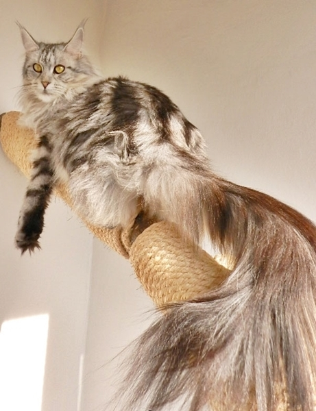
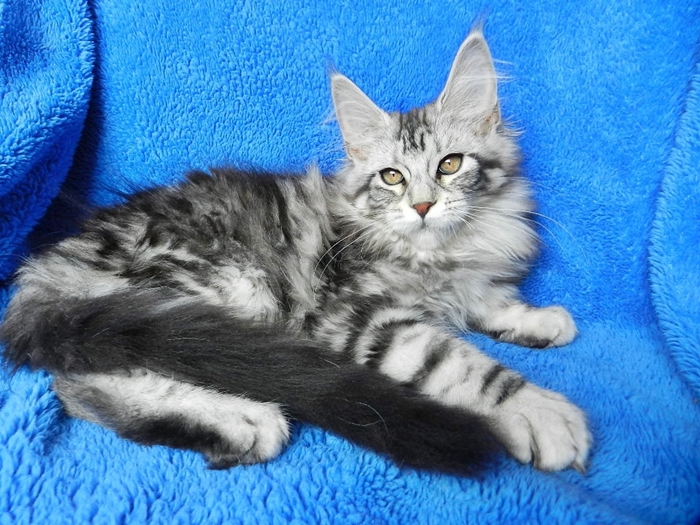
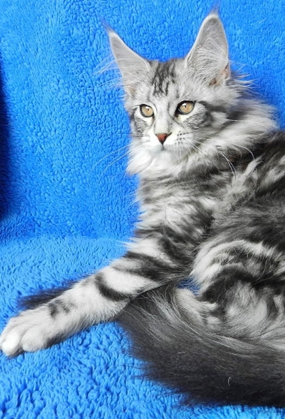
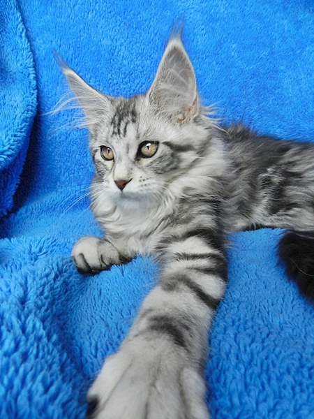

Starbushway Sweet Naomi\
Farbe: black silver tabby classic

Mit Naomi haben wir uns ein ausgesprochen schönes Silberfischchen gezogen. Ganz davon abgesehen das sie ein sehr aufgeschlossenes schmusiges und menschenbezogenes Wesen zeigt, ist sie auch sonst ein Traum in silver classic. Ein sehr helles Silber mit einem perfekten Kontrast. Sie hat mehr den alten moderaten Typ ohne jegliche Extreme. Ein sehr sehr liebes ruhiges Mädchen. Schwangerschaft, Geburt und die Aufzucht ihrer Kitten ist wie aus dem Bilderbuch und wünscht man sich als Züchter!!

Hier mit 15 Wochen

[Stammbaum Naomi klick hier](stammnaomi.jpg)

[Zurück](/neuigkeiten/)
