\>Starbushway La Luna\<\
**black torbie classic (trägt Verdünnung und nonagouti**)

Ein sehr typvolles großes und sehr schweres Mädchen mit märchenhaften grünen Augen. Meine hübsche Kastanie im Feraltyp mußte bleiben. Als Lunchen bei der Geburt in meine Hand plumpste. sagte ich ***"du wärst was für mich".*** Ein Starbushway-Eigengewächs. Wir lieben dieses schöne beeinduckende Mädchen sehr. Von ihrem speziellen Look, ihrem pflegeleichten Fell, ihren auffallenden Luchsohren, ihrer Größe, aber vor allem von ihrem menschbezogenen traumhaften Charakter. Mutter und Großmutter sind hier bei uns gezüchtet und aufgewachsen und somit auch Starbushways. Bis zur 5. Generation mütterlicherseits haben alle hier bei uns gelebt. Ein sehr liebes unkompliziertes soziales sensibles Wesen.

[**Stammbaum Pawpeds**](https://pawpeds.com/db/?a=p&id=1551123&g=4&p=mco&o=elastic)

Luna 4 Jahre

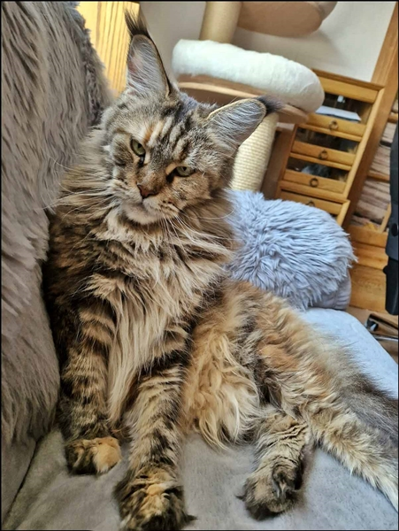
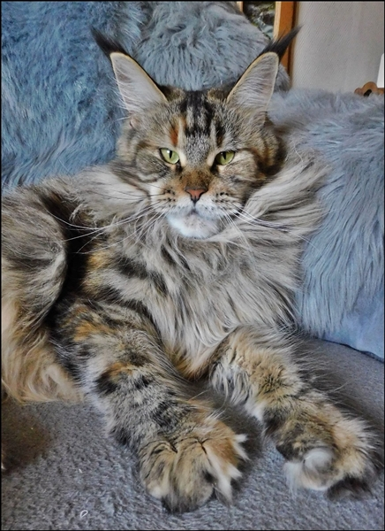

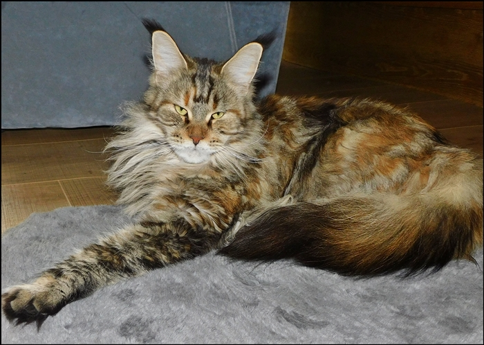

Luna 1 Jahr

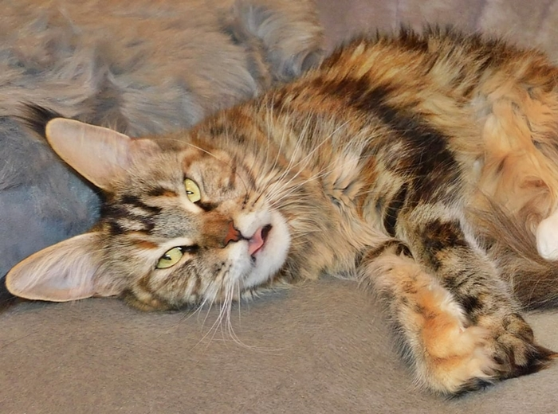

Luna 9 Monate

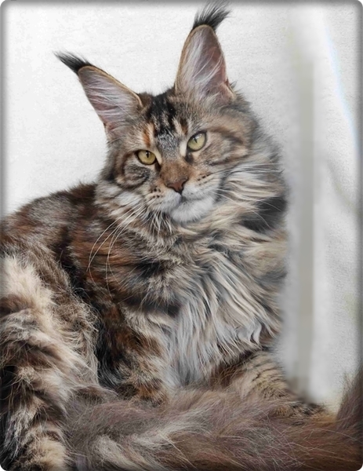
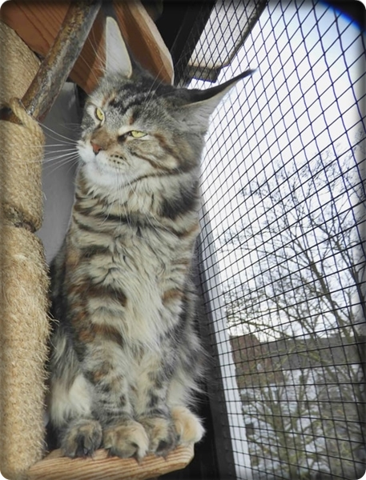

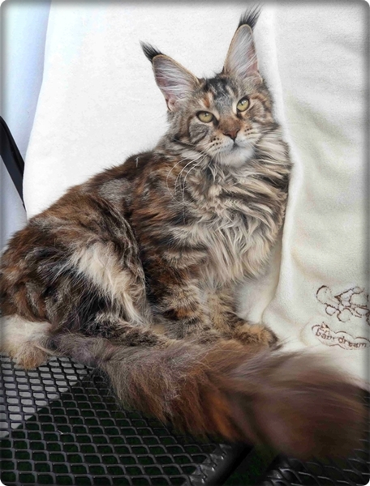
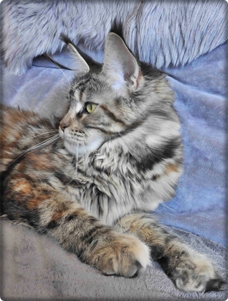

La Luna mit 3 Wochen

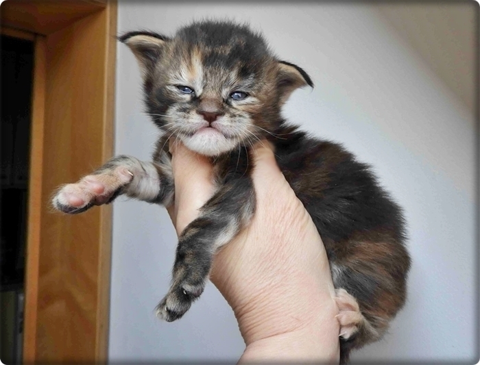

La Luna mit 10 Tagen

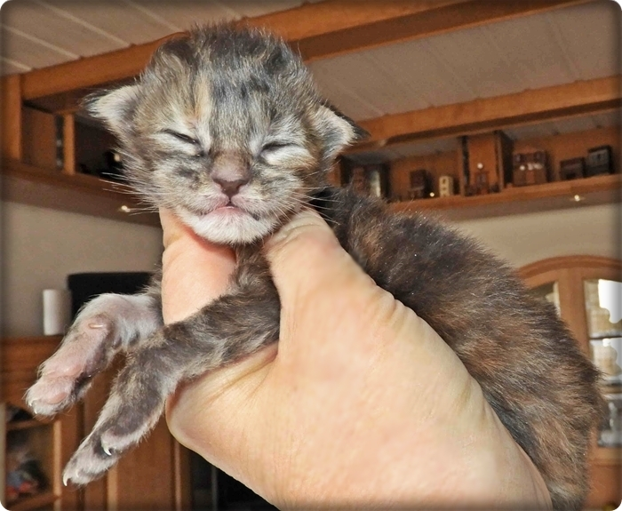

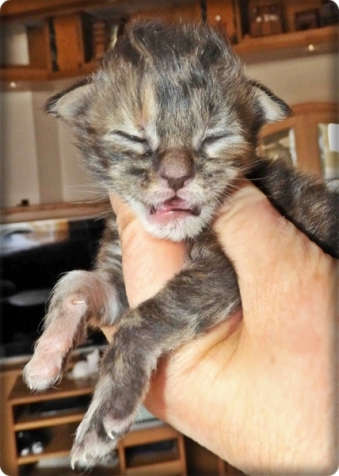
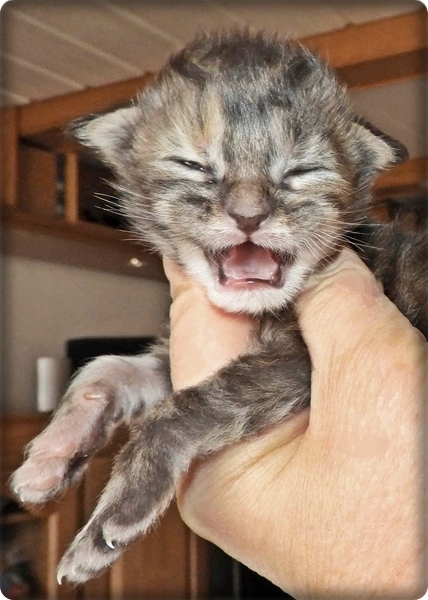
