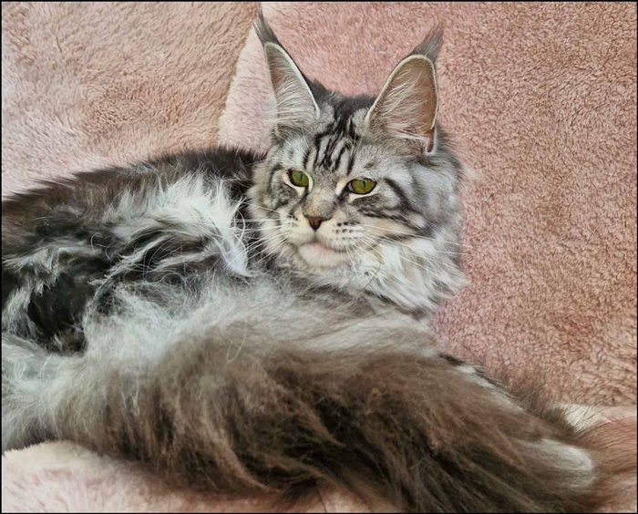
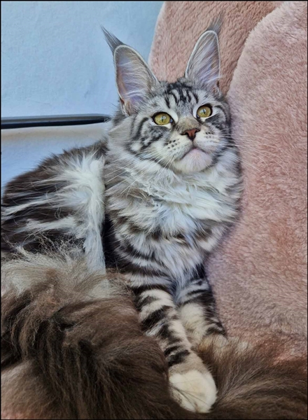
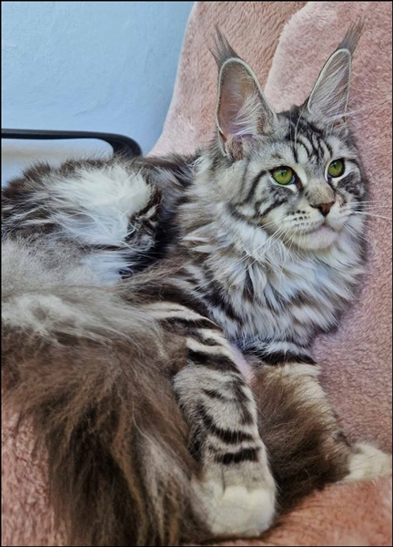
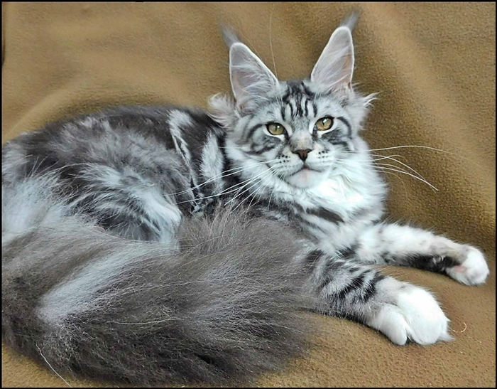
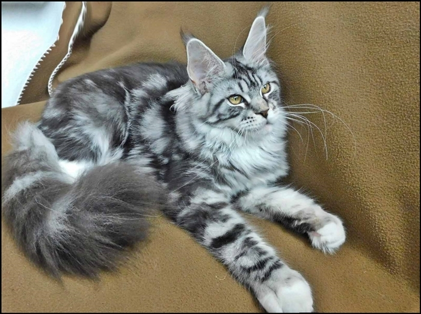
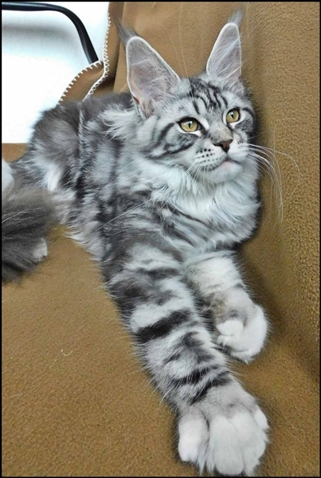
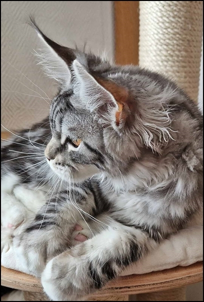
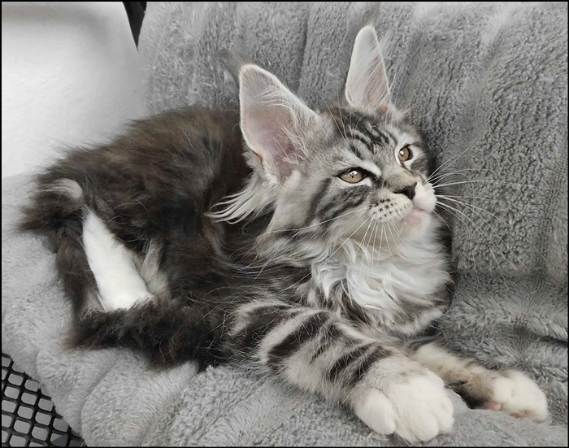
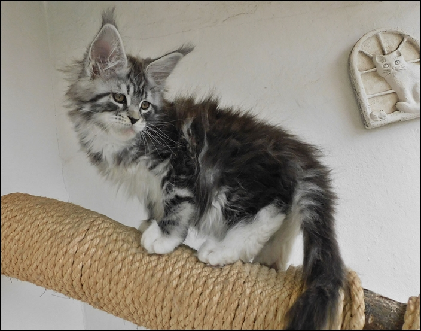

\>Starbushway Sa Hara\<\
black silver classic tabby

Sie wird ihre Mutter und Großmutter in der Silberfarbe hier bei uns würdevoll vertreten. Unser silbernes Zukunftssternchen ist für uns ganz was Besonderes. Ein leuchtendes helles Silber mit einer exakten kontrastreichen classic Zeichnung. Toller Typ ohne Extreme, harmonische Ohren, ganz wie wir sie uns wünschen und einen lieben süßen Charakter, kann ja nur, bei den Eltern. Sie kommt aus generationsübergreifenden Negativ-Schallungen HCM/PKD und in ALLEN gängigen Gentests sind Eltern sowie Großeltern, mütterlicherseits sogar bis Urgroßeltern N/N (auch Blutgruppe).\
Wir freuen uns ihre Entwicklung zu beobachten und haben ihr schon einen ganz besonderen Kater für ihre Kinder ausgeguckt. Aber jetzt darf sie erstmal ihre Kindheit und Jugendzeit genießen.

**14 Wochen**

**7 Wochen**

Ihre Mutter Ari Zona

