Ehemalige Kätzinnen bei Starbushway in der Zeit 1983 - 2022, die teilweise noch in unseren Linien verankert sind. Alle diese Katzen haben hier bei uns in der langen Zuchtzeit für tollen Nachwuchs gesorgt und wurden nach ihrer Zuchtzeit kastriert. Einige sind hier bei uns als Kastraten geblieben und sehr alt geworden und einige haben bei netten Liebhabern kuschelige Verwöhnplätze gefunden. Teilweise bei unseren Freunden, teilweise in unserer tierverrückten Familie. Alle diese Katzen dürfen als Couchkatze ihr Leben weiterleben bis zum Ende, oder sie sind schon über die Regenbogenbrücke gegangen

Starbushway Priscilla\
black torbie cl

[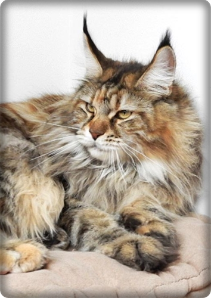](/katzen/zuchtpriscilla/)

Starbushway Malo Dreamdoll\
black tortie smoke

[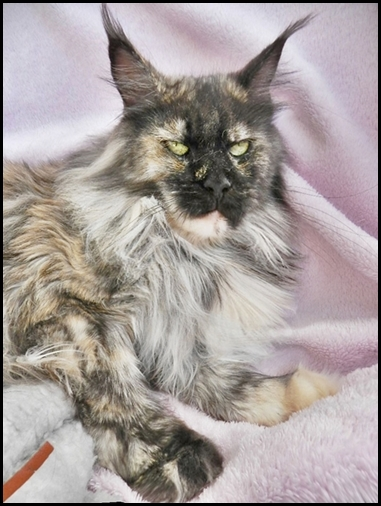](/katzen/zucht2/)

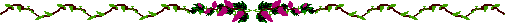

Starbushway Yolanina\
**cream smoke/white**\
N/N

Starbushway Cara-Mella\
**cream smoke**\
N/N

Starbushway Minerva Bell\
**silver ticked tabby**\
N/N

[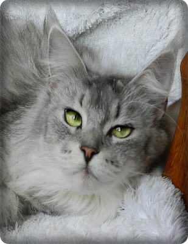](/katzen/zuchtdelphi/)

hatte bei uns 6 Würfe\
ist jetzt 12 Jahre alt

Starbushway Townwalk\
**black torbie classic**\
N/N

[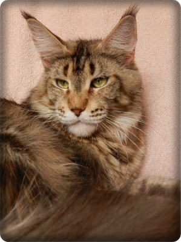](/katzen/zuchttown/)

hatte bei uns 5 Würfe\
ist jetzt 10 Jahre alt

Starbushway Pico-Lina\
blue tortie/white\
N/N

[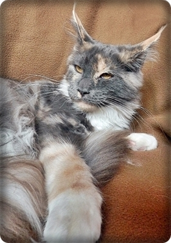](/katzen/zuchttamali/)

Starbushway Towntalk\
**black tabby cl**\
N/N

[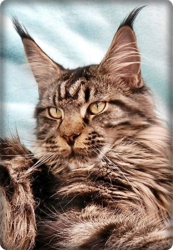](/katzen/zucht9/)

Big Giant Resort Wishing Well\
N/N\
**black tortie**

Elaine von Sprockytown\
N/N\
black tabby classic

[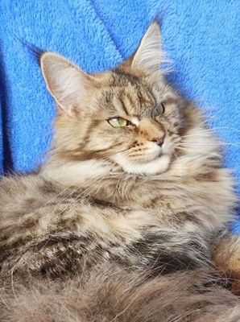](/katzen/zuchtelli/)

Starbushway Chocobon\
**black silver tabby mackerel**\
N/N

[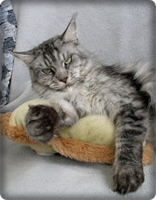](/katzen/zucht6/)

Starbushway Sweet Naomi\
**black silver tabby classic**\
N/N

[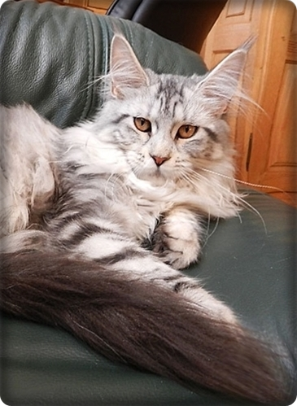](/katzen/zuchtleila/)

Starbushway Push Balboa\
**black tabby classic**\
**N/N**

[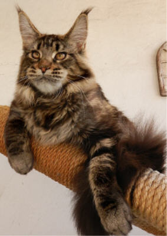](/katzen/zuchtpush/)

Starbushway Pewa Brae-Burn\
**black silver torbie mc**\
**N/N**

[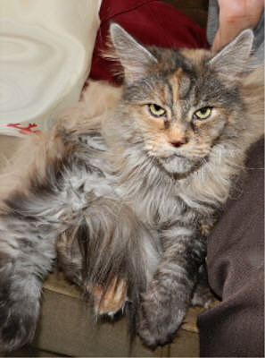](/katzen/zuchtferal/)

Starbushway Pewa Baby Jane\
N/N

[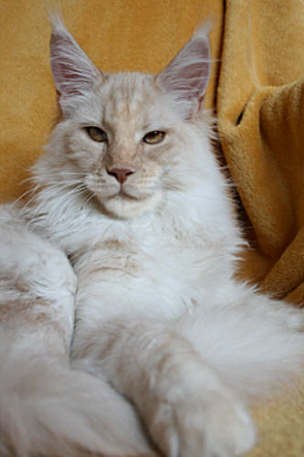](/katzen/zuchtdelphi2/)

Starbushway Orchidee\
N/N

[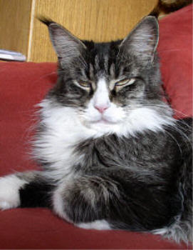](/katzen/zuchtredrose/)

Starbushway Pewa Feral Baby

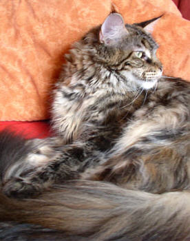

Hatte bei uns 1 Wurf\
wurde 3 Jahre

Starbushway Alabama

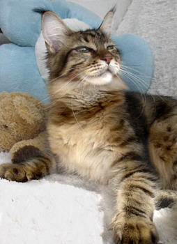

hatte bei uns 3 Würfe\
wurde 15 Jahre

German Forrest Pearl

[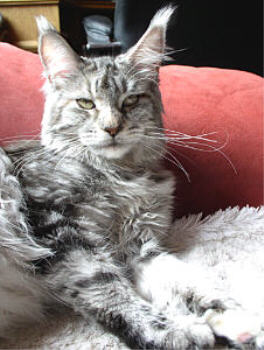](/katzen/zucht8/)

wurde 7 Jahre alt

Big Giant Xanadu

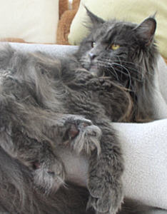

wurde 15 Jahre alt

Starbushway Pewa Big Girl

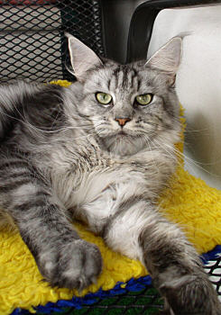

hatte bei uns 5 Würfe\
ist jetzt 18 Jahre alt

Oxygen of El Dorado

[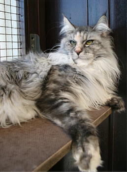](/katzen/zuchtdelphi1/)

hatte bei uns 2 Würfe\
ist jetzt 15 Jahre

Zanzabou Desperada Dixi

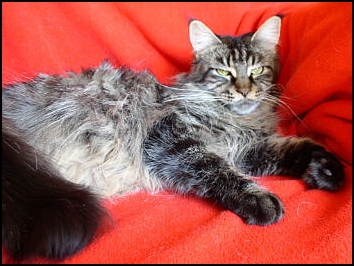

hatte bei uns 6 Würfe\
wurde 7 Jahre alt

Starbushway Brillant

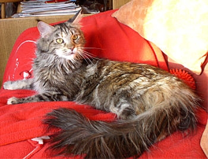

hatte bei uns 1 Wurf\
ist jetzt 19 Jahre alt

Laguna of El Dorado

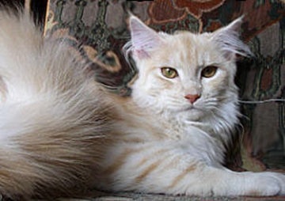

hatte bei uns 1 Wurf\
wurde 14 Jahre alt

Tree Top Branda

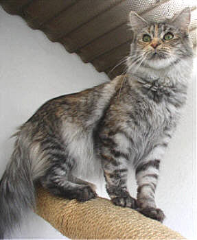

hatte bei uns 4 Würfe\
wurde 12 Jahre alt

Langstteich Mahagony

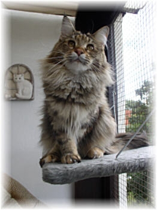

hatte bei uns 3 Würfe\
wurde 4 Jahre alt

Starbushway Rosery

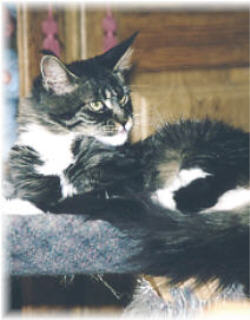

hatte bei uns einen Wurf\
ist jetzt 16 Jahre alt

Pillowtalk Zsa Zsa

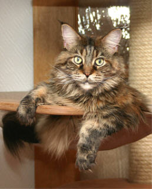

hatte bei uns 4 Würfe\
wurde 14 Jahre alt

Destiny of El Dorado

hatte bei uns 3 Würfe\
wurde 5 Jahre alt

Langstteich Chalimar

hatte bei uns 2 Würfe\
wurde 3 Jahre alt

Blackmoons Happyend

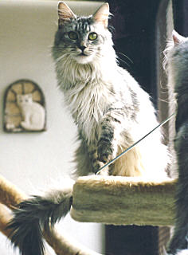

hatte bei uns 4 Würfe\
wurde 6 Jahre alt

Starbushway Sweet Pearl

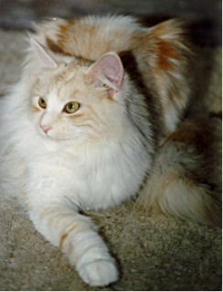

hatte bei 4 Würfe\
wurde 14 Jahre alt

Starbushway Hazelnut

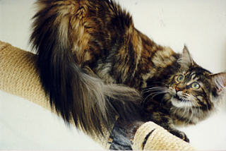

hatte bei uns 3 Würfe\
wurde 13 Jahre alt

Starbushway Patchouli

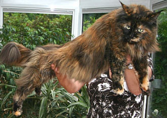

hatte bei uns 4 Würfe\
wurde 12 Jahre alt

Macavity Fancy

hatte bei uns 6 Würfe\
wurde 17 Jahre alt

Starbushway Pewa Red Rose

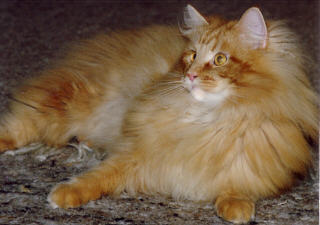

hatte bei uns 3 Würfe\
wurde 19 Jahre alt

Highgate Pandora

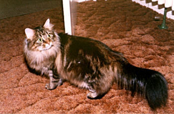

hatte bei uns 8 Würfe\
wurde 17 Jahre alt

Jolly Joker vom Jägersteig

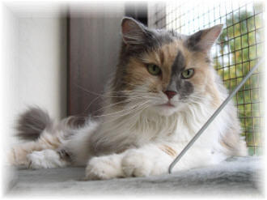

hatte bei uns 6 Würfe\
wurde 17 Jahre alt

Starbushway Monja

hatte bei uns 5 Würfe\
wurde 21 Jahre alt

Starbushway Patchwork

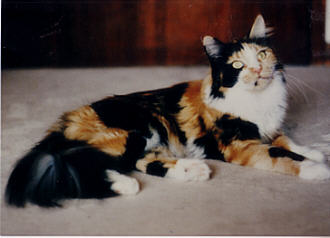

hatte bei uns5 Würfe\
wurde 18 Jahre alt

Flagstaaf Beauty Girl (USA-Line)

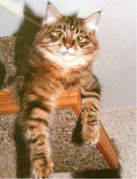

hatte bei uns 10 Würfe\
wurde 20 Jahre alt

Duchesse Bhanja

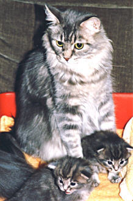

hatte bei uns 6 Würfe\
wurde 21 Jahre alt
