\>Starbushway Priscilla\<\
black torbie classic

Priscilla ist am 25.03.2021 mit 4 Jahren zum 3.mal HCM/PKD negativ geschallt mit besten Herz und Nierenwerten. Mit 5 Jahren wird sie erneut geschallt.\
Sie ist aus generationsübergreifenden HCM/PKD negativ geschallten Tieren mit allerbesten Werten. Alle Ergebnisse können hier bei uns eingesehen werden!! Blutgruppe N/N\
[**Stammbaum Pawpeds**](https://pawpeds.com/db/?a=p&id=1448618&g=4&p=mco&o=ajgrep)

Ein bildschönes Nachwuchsmädchen aus unserer Cattery, ein Eigengewächs aus einer Kombination die es nicht mehr gibt. Prissi ist groß und hat den sehr kräftigen Body und den Typ von Papa[Bosswell](/bilder/bossi.jpg) und ist wie er, charakterlich ein Traum. Ihre Mutter ist ebenso hier bei uns zu besichtigen.Prissi hat ein clowniges sehr neugieriges Wesen und sie bringt uns oft zum Lachen. Ihre Kinder mit unserem Ouzo sind einfach nur **traumhaft.** Prissi könnte geradewegs aus den Wäldern Nordamerikas kommen

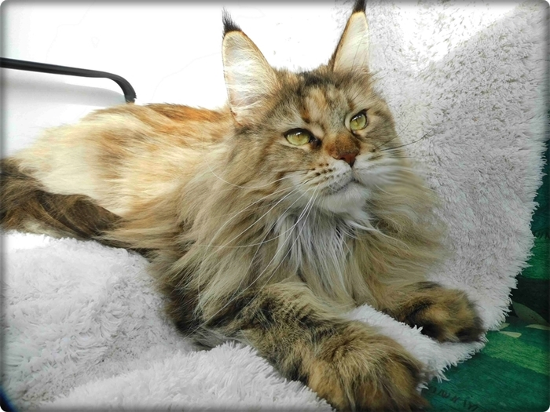
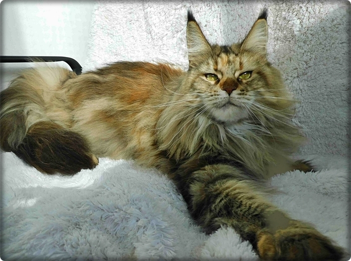

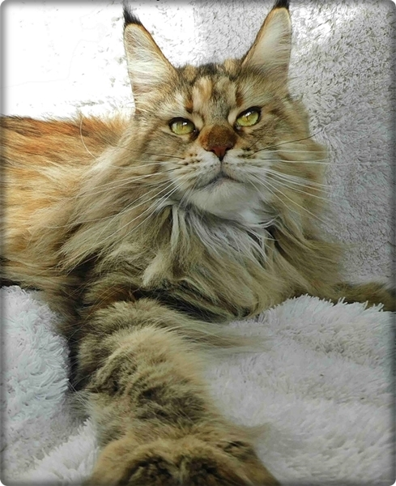

So wild wie sie aussieht ist sie nicht. Sie ist eine liebe Herzenskatze

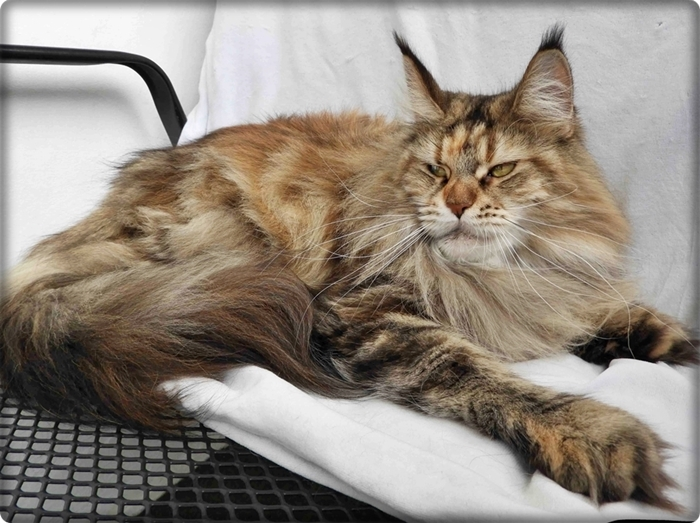

Eine ganz liebe geduldige Menschenkatze die gerne mit mir erzählt

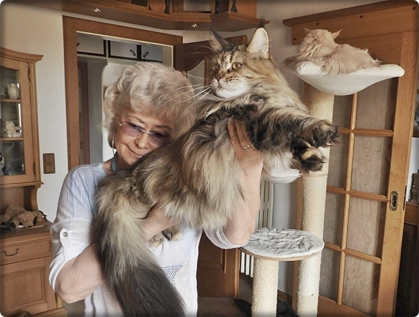
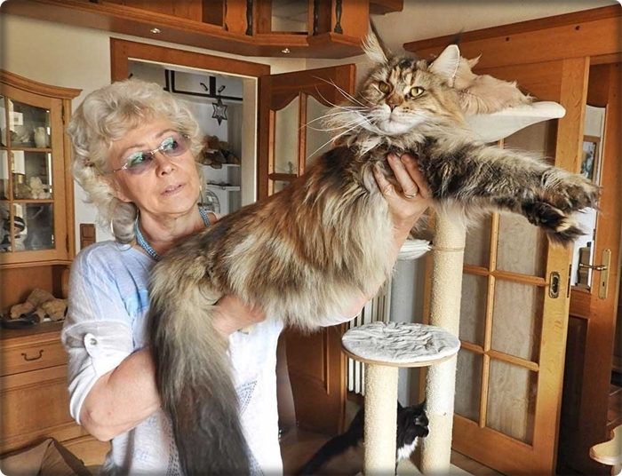

\<

Eine traumhafte Mutter wenn sie Kitten hat. Tragezeit, Geburt\
und Aufzucht...SIE hat keine Probleme!

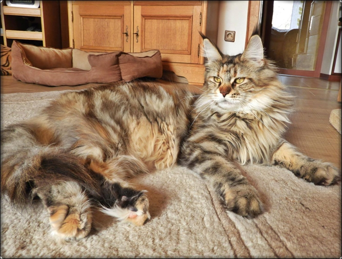
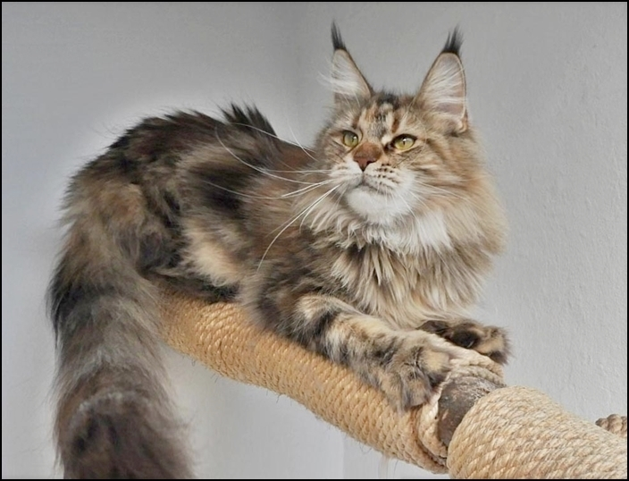
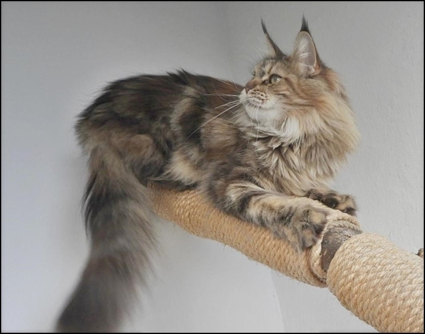

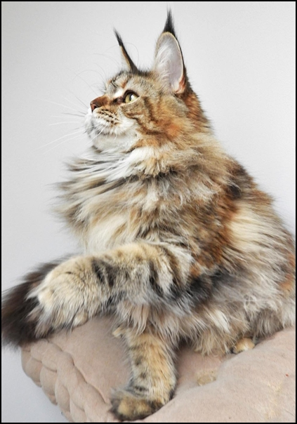
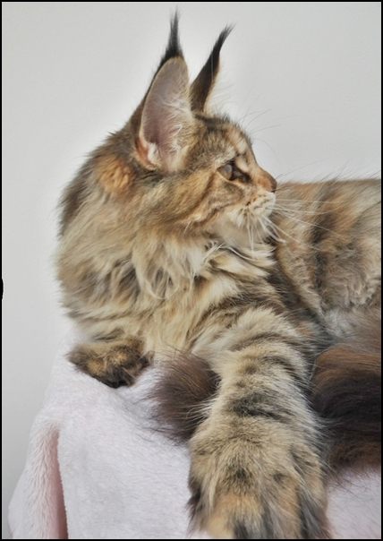

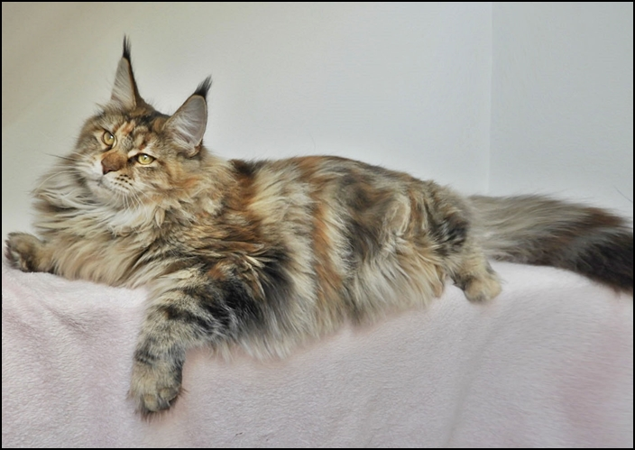

Hier ihr Vater, unser Bossi, ein 9 kilo Exemplar!

