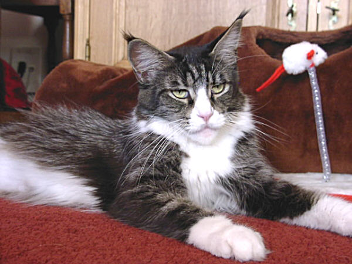
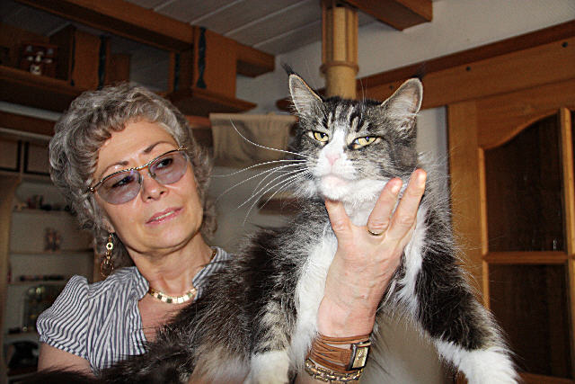

Starbushway Orchidee

Orchidee wurde bis zum 7. Lebensjahr HCM negativ geschallt in der Duisburger Tierklink bei Dr. Kresken.

Orchidee mit dem prägnanten Blick ihres Vaters. Sie ist vom Outfit original Papas Tochter, vom Wesen MamasTochter. Ein selten ausdrucksstarker Typ!! Orchidee ist vom Aussehen und vom Wesen einfach genial, riesige dickbepinselte Luchsohren, ein pefektes Profil mit schöner konkarver Nasenlinie. Sie ist in der Gruppe unserer Mädels führend und trotzdem sehr sozial. Agressionen sind ihr fremd, auch wenn sie Kitten hat. Orchidee hat Fans unter vielen Züchtern im In und Ausland. Für Züchter und Liebhaber die den extremeren Typ bevorzugen, ist Orchi eine Augenweide!\
Die Königin in unserer Zucht!\
Einige Töchter und Söhne von ihr sind in deutschen Zuchten zu finden sowie in dänischen holländischen und österreichischen Zuchten. Einige hervorragende Tiere gingen sogar an sehr nette Liebhaber nach Italien und Frankreich.

Foto: 7 Jahre

Noch mehr Fotos von unserem Traummädel [\>](/katzen/zuchtredrose1/)

Stammbaum von Starbushway Orchidee

Geschlecht :

**weiblich**

Farbe :

**black tabby mc/white**

Eltern

Großeltern

Urgroßeltern

Vater:\
**Langstteich CaBonero**\
black tabby mc/white

Langstteich\
Calvin\
black silver tabby cl

**Coonyham Wilbur**

**Capecoon Cinderella**

Bonita\
von Golzheim\
black torbie mc

**Capecoon Dschafar**

**Langstteich L´Tascany**

Mutter:\
Zanzabou\
Desperada Dixi\
black tabby m**c**

Langstteich\
Santos\
red tabby cl

**Odysseus of Mount Mc Kinley**

**Langstteich L´Maruschka**

Langstteich\
Glamour Girl Gina\
black torbie cl

**Guldfakse Indian King**

**Langstteich Ca´Graffiti**
