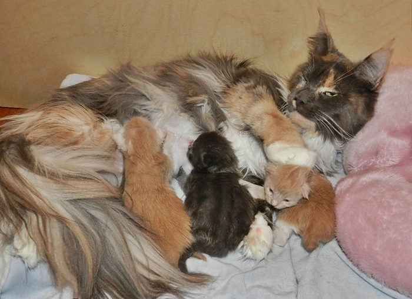
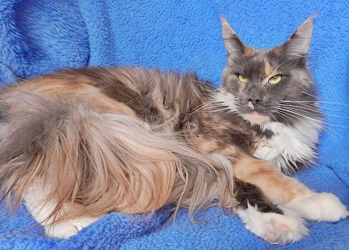
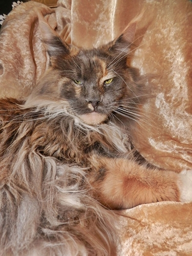
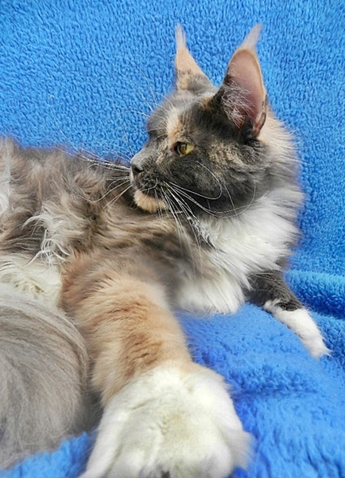
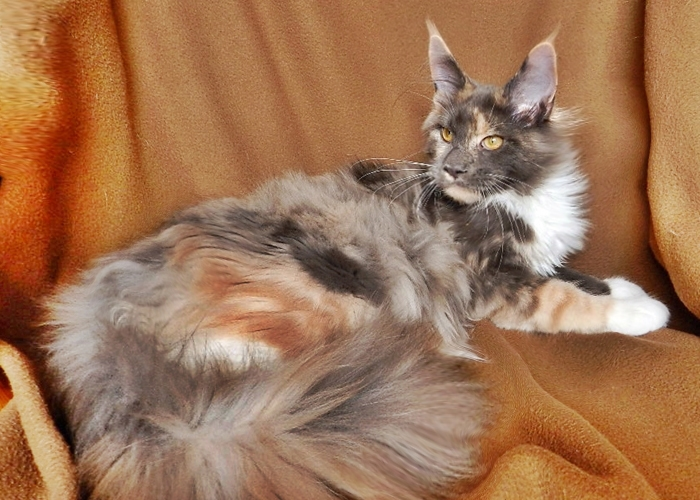
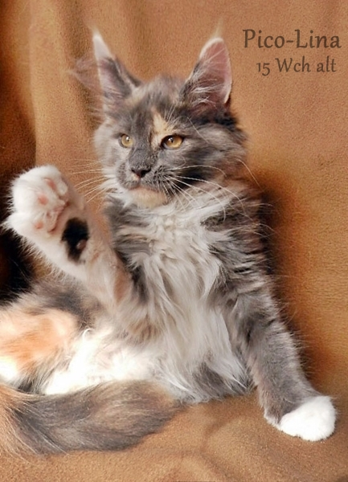

Starbushway Pico-Lina\
Farbe: blue tortie/white

Auf den Fotos ist sie 2 Jahre alt mit ihrem 1. Wurf

Aus der Verpaarung Only und Pepper ist dieses Mädchen entstanden, interessant vom Typ und von der Farbverteilung, mit der Weißverteilung wie ihre Mutter. Picolina ist eine Madame, die lautstark ihren Willen äußert und keine Zweifel aufkommen läßt zu zeigen was sie will und vor allen Dingen was sie nicht will.\
Gewicht: 2 Jahre 5,0 Kg

Stammbaum Pico-Lina

Eltern

Grosseltern

Urgrosseltern

UrUrgrosseltern

Vater:\
A\* Mainefield\
Sgt.Pepper\
**cream smoke**

Summerplace\
Avalon\
red smoke

Q´s Blue Bear\
of Magic Love

Eyck from Glowwind Eyes

DK\* Mountaineers Pink´n Ink

Summerplace\
Tessa

DK\* Shantys Hijacker

A\* El Dorados Nelli Yattu

A\* Mainefield\
AmeliePoulain\
black silver torbie mc

A\* Mainefield\
Camelot

PL\* Top Coon Caruso

PL\* Galadriela Silvi Cola

A\* Island in the Sun\
the Purfect Coon

A\* Gangsta Guy the Purfect Coon

DK\* Castle Rocks Verona Fever

Mutter:\
Coonection\
Only You\
**blue tabby cl/white**

DK\* Neu Coons\
Optimus Prime\
blue smoke

DK\* Aloas\
Romeo

DK\* Mountaineers White Sox

DK\* Aloas Tullmoon Cloe

DK\* Dueleds\
Hazel O´Connor

DK\* Dueleds Adoni Daniele

DK\* Pitho Calypso

B\* Racoone\
Sweet Poison\
blue tabby cl/white

B\* Racoon\
Don Juan

USA\* Willowplace Rocky Star

ÜSA\* Willowplace Niagara

Superstar\
Laluna

USA\* Willowplace Shakari

DK\* Thunderballs Bellis
