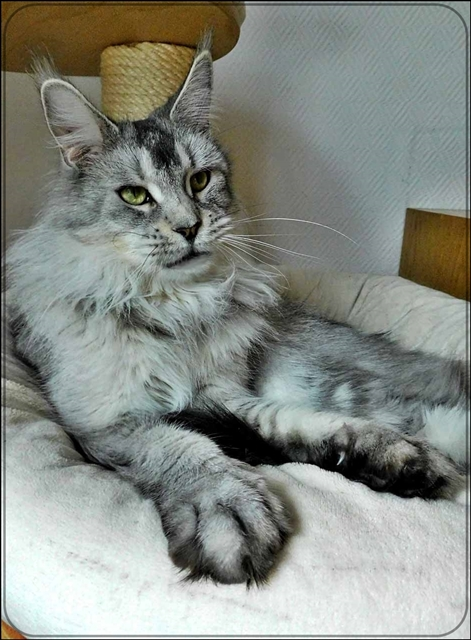
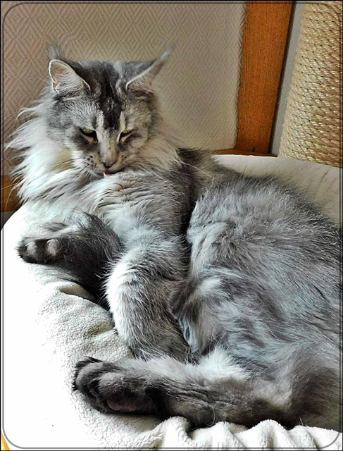
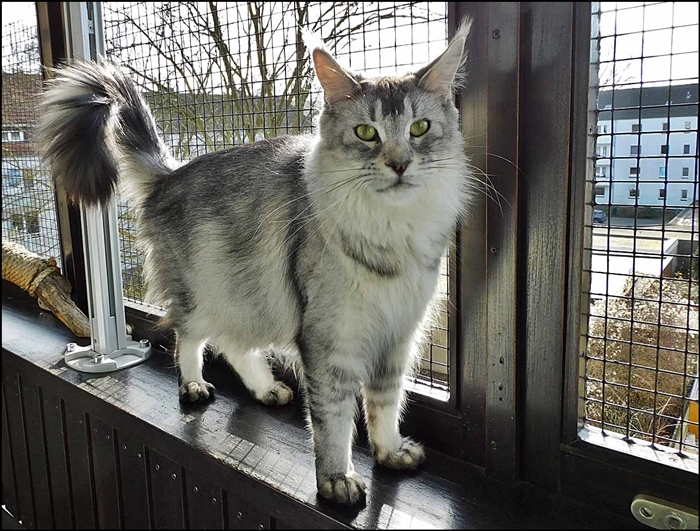
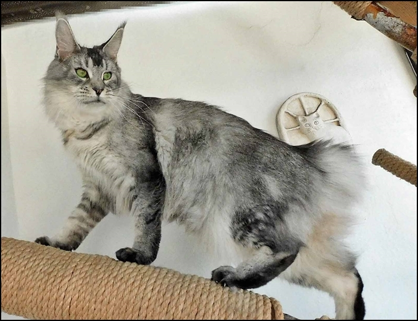
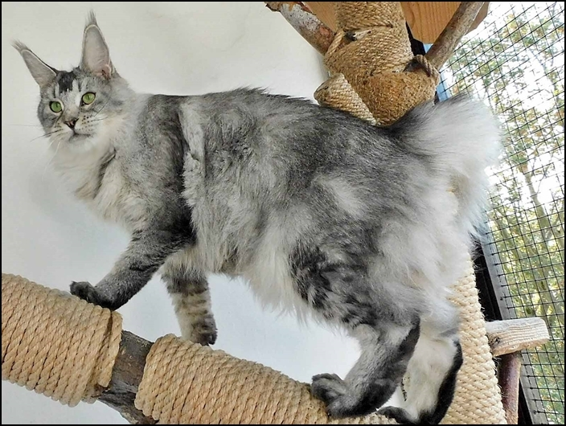
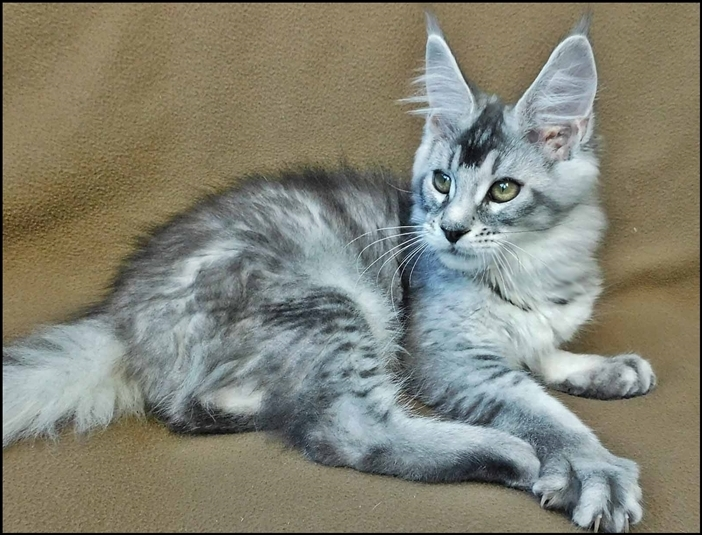

Jechaburger Weides Tamalika\
black silver ticked  tabby

Vor Jahren schon, Anfang 2000 habe ich Tickeds gezüchtet und eigentlich wollte ich keine Ticked mehr haben. Aber seit einiger Zeit habe ich mir so gedacht: ***"Was interessieren mich meine Gedanken von gestern"*** und ich entdeckte wieder meine Liebe zum Ticked. Und nun ist sie hier, die hübsche silberne Ticked-Maus. Ein großes sehr schweres Mädchen auf hohen Beinen mit einem außergewöhnlichen Luchstyp. Ihren Charakter hat sie hier schon gezeigt. Eine ganz zärtliche Schmusemaus, sehr menschenbezogen mit Dauerschnurrmotor! Aber auch durchsetzungsfähig mit sehr starkem Charakter. 3 Würfe hatte sie hier. Der erste 8er-Wurf mit unserem Ouzo war traumhaft. Alle 8 Kitten 160 bis 180g und genauso haben sie sich weiterentwickelt. Ihr nächster Wurf ist für Ende 2026 geplant

[**Stammbaum**](https://www.pawpeds.com/db/?a=p&id=1684988&g=4&p=mco&o=elastic)

1 Schallung HCM/PKD negativ am 12.6.2024 bei Dr. Kresken. 2. Schallung negativ am 18.3. 2026\
Sie ist bei Laboklin getestet\
HCM / SMA / PKdef / Factor 11/ Blutgruppe alles N/N

Tami 4 Jahre

Tami 14 Wochen

