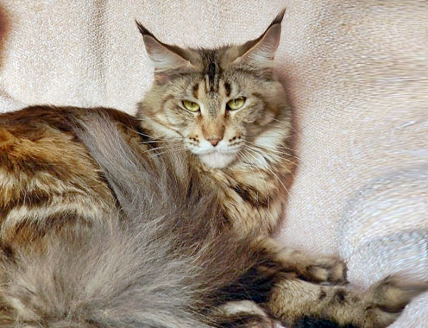
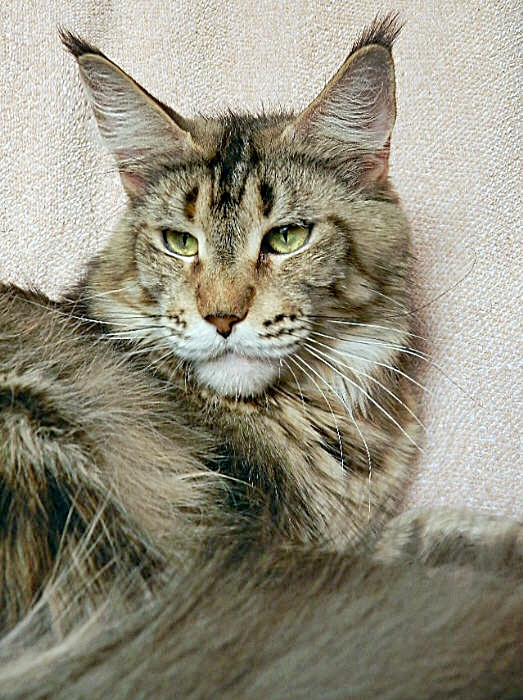
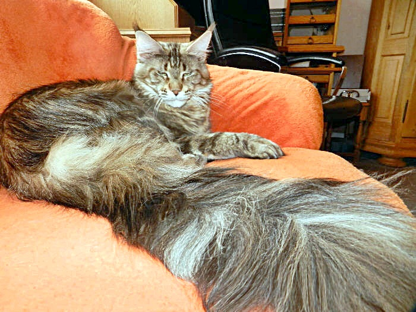
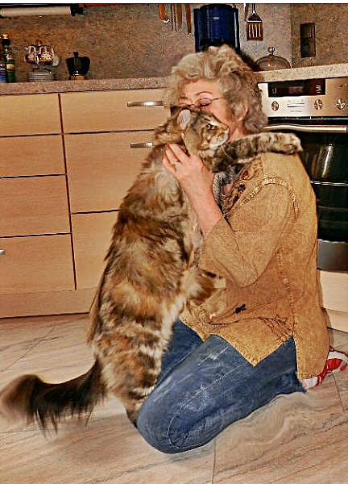
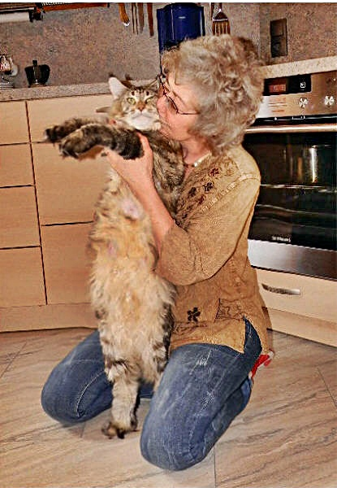
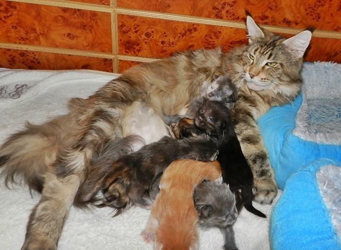
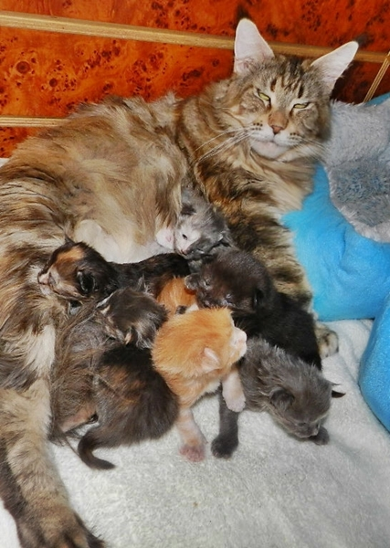
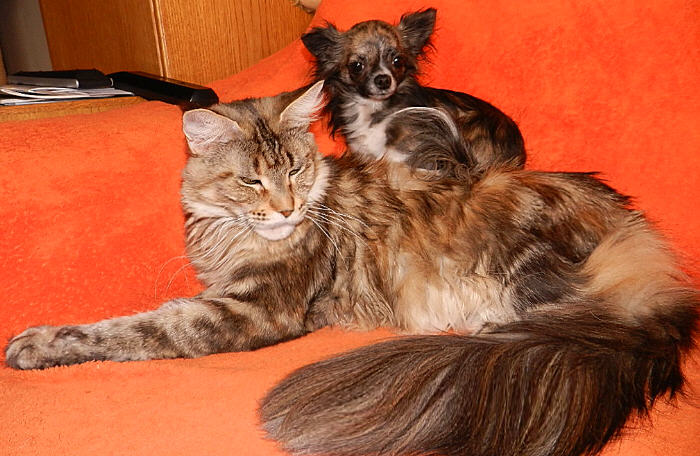
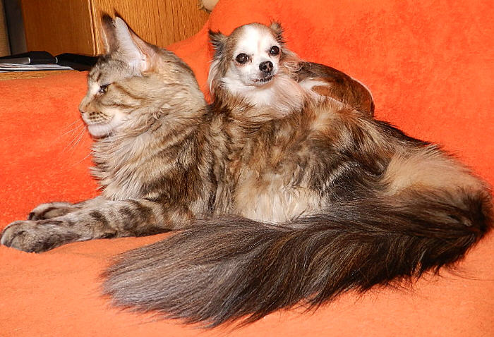

Starbushway Townwalk\
Farbe: black torbie classic

Ein einmaliger Raubkatzenlook!! Dieses Mädchen, sehr schön, riesengross ist ein Eigengewächs. Langgestreckt mit einem kräftigen Körperbau, bringt sie uns weiterhin Grösse in unsere Linien, ebenso wie ihre Mutter Minerva und Urgrossmutter Zsa Zsa (alle hier in unserem Besitz). Sie zeigt ein irre langes Gesicht, sowie riesige Pinselohren. Ihre warme Farbe mit einer superkontrastreichen classic Zeichnung ist Erbe ihres Grossvaters Nashota und ihres Urgrossvaters Sajan, die alle hier in unserer Zucht und unsere Vererber waren. Ihre herrlichen magischen grünen Augen verzaubern jeden der sie kennenlernt.\
Wir haben uns mit Townwalk ein ganz besonders tolles und grosses Mädchen behalten, dessen ausdrucksstarker Typ nicht dem Zufall überlassen war, denn das Ergebnis, genau wie wir es sehen wollten und wir draufhingearbeitet haben, aus wirklich excellenten und spitzenmäßigen Kombinationen, sitzt hier vor uns.

Das kann man natürlich nur vorhersehen, wenn man den kompletten Hintergrund und die Tiere die in den Ahnentafeln sind und deren Vorzüge und Vereberqualitäten kennt! Sie ist über Generationen HCM-negativ geschallt. Aus unkomplizierten und gesunden Müttern, die keinerlei Probleme hatten mit, Fruchtbarkeit, Tragezeit, Geburt und Aufzucht.\
Eine unserer Königinnen!!!\
Gewicht mit 4 Jahren: 8,5 Kg

Sie hat sehr viel von ihrem Großvater \>Starbushway Nashota\< (mütterlicherseits), auch vom Wesen. Aus Vaters Linie\
kommt einiges dazu, was sich zu einer Vollkommenheit vereint hat.\
Diese Kombiantion Minerva mit Renommee war einmalig und die Stammbaumkombination\
mehr als interessant.

Ihr Look erinnert an einen wilden Karakal, dabei ist sie ein ruhiges sehr sehr liebes verträgliches Mädchen.

[Stammbaum Townwalk](stammwalk.jpg)
