Unsere Chronik von\
1982 - 2026

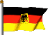

Unsere Züchterlaufbahn oder wie alles 1982 begann

von Karin Lemanowicz\
44 Jahre Starbushway, schauen wir 44 Jahre zurück.\
Im **Sommer 1982** war es, da sahen mein Mann und ich zum erstenmal eine Maine Coon Katze. Sie saß in einem Tierbedarfsladen, auf einem der ausgestellten Kratzbäume. Wohlgemerkt - nicht zum Verkauf. Sie war Eigentum der Ladenbesitzerin, die die Kleine in der Schweiz gekauft hatte. Wir waren so angetan von diesem halbjährigen braungestromten Maine Coon Mädchen mit den dichten Büscheln in den Ohren und dem frechen Backenbart. Ihre Augen verfolgten uns neugierig und interessiert und sie schnurrte sofort als ich ihr seidiges Fell streichelte. Wir waren hin und weg und konnten unsere Augen gar nicht mehr von ihr lassen. Erst der Preis (damals schon 900 - 1200,- **DM**) brachte uns auf den Boden der Tatsachen zurück.\
Das wars erstmal\
Zu dieser Zeit lebten bei uns 2 kastrierte Hauskater Micki und Plumps. Und ich war sehr aktiv im Katzenschutz tätig mit Vereinszugehörigkeit der \>Tierfreunde Duisburg e.V.\<

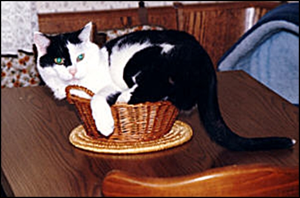

Plumps wurde 18 Jahre alt

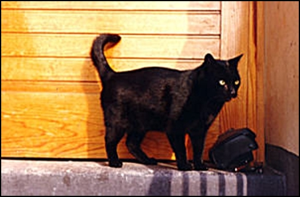

Micki wurde 16 Jahre alt

Jedenfalls spukte nun dieses Maine Coon Tier in unseren Köpfen und war fast täglich unser Gesprächsthema. Wir mussten solch ein Tier besitzen!! Wir sind sowieso angetan von allen Wildkatzenarten.

Foto anklicken

[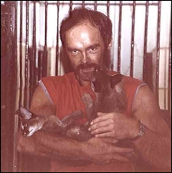](/lesenswert/abend/)

Tony mit den beiden Karakalweibchen Abiba und Asabi

Und nun gab es eine Rassekatze die solch ein wildes Aussehen hatte und doch sanft und verschmust war - und man konnte sie auch noch ohne Probleme in der Wohnung halten. Wir wollten uns Züchteradressen besorgen.

Das war nicht einfach

Man darf sich das nicht vorstellen wie heute, im Zeitalter des Internets und dem Überangebot an Maine Coons und Massen an Maine Coon Züchtern. Man fand damals keinen Züchter und auch keine Anoncen in Katzenmagazinen. Auf Austellungen sah man damals so gut wie keinen Maine Coon Züchter und wenn, dann mal ein oder zwei. Es gab zu dieser Zeit in Deutschland ganze 5 Züchter, die aber selber noch in den Anfängen waren. Über Umwege kamen wir an 3 Adressen. ***"Charmingcat"*** der damaligen Züchterin Ingeborg Jung (gestorben\*1992 ). ***"Legendary"*** der Züchterin Irene Sommerfeld, aber diese Tiere hatten für unseren Geschmack damals einen zu starken Persertyp. ***"Opeldienst"*** der Züchterin Elli Lück (gestorben \*2001 ) der wegen der Haltung der Tiere für uns damals nicht in Frage kam, denn sie ließ ihre Zucht und Deckkater draußen streunen und auch Freilaufkatzen wurden dadurch gedeckt.

Die Jungtiere aus den wenigen Zuchten wurden meist nicht an Liebhaber verkauft oder überhaupt nicht verkauft, einige blieben als Zuchterweiterung bei den Züchtern usw. usw.

Nichts zu machen!

Es verging bis zur Anschaffung einer Maine Coon bei uns noch ein gutes Jahr, in dem ich alles was es an Literatur über diese Rasse gab, verschlang und ich muß auch zugeben, der Preis war ein bißchen gewöhnungsbedürftig für uns damals.

Aber man gewöhnt sich ja auch an alles, auch an den Preis\
Im Februar **1983** ging alles ganz schnell. Es mußte ein Maine Coon Kater her. Nach unendlichen Telefonaten und Kontakten fanden wir endlich einen Kater in der Zucht "Fairygarden" der Züchterin Brigitta Stolper (gestorben\*2012 ) aus den Linien Carmingcat. Die Tiere waren teilweise US-Importe. Einen Sohn des damals bekannten und sehr erfolgreichen "Baco ben Aisha of Charmingcat", ein Sohn des US-Katers "The Maine Place Kalif", unseren blaugestromten Mano, richtig hieß er "Campari of Fairygarden". Er war 5 Monate alt und wir konnten ihn sofort mitnehmen. Mano war genau das was wir uns erhofft hatten. Lieb schmusig, folgte uns auf Schritt und Tritt. Er war imposant und beeindruckend groß für sein Alter.

Wir waren stolz und glücklich!

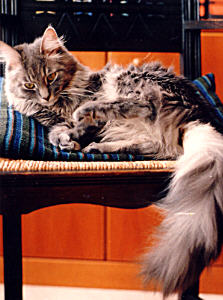

1983, Mano mit sechs Mon.\
bei uns. Wir konnten ihn sofort\
vom Züchter mit fünf Mon.\
mitnehmen.

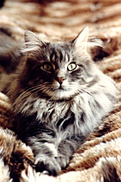

Und das war Mano mit mit\
acht Monaten. Er entsprach\
genau unseren (damaligen!)\
Vorstellungen

Und das war er mit 10 Jahren, kurz darauf wurde er kastriert.

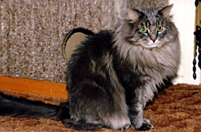

10 Jahre war Mano bei uns Deckkater und Vererber (1983-1993) Als Kastrat lebte er bei uns nochmal 10 Jahre. 1 Monat vor seinem 20. Geburtstag versagten seine Organe und wir mußten den schweren Weg der Erlösung wählen und ihn einschläfern.

**Aber zurück ins Jahr 1983.**\
Warum nicht mal ausstellen? So war unser Gedanke. Wir stellten aus und hatten enormen Erfolg. Glücklich und aufgelöst kamen wir von unserer 1. Ausstellung mit 3 Pokalen nach Hause. **Unser Kater!!!** hatte mit seinen 10 Monaten einige gestandene Kater seiner Rasse in der offenen Klasse mit best Variety, best in Show und best of best geschlagen, darunter waren 3 Europachampion-Anwärter. Unser Stolz war grenzenlos. Waren wir erst skeptisch dem armen Tier eine Ausstellung zuzumuten, belehrte uns Mano eines Besseren. Er war cool und aufgeschlossen und es schien im sichtlich Spaß zu machen im Mittelpunkt zu stehen.

Der Gedanke \>Zucht\< war geboren

Der Beginn unserer Zucht und unseres Erfolges fing im Sommer 1983 an.

Hier auf unserer allerersten Ausstellung mit unserem Kater\
**\>Fairygardens Campari\< (Mano)**\
Der Einstieg in eine langjährige beständige Zucht, die immer noch unsere Sucht Nr.1 ist und auch bleiben wird.

Camparis 1. Austellung\
"best in Show"

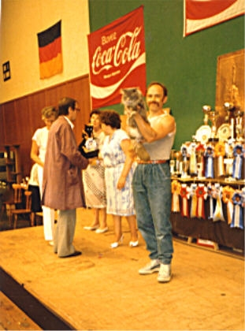

und best of best

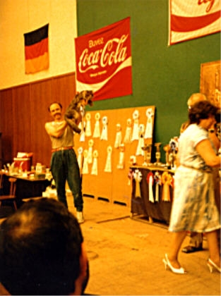

"best in Show" und "best of best"\
unsere ersten zwei Pokale

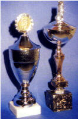

Als wir ein bißchen mehr Ausstellungsluft geschnuppert hatten und uns gründlich über die Theorie des Züchtens aus Büchern holten, zog kurze Zeit später die blaugstromte "Bhanja of Ocanda" bei uns ein. Bonny wurde sie gerufen. Sie war noch eine Enkelin des legendaren US-Katers "Heidi Ho´s Jonathan", in der Zucht Nonsuch/Nonpareil der Züchterin Barbara Simon.

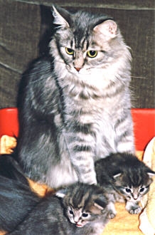

Bonny ist bis zum Tod bei uns geblieben und 20 Jahre alt geworden!!

1984 zogen wir in eine grössere Wohnung, um ausreichend Platz für unsere Zuchtpläne zu haben und um alles verwirklichen zu können. Wir bauten unsere Wohnung zuchtgerecht um. Eigene Kater und Kittenbereiche mussten sein!

Wieder kurze Zeit später, kam die braungestromte "Highgate´s Pandora" aus amerikanischen Eltern dazu.

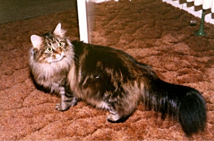

Immer noch waren die MC-Züchter dünn gesät, an gute Tiere kaum zu kommen. Und so fuhren wir für Pandora zwei mal nach Salzgitter zu der amerikanischen Züchterin Kathy Mc Mahon, die nur vorrübergehend als Lehrerin in Deutschland lebte und kurz darauf in die USA zurückging. Wir blieben aber in Kontakt. Sie hatte sich einige gute Tiere aus USA mitgebracht. Eine bildschöne sehr große torbie/white US-Kätzin "Mountview´s Tawny Girl" und den blaugestromten US-Kater "Charmalot´s Stardust", Dusty gerufen, das waren die Eltern von Pandora. Mit diesem kleinen amerikanischen Zuchtstamm haben wir erstmal ein paar Jahre gezüchtet.

Pandora war bei uns 8 Jahre Zuchtkätzin, wurde hier bei uns bei guter Gesundheit 18 Jahre alt!

1986

Nachdem wir auch in der Praxis mehr Erfahrung gesammelt hatten und einige Würfe aufgezogen hatten, entschlossen wir uns, unsere Zucht um einen Kater und einige Kätzinnen zu erweitern. Wir bekamen ein aussergewöhnlich schönes Zuchtmädchen aus dem unglaublich erfolgreichen US-Kater "Tanstaafl´s Barry" aus der Zucht von Beth Hicks und der torbie US-Kätzin "Calicoon´s Cassy" aus der Zucht von Lynne Sherer .\
Tanstaafl Barry, hier 1988 im Alter von 3 Jahren stand uns auch mehrfach zum Decken für Bhanja und Pandora zur Verfügung

Aus aus diesen amerikanischen Eltern \>Tanstaafls Barry\< und \>Calicoons Chassy\< bekamen wir unsere traumhaft schöne "Flagstaaf´s Beauty Girl",

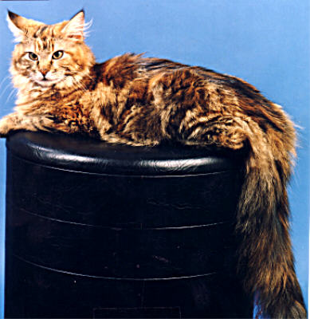

9 Jahre lang die Königin in unserer Zucht!

Beauty, unser erfolgreichstes Ausstellungsmädchen wurde neben ihrer Babyaufzucht Großer Europa Champion. Konditionsschwäche kannte diese Katze nicht. Sie war immer glücklich wenn sie tragend war und Babys bekam, hatte nie Probleme mit Geburt und Kittenaufzucht. Wenn die Kitten 8 Wochen alt waren, war sie gutgenährt und aufgeblüht und in top Ausstellungskondition. Einge wunderschöne Würfe brachte Beauty uns. Auch sie blieb als Kastratin hier bei uns und wurde 20 Jahre alt.

Wieder 2 Jahre später, erfüllten wir uns einen Traum in blauschildpatt/weiß. Für "Jolly-Joker vom Jägersteig" (kurz J.J.= Jay Jay gerufen) haben wir jahrelang gesucht und eigentlich nur durch Zufall bei der Züchterin Sigrid Ubber gefunden.

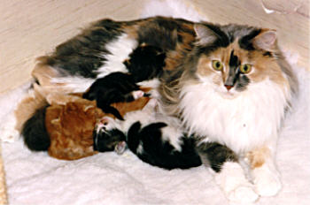

7 Jahre war sie bei uns Zuchtkatze und brachte uns 7 Würfe. Jolly. ist auch als Kastratin bei uns geblieben und wurde bei uns 17 Jahre alt\
Aus J.J.´s 3. Wurf mit Mano behielten wir ein kräftiges blau/weißes Mädchen. "Starbushway´s Monja" war für damalige Begriffe eine Farbrarität. Blau/weiße gab es kaum.

Die wunderschöne blau-weiße Monja.

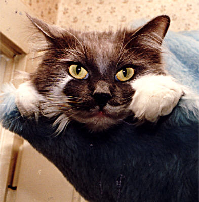

5 Würfe hatten wir von ihr in verdünnten und solid Varianten

Monja mit ihrem Töchterchen "Quilana" 8 Wch aus einem 6er Wurf, alle in verdünnten Farben.

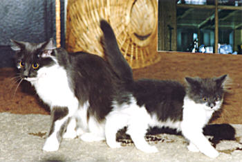

Monja hatte auch einige wunderschöne Würfe. Nach ihrer Zuchtzeit wurde sie kastriert und zog sie zu einer damaligen Freundin und wurde fast 21 Jahre alt

Hier im Alter von 1 Jahr

Hier als Senorin mit 18 Jahren

[hier geht es weiter\>\>\>\>\>\>](/lesenswert/anfang1/)
