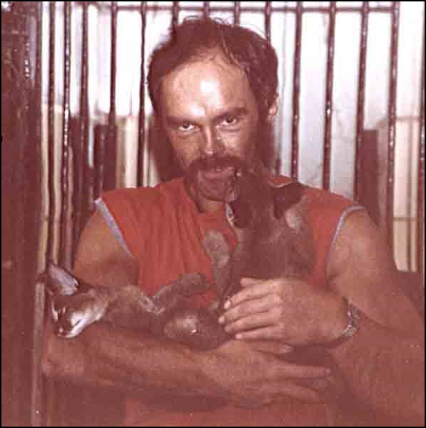

1985 durften wir im Duisburger Zoo die Patenschaft von 2 Karakalweibchen\
übernehmen (auf dem Foto 10 Wch alt)

Wir durften sie oft besuchen, auch in den hinteren Gehegen, die für Besucher eigentlich unzugänglich waren und konnten viel Zeit mit ihnen verbringen. Obwohl sie sehr engen Kontakt zu Menschen, insbesondere zu ihrem Pfleger hatten, waren sie sehr zahm nur bis zur Gechlechtsreife, dann mit 2 Jahren veränderten die Karakale ihren Charakter. Sie waren zwar ihren Menschen zugetan, aber recht wild.

Ganz sicher nichts fürs Wohnzimmer!!

