Nach dieser Fotoserie geht es dann mit unserer Züchterlaufbahn weiter

Das war 1983

Unsere ersten Ausstellungen. Tony auf der Bühne mit klein Pandora "best in Show" Babyklasse. Unser ganzer kleiner Stolz war die damals 14 Wch. alte Pandora, die unsere Zuchtzukunft wurde.

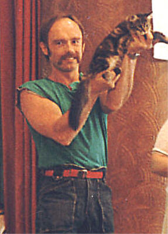
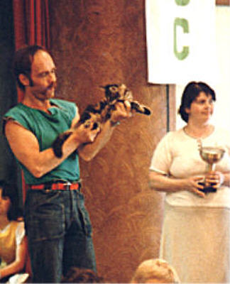
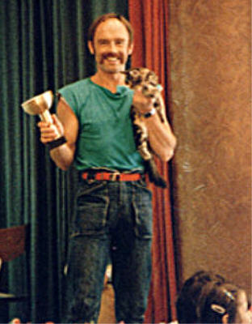

Tony, stolzer Besitzer und Züchter

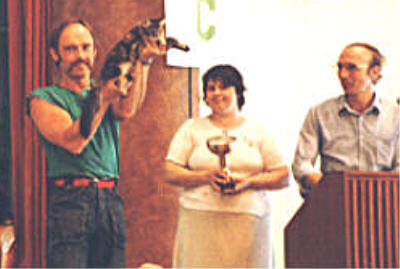

Diese nächsten Fotos sind vom 12.Sept. 1984 Ausstellung GDK in Oberhausen, der Erfolg "bestes Nest" und auch noch "best of best Nest" der Ausstellung, über alle Rassen unser 3. Wurf!!

Hier beim Vergleich mit Würfen anderer Rassen für:\
"best of best Nest"

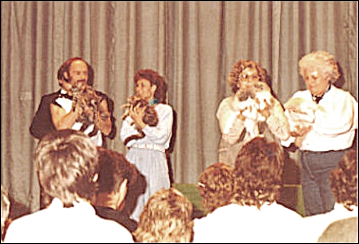

**1984**

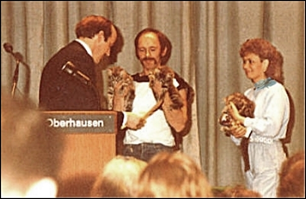

**1984**

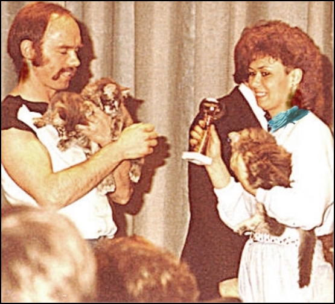

**1984**

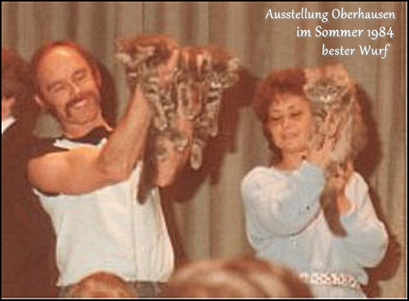

Unser 3. Wurf von Bonny u. Campari

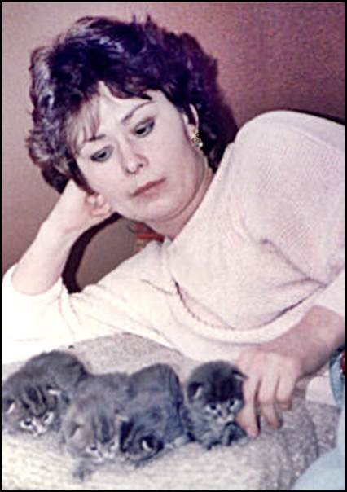
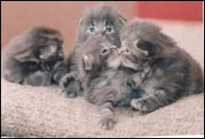

Dieses war 1983 unser kleiner Zuchtbestand mit dem wir begannen.\
Campari 8 Mon, Bonny 5 Mon.und klein Pandora mit 14 Wochen.

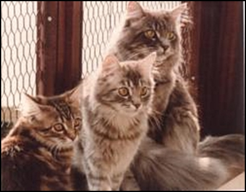

**Fotos von 1983/85**\
Linkes Bild: Campari (Mano) damals 8 Mon mit seiner Partnerin der Zukunft. Pandora 14 Wochen\
alt, da war sie gerade 3 Tage bei uns\
Rechtes Bild: Und das waren die beiden 3 Jahre später, da hatten sie schon 2 kräftige Würfe gehabt. Beide leben schon lange nicht mehr Pandora starb mit 18 Jahren und Mano mit fast 20 Jahren.

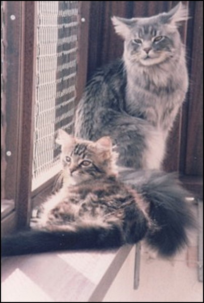
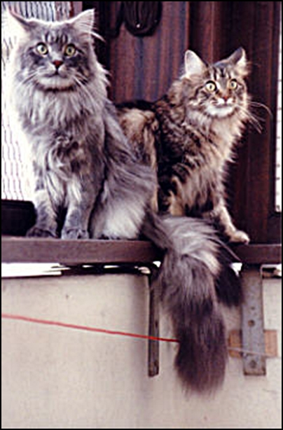

1986\
war gekrönt von Erfolgen!!!

Und diese Fotos sind von 1986, da waren wir schon Ausstellungsprofis und präsentierten stolz unsere ersten erwachsenen Nachzuchten auf Austellungen und das sehr erfolgreich von Rassesieg bis best over all

Starbushway war immer dabei

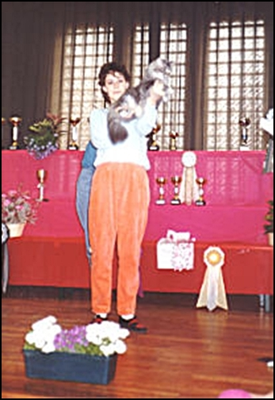
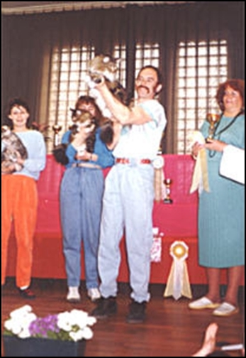

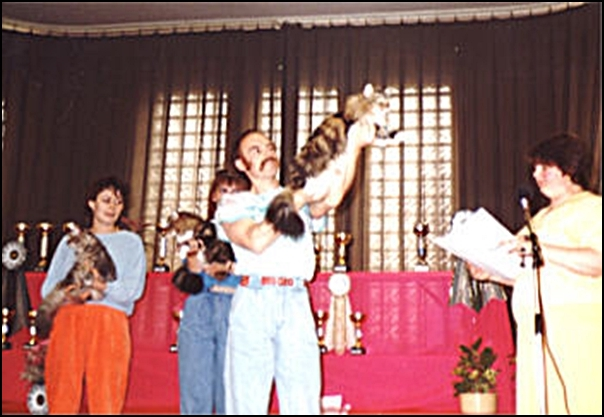

1988

und es setzte sich auch die nächsten Jahre fort!

Ausstellung1988. Links: Orjet Drössler. Mitte: Tony für "best in Show" Kitten und rechts unsere Züchterfreundin Olga Koch vom Cattery "Mainecastle"

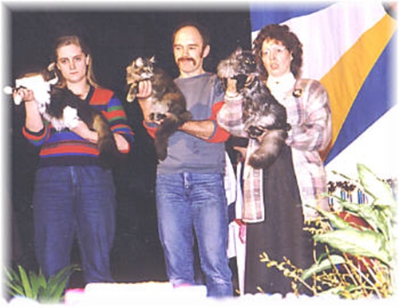

Hier präsentierten wir (Foto 1988) zwei unserer Nachwuchsgirls mit 8 Mon. Töchter unserer Zuchtqueen "Beauty Girl" die es beide zu unglaublichen Ausstellungserfolgen im In und Ausland wie, Frankreich, Belgien Luxenburg, Holland, brachten. Beide wurden nach Holland verkauft. Und beide wurden große Europa Champion mit Auszeichnungen von Rassesiege bis best of best

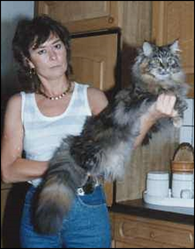
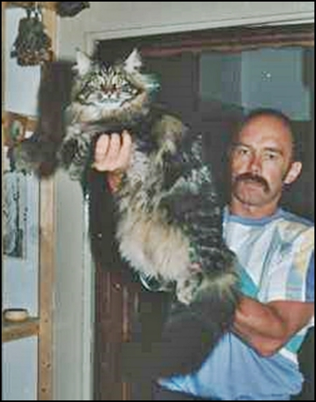

1990

Und weiter ging es:\
Wir planten nun für unsere blau/weisse Monja, die wir nun behalten hatten einen schönen kräftigen Deckkater, den wir uns aber selber ziehen wollten.

Wieder knüpften wir im Jahr 1990 Kontakte in die USA und fanden die Cattery "Tolkat", eine kleine familiäre Zucht. Keine Zuchtfarm, das wollten wir nicht. Wir scheuten natürlich keine Kosten und Mühen und importierten einige Coons aus USA zusammen mit unseren damaligen sehr engen Züchterfreunden Marion und Jürgen Holm, der Cattery **"Beam Beauty".**

Den riesigen "Wizard Gandalf of Tolkat", den sich unsere Züchterfreunde zusammen mit uns, über unsere Kontakte nach Amerika, bei der amerikanischen Züchterin: Dr. Frances A. Lloyd importierten. Wizard wurde der Vater vieler Starbushway-Kitten

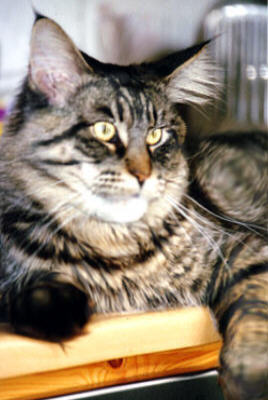

Grosser Europa Champion \>Wizard Gandalf of Tolkat\<

Dann kamen über Kontakte und Vermittlung und einer guten Fürsprache von Frances, (über Frances hatten wir in USA einen guten Ruf) noch einige Mädchen aus der die Cattery Mainehouse.

Importe waren: ein schönes Mädchen in cream/white und ein blue solid Girl.

Hier die beiden Kätzinnen aus USA:

Mainehouse Bella Donna

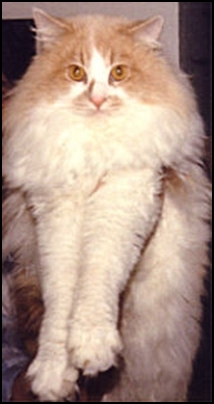

Tolkat Moonshine in blue

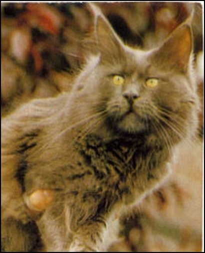

Wir deckten nun unsere inzwischen 7 jährige "Pandora" mit dem Tolkat-US Kater und es fielen 3 black tabby Kater. Der Beste blieb für uns. Er hieß Starbushway Rebound ein sehr großer kräftiger 9 Kilo Kater. Pandora ging nach diesem Wurf in Rente und blieb bei uns.

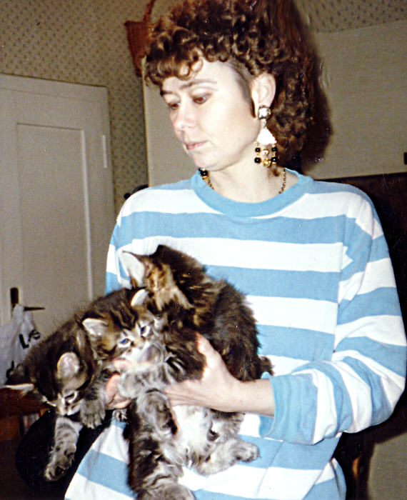

Hier unser Rebound im Alter von 3 Jahren, da hatte er schon fleißig Nachwuchs gezeugt

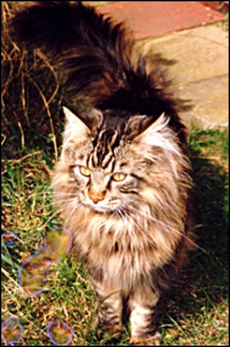

1994\
gingen wir wieder andere Wege in der Zucht

1994 zog der schwarze Panther "The Dream Coons King Dark V" bei uns ein. Darky war gezogen aus unseren eigenen Linien, kombiniert mit Linien unserer damaligen sehr engen Züchterfreunde

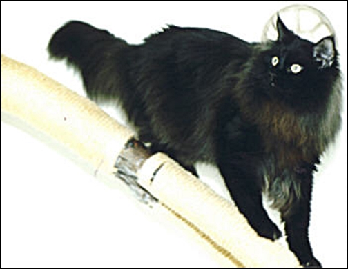

Und so zogen wir für unseren King Dark (Darky) als Partnerin ein schönes Mädel aus unserer Beauty Girl. Wir ließen Beauty fremddecken bei unseren Züchterfreunden von dem Kater "Brian of Green Valley" (cream silver tabby) und behielten uns ein schönes Mädchen in der Farbe creamsmoke, unser Perlchen. Es war die letzte Tochter unserer Beauty, später wurde sie mit 10 Jahren kastriert und blieb bei uns, wurde 20 Jahre hier bei uns.

Foto: Unser Traumgirl, Partnerin für Darky "Starbushway Sweet Pearl" Perlchen gerufen aus einer Fremddeckung. Aus dieser Verpaarung kamen kleine Träumchen!

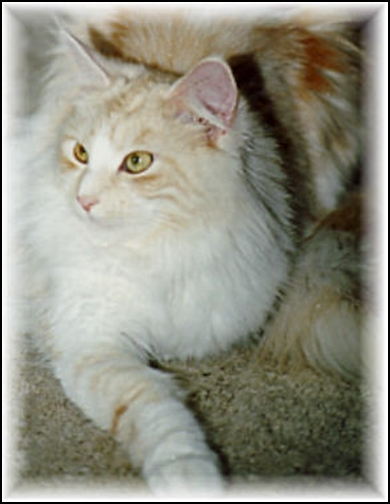

Unser King Dark (Darky) war ebenso 5 Jahre lang bei uns Deckkater und Vererber. Er ging zusammen mit seiner Partnerin Sweet Pearl (Perlchen) kastriert an Liebhaber. Mit 14 Jahren starb Perlchen an einer Nierenerkrankung. Darky wurde 21 Jahre alt.

[hier geht es weiter\>\>\>\>](/lesenswert/anfang2/)
